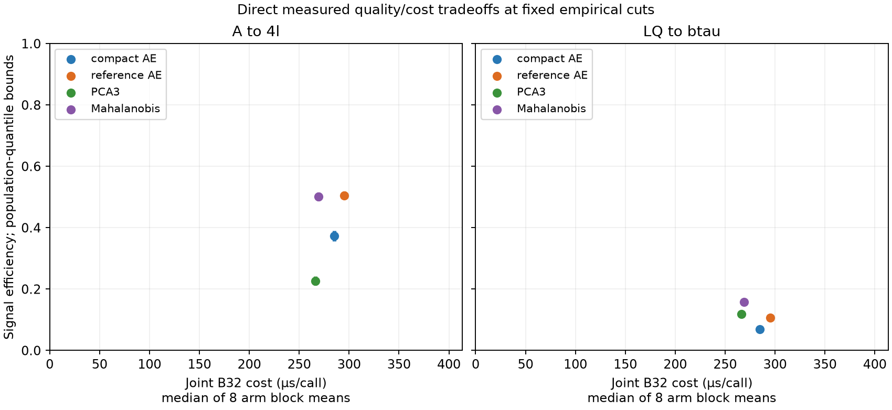

<p align="center">
  
</p>

# RareGate

**Hardware-aware machine learning for real-time LHC event selection**

RareGate is an independent research and engineering project studying how much
anomaly-detection performance survives when models must also be computationally
inexpensive. Motivated by the Large Hadron Collider (LHC), it connects simulated
collision data, background-only learning, calibrated event selection and direct
CPU measurements in an auditable experimental workflow.

The central question is practical: **can a smaller model preserve sensitivity to
rare signals while reducing the cost of the complete selection pipeline?**
The current research cycle is complete; the repository contains the implementation,
protocols, curated results and final scientific report.

## Approach

- **Data and features:** verified public HDF5 sources, exact-content deduplication,
  separate training/selection/calibration/evaluation roles, and training-only
  preprocessing. The final ADC2021 study uses 12 event aggregates derived from
  missing transverse momentum, electrons, muons and jets.
- **Anomaly detection:** background-only compact and reference autoencoders
  (271 and 1,999 parameters), three-component PCA and regularized Mahalanobis
  distance. Signals are reserved for evaluation.
- **Scientific evaluation:** frozen background-calibrated cuts, paired signal
  comparisons, calibration uncertainty, simultaneous bounds, numerical parity
  and selection-profile checks.
- **Computational evaluation:** explicit timing boundaries, paired CPU blocks,
  batch-size studies and resource accounting. Earlier work includes LHCO
  baselines, synthetic queue simulations and bounded streaming prototypes.

## Selected results

The final study evaluates **1,000,000 background events and 40,000 events per
signal** from lepton-prefiltered ADC2021 simulation. At a **1% target background
acceptance**, the frozen empirical cuts give:

| Method | A → 4ℓ efficiency | LQ → bτ efficiency | Joint CPU cost, batch 32 |
|:--|--:|--:|--:|
| Compact autoencoder | 37.33% | 6.90% | 284.9 µs/call |
| Reference autoencoder | 50.53% | 10.63% | 295.4 µs/call |
| PCA, 3 components | 22.72% | 11.91% | 266.3 µs/call |
| Regularized Mahalanobis | 50.13% | 15.84% | 269.1 µs/call |

Neural efficiencies average three separately trained seeds, without ensembling.
CPU values are medians of eight block means from the recorded single-thread
macOS arm64 run, averaging neural seeds within blocks. The joint boundary covers
in-memory objects → features/scaling → scores, masks and owned outputs; it excludes
data loading and HDF5 I/O. These are batch-call costs, not detector latencies.



*Points use frozen empirical cuts; vertical intervals are simultaneous bounds at
the population background quantile, including calibration uncertainty.*

**Compact compression did not meet the preregistered criterion:** 90% retention
of reference efficiency was excluded on both signals, and the required 25% joint
CPU reduction was not achieved. Mahalanobis is the recommended baseline for this
representation and measured workload, with supported gains over compact on both
signals. Its absolute 15% LQ utility target remains unresolved (simultaneous bound:
14.65–16.97%); no method passed the full compound criterion.

The [final report](docs/raregate-final-report.md) explains the uncertainty,
selection effects and timing scope, with links to the underlying tables.

## Getting started

Use **Python 3.11 or 3.12** (3.12 recommended), Git and a virtual environment.
Core dependencies are NumPy, scikit-learn and PyTorch; the extras below add HDF5
support, plotting and development tools. A CPU is sufficient.

```bash
git clone https://github.com/matteosgobba/RareGate.git
cd RareGate
python3.12 -m venv .venv
source .venv/bin/activate
python -m pip install --upgrade pip
python -m pip install -e ".[dev,data,analysis]"

# Small tensor diagnostic; no dataset download or model training.
python scripts/smoke_test.py

# Code quality and tests.
python -m ruff check .
python -m ruff format --check .
python -m pytest
```

On Windows, activate with `.venv\Scripts\activate`. For CPU-only Linux, install
PyTorch from its [CPU wheel index](https://download.pytorch.org/whl/cpu) before the
editable install. The full suite needs Git history for compatibility tests;
GitHub Actions is configured for Python 3.11 and 3.12.

Datasets, processed arrays and most model artifacts are kept outside Git; curated
figures and small tables are included. Setup and tests do not reproduce the
scientific study. For data preparation and experiment contracts, follow the
[ADC protocol](docs/decisive-scientific-experiment.md),
[preparation record](docs/decisive-adc-preparation-training.md) and
[earlier LHCO data workflow](data/README.md). Historical campaign entrypoints
record completed, source-bound runs and are not general-purpose rerun commands.

## Repository layout

```text
src/raregate/  Data, models, training, evaluation, benchmarks and streaming
configs/      Versioned data, model, experiment and resource contracts
scripts/      Preparation, validation, diagnostics and reporting entrypoints
tests/        Numerical, protocol and software integration tests
results/      Curated figures/final/ and tables/final/; other outputs stay local
artifacts/    Selected small historical model artifacts
docs/         Scientific reports, design decisions and development records
data/         Local datasets and derived stores; only the data policy is tracked
assets/       Project branding
```

For deeper context, see the [evaluation protocol](docs/evaluation-protocol.md),
[earlier research conclusions](docs/v1-research-conclusions.md),
[development guide](docs/development.md) and
[archived operational README](docs/old/README.md).

## Scope and disclaimer

RareGate is a completed research study, **not a deployment-ready trigger**.
Results are conditional on simulation, object preselection, the chosen features
and finite training budgets; they do not establish detector readiness, physical
LHC rates or discovery significance. Streaming and alternative-runtime branches
retain the limitations documented in their reports. The project has no official
affiliation with or endorsement by CERN, ATLAS, CMS or CERN openlab.

## Author, credits and license

**Matteo Sgobba** · [GitHub](https://github.com/matteosgobba) ·
[LinkedIn](https://www.linkedin.com/in/matteosgobba/)

Data credit belongs to the [ADC2021 dataset authors](https://mpp-hep.github.io/ADC2021/)
([data descriptor](https://doi.org/10.1038/s41597-022-01187-8)) and the
[LHC Olympics 2020 dataset creators](https://doi.org/10.5281/zenodo.6466204).
Pinned dataset versions and provenance are recorded in the linked protocols.
The analysis builds on NumPy, scikit-learn, PyTorch, h5py and Matplotlib.

Code is released under the [MIT License](LICENSE). Referenced datasets retain
their own **CC BY 4.0** terms and attribution requirements.
