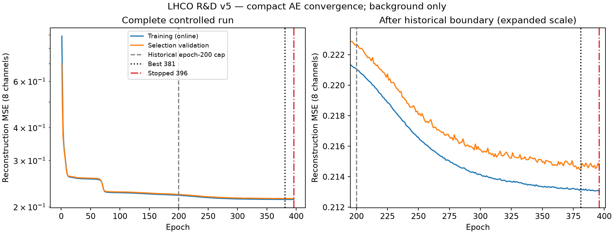

# Compact autoencoder convergence — Task 0008

**Convergence closure under the frozen background-selection patience rule;
compact-autoencoder-v2 supersedes compact-autoencoder-v1 as the canonical
compact AE baseline. No signal information was used.**

The [Task 0007 report](compact-autoencoder.md) remains historical evidence.
Exact Task 0008 scientific results, complete history, prefix verification,
score-byte hashes, calibration and selection audits are in
[the curated summary](../results/tables/final/task0008-autoencoder-convergence-summary.json).
[The history CSV](../results/tables/final/task0008-autoencoder-convergence-history.csv)
contains all 396 executed epochs. Rounded values below are snapshots.

## Motivation / controlled protocol change

V1's best epoch was its last allowed epoch, 200, with losses still improving.
The epoch ceiling—not early stopping—determined the endpoint. It therefore
could not be called converged. Task 0008 gives the same model a larger horizon
and asks the existing selection-background stopping rule to determine the endpoint.

The only configuration diff is:

```diff
- "max_epochs": 200,
+ "max_epochs": 1000,
```

[The v2 config](../configs/models/compact_autoencoder_v2.json) was recorded before
extended training. It is otherwise exactly equal to the preserved
[v1 config](../configs/models/compact_autoencoder.json); code rejects any other
change. No extra version identifier is needed: config hash and model directory
identify v2. Both configs use interchange/processed schema 1.

Architecture unchanged: **8→6→3→6→8**, ReLU hidden layers, linear latent/output,
**155 parameter s**. Same frozen standardized FP32 eight aggregates, Adam lr=0.001,
batch 4,096, seed 1729, default initialization/Adam settings, deterministic CPU,
one intra-op thread (observed inter-op 10), zero workers, deterministic shuffled
batches, no dropped tail, channel-mean MSE, strict selection-loss improvement,
patience 15, min_delta 0. No schedules, regularization, clipping, feature/scaler
changes, architecture comparison or hyperparameter search. The
[evaluation protocol](evaluation-protocol.md) is unchanged.

## First-200-epoch reproduction

Before editing source, a fresh v1 CPU training run reproduced all 200 training
and selection losses, the entire selection record and every FP32 parameter
exactly (31.039 s). It requested train/selection background only.

Each subsequent from-scratch extension initializes model, optimizer and seeded
shuffle independently. An observer checks each epoch 1–200 against the historical
CSV, checks best-epoch/loss/consecutive-failure progression, then compares all
FP32 parameter bytes at epoch 200 with frozen v1. Any mismatch aborts immediately
before later training or calibration. Historical CSV content hash is verified
against v1's artifact, and source/processed/preprocessing/split/scope identities
must match before fitting. Historical best-epoch/loss/failure-count progression is reconstructed
from the stored selection losses and unchanged strict-minimum rule; intermediate
historical weight checkpoints were not saved. Parameter states are compared at
epoch 200. The observer does not modify RNGs, weights or optimizer.

**Both extensions reproduced the first 200 losses, best-state progression and
parameter bytes exactly.** No continued checkpoint or optimizer state was used.
The exact historical model remains
[compact-autoencoder-v1/model.json](../artifacts/models/compact-autoencoder-v1/model.json).

## Extended training / early stopping

Populations remain train 699,957, selection 74,749, calibration 74,823. Only the first
receives gradients; only the second selects the best epoch. Calibration is not
an optimizer or early-stopping input. It is loaded after best-state restoration,
JSON freeze and independent frozen-model validation.

| Quantity | Historical v1 | Extended v2 |
| --- | ---: | ---: |
| Epoch ceiling | 200 | 1000 |
| Epochs executed / stopping epoch | 200 | 396 |
| Best epoch | 200 | 381 |
| Best-epoch online training MSE | 0.221068287052 | 0.213184650578 |
| Frozen/restored training MSE | 0.221007377055 | 0.213053744255 |
| Best/restored selection MSE | 0.22261241728 | 0.214475987312 |
| Stop reason | Epoch ceiling | Patience |

Epoch 381 is selected. Epochs 382–396 did not beat its selection MSE, so the
unchanged **15-consecutive-failure rule** stopped training at 396. Last-epoch
selection MSE was 0.214645658326; it is not the selected
model. Best-state weights were restored, exported, reloaded, and evaluated on
selection background a second time: **0.21447598731176187**,
exactly equal to the original best-epoch loss. Online training loss and restored
training loss differ because weights change during an epoch.



This closes convergence **according to the preregistered patience rule**. It does
not prove a global minimum, fully stationary training loss or optimal architecture.
Training loss was still gently decreasing, while selection loss fluctuated without
new records for 15 epochs. No ceiling extension beyond 1,000 or revised criterion
was attempted. Descriptive last 50/100-epoch slopes in the summary were computed
afterward and never influenced stopping or selection.

## Canonical model decision / v1 vs v2

V2 best selection MSE improves by **0.0081364299684**,
**3.654976%** relative to v1. Frozen training MSE
improves by **0.00795363279971**.
All four user-specified conditions hold: exact prefix, training beyond 200,
strictly improved selection loss, intact protocol/test embargo.

**compact-autoencoder-v2 supersedes compact-autoencoder-v1 as the canonical
compact AE baseline.** V1 config, model, history, results, prompt and handoff remain
unchanged. The dated note in the model documentation distinguishes its historical
results from the current canonical model. No signal performance selected v2.
Architecture, parameter count and artifact format are identical; only permitted
training duration changes. PCA is not rerun or reinterpreted in this task.

## Background scoring / calibration / stability

Same raw score: FP32 forward with CPU float64 accumulation of SSE over eight
channels, higher is more anomalous. No score normalization or clipping. All
allowed inputs, losses, reconstructions and scores finite.

| Population / version | N | Mean SSE | Std | Median | p99 | p99.9 | Max |
| --- | ---: | ---: | ---: | ---: | ---: | ---: | ---: |
| train_background / v1 | 699957 | 1.76805903 | 1.75090194 | 1.27390986 | 8.58919378 | 16.5575944 | 60.3595427 |
| train_background / v2 | 699957 | 1.70442995 | 1.69104028 | 1.23660827 | 8.23420055 | 16.1773226 | 70.7488184 |
| validation_selection_background / v1 | 74749 | 1.78089936 | 1.77122877 | 1.27688274 | 8.70885965 | 16.2907378 | 46.1753957 |
| validation_selection_background / v2 | 74749 | 1.7158079 | 1.70994643 | 1.24101264 | 8.32968254 | 16.0283995 | 43.9811073 |
| validation_calibration_background / v1 | 74823 | 1.77238256 | 1.74759089 | 1.27072766 | 8.63797953 | 16.5014062 | 35.9769365 |
| validation_calibration_background / v2 | 74823 | 1.7158544 | 1.70255194 | 1.23315803 | 8.32375941 | 16.438957 | 40.7289112 |


Min/p90/p95 and all other precise statistics are in
[the background CSV](../results/tables/final/task0008-autoencoder-background-summary.csv).
Mean/most quantiles decreased, but per-event error need not improve monotonically:
training maximum increased 60.36→70.75. No tail clipping or selection response.

| KS distance | v1 | v2 |
| --- | ---: | ---: |
| Train / selection | 0.00338839147 | 0.00345339966 |
| Train / calibration | 0.00328515435 | 0.00470542815 |
| Selection / calibration | 0.00488806967 | 0.00473605636 |

Fit thresholds on calibration background using unchanged higher quantiles and
strict `score > threshold`; verify on independent selection background. The
model/canonical decision precedes calibration and is not changed afterward.
No threshold refit on selection/test or absolute-threshold quality ranking.

| Target FPR | v2 SSE threshold | Calibration accepted / 74823 | Calibration FPR | Selection accepted / 74749 | v2 selection FPR | v1 selection FPR |
| ---: | ---: | ---: | ---: | ---: | ---: | ---: |
| 0.1 | 3.47833853741 | 7482 | 0.0999959905 | 7475 | 0.100001338 | 0.100309034 |
| 0.05 | 4.68107097472 | 3741 | 0.0499979953 | 3698 | 0.0494722337 | 0.0501812733 |
| 0.01 | 8.32417466013 | 748 | 0.00999692608 | 749 | 0.0100202009 | 0.0103278974 |
| 0.001 | 16.6422188686 | 74 | 0.000989000708 | 64 | 0.000856198745 | 0.000976601694 |


At target 1e-3, selection 64 accepted events give FPR 0.000856199 with Wilson 95%
[0.000670616,0.001093082]. The -14.38% signed relative deviation is an absolute
FPR deviation 0.000143801 with finite tail counts, not proof of better rejection
or anomaly discrimination. All target rates lie within their selection Wilson
intervals. Exact counts/rates/intervals/deviations are in
[the thresholds CSV](../results/tables/final/task0008-autoencoder-thresholds.csv).
This is background transfer stability only. No AUC/AP/signal efficiency exists.

## Frozen artifact / scientific identity

[Canonical v2 model](../artifacts/models/compact-autoencoder-v2/model.json):
**11,941 byte s**, **155 parameter s**, model generation **v2**,
unchanged transparent interchange **artifact_version=1**. Exact ordered FP32
parameters, architecture, feature order, config/preprocessing/source/processed/
split identities and selected-state record are included. No pickle, timestamps
or absolute paths enter its scientific identity. Source and fitted preprocessing
remain pinned to Task 0005's verified store/config.

V2 scientific model SHA-256:
`6a7044ae199cf6609d096377d7bca782b0ae2a0398ad870a4f63cb874a46777b`.
V2 scientific background-results SHA-256:
`324d7363b3e2d2ec96f57cc88790af99895097a35c91efe4839c3cead25c7d33`.
V2 config SHA-256:
`0af02cba0dcab4cd750b19f6357fe5030aadb56c7c0422c4f35ea4adc1521800`.
Processed scientific SHA-256:
`d12574e90e9ba9dff71e4e796f5004e704bce5d824db98c545a96d2df08e12d2`.
Preprocessing configuration SHA-256:
`2c11e6a995fd677ac88a4830243bfb7944532e3ef1aa83d1b6389ab9ca802e68`.

Build metadata (base 64bb817, dirty source hashes, versions, UTC, runtime and RSS)
remains separate under ignored local data. Scientific values and tiny artifacts
are intentionally curated. The new exact JSON ignore exception permits only
v2/model.json; neighboring checkpoints/exports remain ignored.

## Independent reproducibility / commands

Second full CPU extension: identical first 200 epochs/progression/parameters,
best 381, stop 396, complete 396-epoch history, final FP32 parameter bytes, model/results
scientific hashes, calibrated thresholds, background summaries, tables and PNG.
Each role's little-endian float64 score-array byte SHA-256 also matches exactly.
Scores are held in memory and **no per-event score files or checkpoints are
written** in Task 0008. This implements byte-level reproducibility checks without
storing large arrays. Local independent CPU identity is not a cross-platform guarantee.

```bash
python -m pip install -e ".[dev,data,analysis]"
python -m latenttrigger.data.preprocessing --verify data/processed/lhco-rd-v1/schema-v1/full
python -m latenttrigger.training.convergence
python -m latenttrigger.training.convergence \
  --output data/baselines/compact-autoencoder-v2-repeat
```

Defaults use frozen v1 history/artifact and v2 config from the editable checkout.
Outside it supply explicit config/historical-model/historical-history/store/output
paths. The old `models.autoencoder` defaults remain the historical Task 0007 command;
use this guarded convergence CLI for the canonical v2 experiment. Existing outputs
are refused; reruns need fresh directories. Local manifests enumerate every final
file hash/size including convergence reports. Figures use the existing analysis
extra. Cache paths can be set under ignored data via MPLCONFIGDIR/XDG_CACHE_HOME.
No automatic commit/push, data download or preprocessing/refitting.

## Resource observations / validation

First extension training **59.700 s**; scoring
train/selection/calibration **0.029427/
0.003080/
0.010419 s**.
Core background run before finalization **66.847 s**,
lifetime RSS at that point **2,051,489,792 bytes
(1.91 GiB)**. This excludes the subsequent
convergence-figure/summary finalization. Repeat training
**59.063 s**, core total
**66.037 s**, RSS
**2.38 GiB**. Verification/mmap pages contribute
most memory; these are engineering observations, not inference/hardware benchmarks.

Editable installation, pip consistency, import 0.1.0, Ruff lint/format, **167 test s**,
CPU smoke, native MPS tensor smoke (result 16), full-store verification, prefix
checks, independent restored validation, calibration and repeat all pass.
No new MPS model-training experiment or CPU/MPS speed comparison. Existing
[Task 0007 MPS compatibility](compact-autoencoder.md#mps-compatibility) remains evidence.
Synthetic tests cover controlled config, prefix failure/progression/parameters,
max-epoch type handling, supersession, schema mismatch, callback neutrality,
no-score persistence and calibration isolation. CI needs no real data.

## Test embargo / limitations / next stage

**Real model/evaluation requests: test_background=0; test_signal=0.**
Only 699,957/74,749/74,823 background records were requested; all audits disable
test and truth access. Full-store hashing/structural label-role checks are
permitted custody and expose no test scores/distributions to decisions. No real
unblinding manifest was created. No signal information was used.

Convergence means the fixed validation-patience endpoint, not global optimization
or established anomaly sensitivity. Pure simulated background, finite calibration
tails, aggregate information loss and platform/version dependence remain limits.
No methodological or execution blocker remains. Recommend next
**Task 0009 — Particle-Level / Set-Aware Neural Baseline Design**: choose a compact
mask-aware architecture and objective for existing particle views before training;
no automatic Transformer choice. Preserve real-test embargo.
