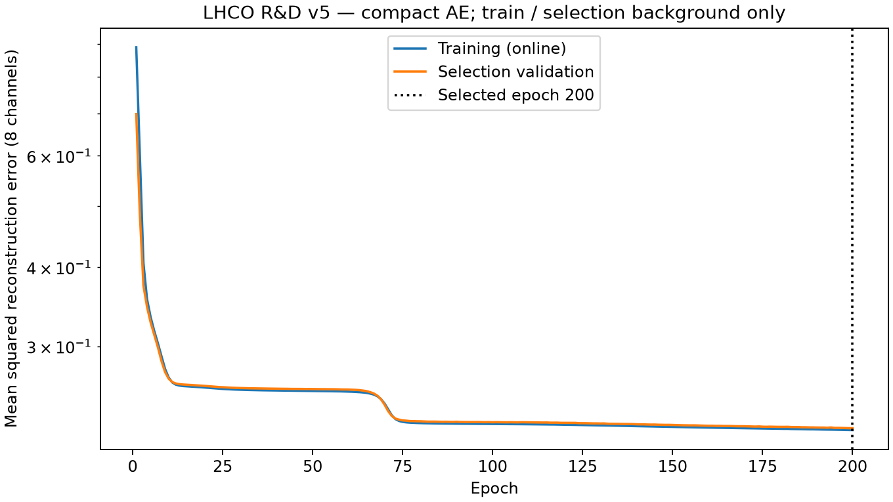
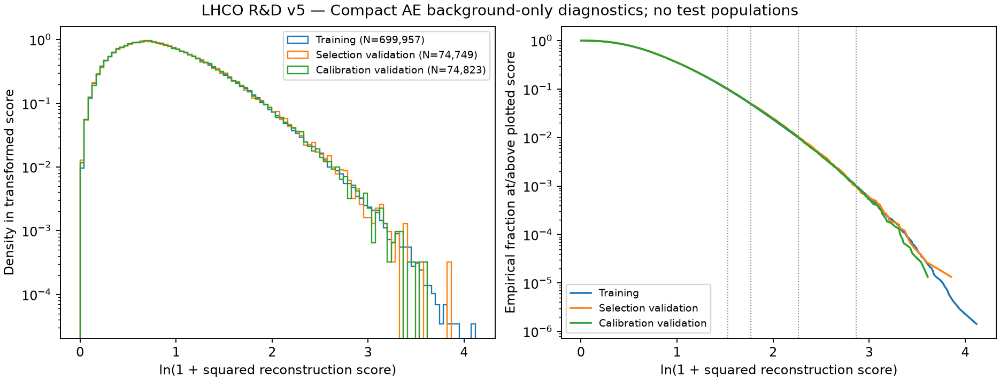

# Compact autoencoder baseline — Task 0007

> **Task 0008 update — 2026-10-06:** v2 supersedes v1 as the canonical compact AE
> after exact epoch-200 reproduction and selection-background early stopping
> (best 381, stopped 396). V1 and the following Task 0007 results remain historical
> evidence. See [the convergence report](autoencoder-convergence.md) and
> [frozen v2 artifact](../artifacts/models/compact-autoencoder-v2/model.json).

**Frozen CPU model; background-only development. No real test-signal performance
was inspected during Task 0007. No real test-background model scores were read.**

The [evaluation protocol](evaluation-protocol.md) is unchanged. Exact scientific
results, history and population audits are in
[the curated JSON](../results/tables/final/task0007-autoencoder-results.json);
this report contains rounded snapshots. The
[configuration](../configs/models/compact_autoencoder.json) was recorded before
canonical training and remained unchanged. No hyperparameter or architecture search.

## Architecture / parameter count / inputs

Four biased Linear layers: **8→6→3→6→8**, ReLU after the first encoder and first
decoder layers; linear latent and output. Parameter counts by layer are
54+21+24+56 = **155** (620 bytes of FP32 parameter payload).
No BatchNorm, dropout, residual blocks or stochastic latent variables.

Inputs are exactly the existing standardized FP32 full-event aggregates:
`multiplicity, scalar_pt, max_pt, pt_balance, weighted_eta_mean, weighted_eta_std,
pt_concentration, massless_event_mass`. The
[preprocessing contract](preprocessing-contract.md) and scalers remain unchanged.
No particle arrays, labels, IDs, slots, source or split channels enter the network.
The shared feature-only guarded reader copies only the small eight-channel matrix.

## Training protocol / reproducibility

Canonical training uses CPU, Adam (PyTorch defaults except lr=0.001), batches of
4096, maximum 200 epochs, patience 15, min_delta=0, seed 1729. Python, NumPy and
PyTorch RNGs are seeded; deterministic algorithms enabled; one intra-op CPU
thread; observed inter-op setting 10. Caller RNG/thread/determinism state is
restored afterward. Linear initialization is PyTorch's default FP32 initialization.
A separate seeded DataLoader generator drives uniform shuffled row batches;
zero workers, no dropped tail. A BatchSampler with automatic batching disabled
provides vectorized feature indexing rather than per-row tensor collation.
These choices follow the documented
[DataLoader batching API](https://docs.pytorch.org/docs/2.14/data.html#disable-automatic-batching)
and [determinism guidance](https://docs.pytorch.org/docs/2.14/notes/randomness.html).
Exact reproducibility across PyTorch versions/hardware is not guaranteed.

Only **699,957 train_background** events receive gradient updates.
**74,749 validation_selection_background** events select the best epoch using
mean reconstruction MSE. Equal event weights, including incomplete batches;
training history is online MSE while parameters evolve within the epoch.
Calibration is absent from the optimizer/early-stopping API and first loaded
only after best-state restoration and JSON export. The canonical model never
trains on the convenience subset. Dev validation used only 6,999/747/748 saved
allowed-background members and exported a separately identified dev diagnostic.
The future gate explicitly refuses dev models.

## Training dynamics

Best epoch **200**, executed **200**; stopping reason
**max_epochs**, not patience. Last epoch also best, zero consecutive non-improvements
at stopping; patience snapshots/restoration were independently tested synthetically.
Online best-epoch training MSE **0.221068287052**;
restored frozen-model training MSE **0.221007377055**;
selection-validation MSE **0.22261241728**.
The small online/frozen difference is expected from within-epoch updates.
The curve was still improving at the cap; this single preregistered run does not
establish convergence. No extension or retuning was performed after inspection.



## Anomaly score / background validation

For FP32 input and reconstructed vector, score is
`sum_j (x_j - reconstruction_j)^2` over eight channels, **higher is more anomalous**.
Forward/training arithmetic is FP32; residual subtraction/SSE accumulation is
float64 on CPU after the forward pass, matching the common score definition.
Optimization uses channel-mean MSE. Mean score / 8 agrees with frozen MSE to
FP32 reduction precision. No score renormalization, clipping or signal proxy.
All inputs, epoch losses, reconstructions and scores were finite.

| Population | N | Mean | Std | Min | Median | p90 | p95 | p99 | p99.9 | Max |
| --- | ---: | ---: | ---: | ---: | ---: | ---: | ---: | ---: | ---: | ---: |
| train_background | 699957 | 1.76805903 | 1.75090194 | 0.00358822799 | 1.27390986 | 3.58689775 | 4.82906306 | 8.58919378 | 16.5575944 | 60.3595427 |
| validation_selection_background | 74749 | 1.78089936 | 1.77122877 | 0.0162271331 | 1.27688274 | 3.61893285 | 4.87022536 | 8.70885965 | 16.2907378 | 46.1753957 |
| validation_calibration_background | 74823 | 1.77238256 | 1.74759089 | 0.0103552084 | 1.27072766 | 3.613635 | 4.86280619 | 8.63797953 | 16.5014062 | 35.9769365 |


KS distances: train/selection **0.00338839147**,
train/calibration **0.00328515435**,
selection/calibration **0.00488806967**.
These small absolute ECDF differences reveal no obvious background split drift;
no p-values or diagnostic-driven model changes. Tails remain visible and finite.



The display uses ln(1+s); actual calibration and saved scores use unscaled SSE.
Only the three permitted background populations are plotted.

## Threshold calibration

Use the existing higher empirical quantile and **strict score > threshold**.
Fit thresholds only on 74,823 calibration background events, then independently
check 74,749 selection background events. Neither model nor thresholds retuned.

| Target FPR | Threshold (SSE) | Calibration accepted / 74823 | Calibration FPR | Selection accepted / 74749 | Selection FPR | Signed relative deviation |
| ---: | ---: | ---: | ---: | ---: | ---: | ---: |
| 0.1 | 3.61370729993 | 7482 | 0.0999959905 | 7498 | 0.100309034 | +0.3090% |
| 0.05 | 4.8628349129 | 3741 | 0.0499979953 | 3751 | 0.0501812733 | +0.3625% |
| 0.01 | 8.63893868312 | 748 | 0.00999692608 | 772 | 0.0103278974 | +3.2790% |
| 0.001 | 16.5471513199 | 74 | 0.000989000708 | 73 | 0.000976601694 | -2.3398% |


Selection Wilson95 interval at target 1e-3 is
[0.00077686844,0.00122762337], with only 73 accepted events. Relative tail-rate
fluctuations must be interpreted with counts, resolution and finite-sample intervals
in the JSON. The four nominal rates lie within their selection Wilson intervals.
These are background stability observations, not signal/discovery performance.

## Bounded latent sanity

First 4,096 training-background events in source-ordinal order only, no signal.
Latent means: [-0.6874434056636005, 1.5663031973684838, -4.777592980766713].
Population standard deviations: [3.394036496641827, 2.895632669423341, 4.448633578121435].
All finite; no dimension has std <=1e-6. This is a bounded implementation sanity
check, not full latent EDA or evidence of useful anomaly separation. No tuning.

## PCA background-only comparison

Both models use identical input features/splits/calibration semantics. PCA retains
six axes, AE has latent dimension three; this also changes compression capacity,
so the comparison is not a controlled equal-latent-dimension study of nonlinearity.
No AUC, AP, signal efficiency or test-background rejection was calculated.

| Quantity | PCA (Task 0006) | Compact AE |
| --- | ---: | ---: |
| Latent dimensions | 6 | 3 |
| Neural trainable parameters | Not applicable | 155 |
| Stored fitted numeric values | 88 | 155 |
| Reported JSON artifact bytes | 9253 | 11945 |
| Fit/training time (engineering seconds) | 0.104816 | 31.181046 |
| Training mean SSE | 0.170393083 | 1.76805903 |
| Train/selection KS | 0.00446978685 | 0.00338839147 |
| Selection/calibration KS | 0.00233090873 | 0.00488806967 |

PCA saves eight means, all eight axes (64 coefficients), eight variances and eight
variance ratios: 88 values, although inference needs only six axes plus mean
(56 stored coefficients, not unconstrained neural parameters). AE saves 155
weights/biases. JSON sizes include different provenance/diagnostic overhead;
neither file size nor numeric-count comparison measures equal model capacity.
PCA's lower reconstruction residual is expected from retaining more dimensions
and does not establish better anomaly discrimination. Absolute threshold scales
are not a quality ranking. Both show stable independent background acceptance;
[the comparison CSV](../results/tables/final/task0007-autoencoder-pca-comparison.csv)
records all three KS distances and all four selection FPRs. The background-only
comparison gives no basis for claiming AE superiority or selecting a final model.

## Frozen artifact / reproduction

Tiny intentionally curated [model.json](../artifacts/models/compact-autoencoder-v1/model.json)
is **11,945 bytes**. Ordered named FP32 tensors, shapes, exact decimal
values, architecture/feature/schema/score metadata, model config, source/processed/
preprocessing/split identities and deterministic selection record are transparent.
JSON values must round-trip exactly to finite FP32; mismatched hashes, shapes,
names, channel order or architecture fail loading. No pickle dependency.
Timestamps, environment, code hashes and timings live in ignored run build metadata,
separate from model scientific identity. SHA-256 is an integrity identity, not a signature.

Scientific model SHA-256:
`30dadcdc20fa788d5442e031f44694346d2ac152c9b647b77e17351558a1610e`.
Scientific background-results SHA-256:
`490f8cf757ea2f2ab46dc7cee58c8d1b5b40b29cb06b799df7d8361987c222cd`.
Processed scientific identity:
`d12574e90e9ba9dff71e4e796f5004e704bce5d824db98c545a96d2df08e12d2`.
Preprocessing identity:
`2c11e6a995fd677ac88a4830243bfb7944532e3ef1aa83d1b6389ab9ca802e68`.
Source DOI/checksums/split identity are preserved in artifact provenance and
[the preprocessing report](preprocessing-pipeline.md).

Independent second CPU run: same best epoch, exact FP32 parameters (max difference
0), identical model/results scientific hashes, every background score-array byte,
threshold, summary, history CSV and both PNGs. Runtime/build metadata differs.
This is measured local reproducibility, not a cross-device training claim.

```bash
python -m pip install -e ".[dev,data,analysis]"
python -m latenttrigger.models.autoencoder --config configs/models/compact_autoencoder.json \
  --dev --output data/baselines/compact-autoencoder-v1-dev --no-plots
python -m latenttrigger.models.autoencoder --config configs/models/compact_autoencoder.json
python -m latenttrigger.models.autoencoder --config configs/models/compact_autoencoder.json \
  --output data/baselines/compact-autoencoder-v1-repeat
```

Run from the checkout; outside it supply explicit config/store/output paths.
Existing output/partial paths are refused. Ordinary failures clean owned staging;
hard kills may leave partial files: confirm no process runs before removing them.
Results are promoted only after frozen-model reload validation and reporting.
Defaults keep generated models, scores, run manifests and caches ignored under
`data/baselines/`. Only one exact model JSON path is exempted from artifact ignores;
checkpoints/exports and neighboring files remain ignored. Curated tables contain
no per-event records. Set local MPLCONFIGDIR/XDG_CACHE_HOME under data when needed.

## MPS compatibility

The original native MPS tensor smoke succeeds (sum=16). Separate newly initialized
FP32 AE, **256 dev-training events**, **five Adam training steps** on MPS,
finite forward, backward, updates and scores. Losses 0.999993265→0.993118167.
This mode loads 6,999 dev-training feature records before bounding the tensor;
its access audit reflects that count. It exports no model and never replaces
canonical CPU weights. No selection/calibration/test use or speedup/latency claim.

```bash
python -m latenttrigger.models.autoencoder --config configs/models/compact_autoencoder.json \
  --device mps --smoke
```

## Resources / limitations / future evaluation

Canonical CPU training 31.181 s; background scoring
train/selection/calibration 0.02829/
0.00309/
0.00307 s.
Whole run 47.747 s including custody verification
and first-use plotting/font cache; lifetime peak RSS 2,255,962,112
bytes (2.10 GiB). Repeat training
32.438 s, total
39.353 s, peak
2.88 GiB.
RSS includes verification/mmap pages; aggregate model matrices total ~27.2 MB.
These are engineering observations, not controlled hardware/inference benchmarks.
No new dependency: existing PyTorch/NumPy/evaluation/optional Matplotlib suffice.

The eight aggregates discard particle structure; pure background training is
idealized and convergence/capacity/simulation realism remain limitations. No
anomaly sensitivity is known. The future common gate can load this artifact
and reuse Task 0006 metrics only with explicitly authorized final unblinding;
its AE path was tested only synthetically. Canonical-full scope and training
count are required. Never invoke that gate during background model development.

**Real model requests: test_background=0; test_signal=0.** Full-store hashing and
structural checks read full artifact bytes, including integrity-only label/split
validation; this permitted custody step produces no test scores/distributions.
No real test-signal performance was inspected during Task 0007.

Recommend next **Task 0008 — Particle-Level Autoencoder or Set-Based Neural Baseline
Design**: specify a compact mask-aware set model using the existing particle view
before implementation. Aggregate nonlinear baseline is now reproducible; particle
structure is the remaining modeling distinction. No automatic Transformer choice,
export work or real-test unblinding is implied.
