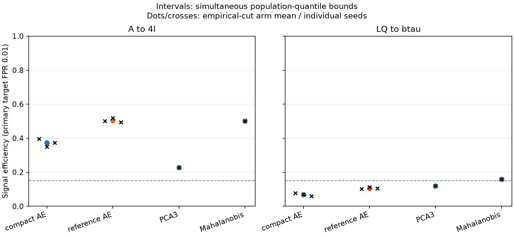
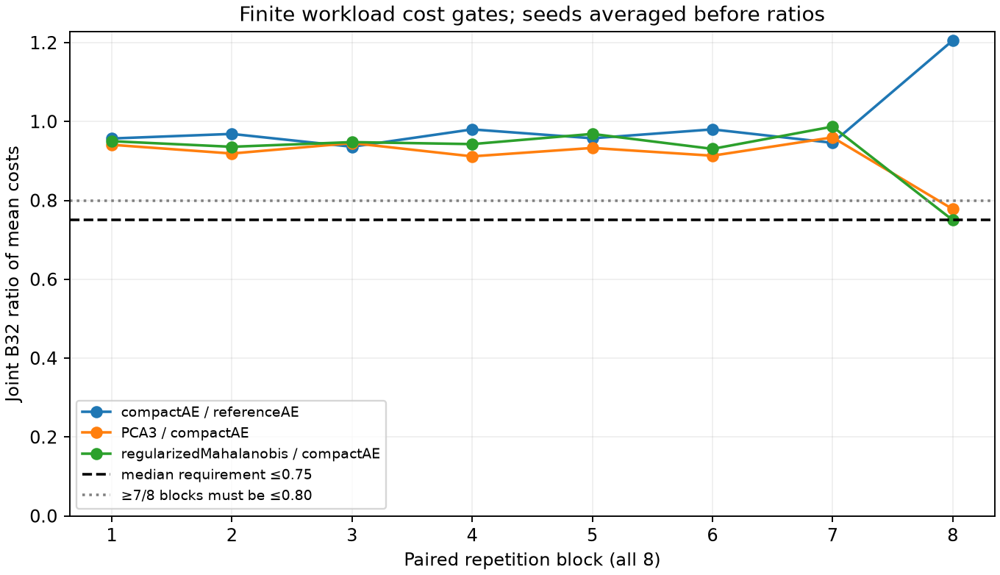

# ADC2021 decisive study: final results

Task0062, 2026-10-16 Europe/Rome. Status: **completed_preregistered_adc_evaluation**,
valid final evaluation of the qualified eight-stream/B1/B32/B512 scope; **negative
compound compression criterion**. Operational readiness remains false. This completes
the substantive Task0060–0062 research cycle; no successor task is launched.

## Scientific answer and practical decision

The compact AE does **not** retain90% of reference efficiency on either signal,
and does **not** deliver25% lower direct joint CPU cost. These are resolved negative
criteria, not merely overlapping confidence intervals. At approximately1% measured
background acceptance it detects37.334% of A→4l and6.897% of LQ→bτ, versus50.528%
and10.625% for the reference. Empirical-cut efficiency ratios are73.89% and64.91%;
the preregistered inference is the paired difference compact−.9reference below,
not a confidence interval obtained by dividing marginal bounds.

There is useful discrimination on A→4l: every arm's population-quantile lower
bound exceeds15%. None supports the **joint both-topology utility claim**.
Compact/reference/PCA have LQ upper bounds below15%; Mahalanobis's LQ interval
[14.649%,16.972%] straddles15%, so its utility gate is unresolved rather than
excluded. Its point estimate15.838% must not be promoted to a passed lower-bound gate.

The simple regularized Mahalanobis selector beats compact by more than1percentage
point on both signals: paired lower differences are11.004 and7.611percentage
points. It also improves LQ efficiency over reference by a supported3.954–6.456
percentage points, while reference−Mahalanobis on A is unresolved
[−0.567,1.386]percentage points. Nevertheless Mahalanobis does **not** satisfy
preregistered simple-selector dominance: its LQ utility lower bound and required
joint CPU advantage fail to pass. PCA trades lower A efficiency for higher LQ
 efficiency than compact, not universal superiority.

**Technical recommendation:** do not select the compact AE as the successful
quality/cost compression result. Keep the covariance selector as the stronger
simple comparator for this representation, with its clear LQ quality advantage
and unresolved both-signal utility target explicit. No candidate is certified as
a both-topology15%-efficient selector with the demanded joint cost advantage.
This is a completed negative/mixed scientific result, not a request to search
architectures or change thresholds until something wins.

## Frozen population, representation and execution

The immutable [protocol](decisive-scientific-experiment.md),
[v2 sidecar](../configs/research/decisive_scientific_experiment_v2.json) and
[Task0061 preparation report](decisive-adc-preparation-training.md) remain unchanged.
The accepted v2 background has13451915rows/13449154exact content groups, not the
descriptor's4M expectation. A and LQ have55969/340544groups. Source metadata do not
verify actual SM subprocess mixture proportions or generator independence.
Exactly1M final background,40000 A and40000 LQ groups are used. Unused groups,
training200k, selection50k and calibration1M cannot become new evaluation retries.
The4096 development groups are a hash-ordered training subset, not final events.

This is lepton-prefiltered simulation with provided MET/4e/4mu/10jet object caps.
The12 invariant aggregates use all provided visible objects, type masks, FP64
accumulation, training-only means/ddof0 standard deviations, then one FP32 cast.
There is no full-event, unfiltered collision-stream or detector deployment claim.
Structural preparation was exposure; final outcomes were protected, not truly blind.

All six AEs and two analytical fits were already consumed/frozen. Compact is
12→8→3→8→12/271parameters; reference12→32→16→3→16→32→12/1999parameters;
PCA3 and the .1-shrinkage covariance selector use the same representation.
All six AEs reached80epochs; selected epochs in seed order compact/reference are
80/80,80/78,80/79. These are fixed-budget selected models, not converged or optimal
networks. Task0062 performs **zero** acquisition, fitting, optimizer updates,
checkpoint selection, recalibration, ensemble construction or threshold search.
All six neural streams stay separate; arm means average event indicators at each
seed's own frozen strict cut. A seed count never multiplies N=40000 into120000.

## Primary efficiency and direct cost

Points are empirical-cut deployment estimates. Brackets are **simultaneous
population-background-quantile efficiency bounds**, incorporating calibration
rank endpoints; they are not Wilson intervals conditional on the empirical cut.
Costs are µs per **32-event call**, median of eight arm block means, three seed
costs averaged within each block. Ratios of those displayed medians are not the
predeclared paired ratio statistic.

| Arm | A→4l efficiency [bound], target.01 | LQ→bτ efficiency [bound], target.01 | Algorithm B32 µs | Joint B32 µs |
|---|---|---|---:|---:|
| compactAE | 37.334% [35.655, 39.022] | 6.897% [6.178, 7.631] | 18.522 | 284.881 |
| referenceAE | 50.528% [49.234, 51.807] | 10.625% [9.737, 11.486] | 31.846 | 295.362 |
| PCA3 | 22.717% [21.289, 24.170] | 11.905% [10.885, 12.968] | 6.530 | 266.302 |
| regularizedMahalanobis | 50.133% [48.773, 51.457] | 15.837% [14.649, 16.972] | 8.691 | 269.108 |

Per-seed primary counts are deliberately visible; analytical stream and arm rows
in the CSV have distinct scopes rather than independent duplicated observations.

| Signal | Arm | Seed | Accepted / N | Efficiency |
|---|---|---|---:|---:|
| A_to_4l | compactAE | 1729 | 15874 / 40000 | 39.6850% |
| A_to_4l | compactAE | 1730 | 14010 / 40000 | 35.0250% |
| A_to_4l | compactAE | 1731 | 14917 / 40000 | 37.2925% |
| A_to_4l | referenceAE | 1729 | 20061 / 40000 | 50.1525% |
| A_to_4l | referenceAE | 1730 | 20780 / 40000 | 51.9500% |
| A_to_4l | referenceAE | 1731 | 19793 / 40000 | 49.4825% |
| A_to_4l | PCA3 | fit | 9087 / 40000 | 22.7175% |
| A_to_4l | regularizedMahalanobis | fit | 20053 / 40000 | 50.1325% |
| LQ_to_btau | compactAE | 1729 | 3119 / 40000 | 7.7975% |
| LQ_to_btau | compactAE | 1730 | 2814 / 40000 | 7.0350% |
| LQ_to_btau | compactAE | 1731 | 2343 / 40000 | 5.8575% |
| LQ_to_btau | referenceAE | 1729 | 4060 / 40000 | 10.1500% |
| LQ_to_btau | referenceAE | 1730 | 4483 / 40000 | 11.2075% |
| LQ_to_btau | referenceAE | 1731 | 4207 / 40000 | 10.5175% |
| LQ_to_btau | PCA3 | fit | 4762 / 40000 | 11.9050% |
| LQ_to_btau | regularizedMahalanobis | fit | 6335 / 40000 | 15.8375% |

Paired NI uses compact−.9reference, opposite calibration endpoints, shared signal
events and ddof1 variance. The whole44-row family, support widths, endpoint means
and variances is in [paired inference](../results/tables/final/task0062-adc-paired-inference.csv).

| Signal | Target | Empirical-cut NI point | Population-quantile NI bound |
|---|---:|---:|---|
| A_to_4l | 0.01 | -0.081413 | [-0.097949, -0.064946] |
| LQ_to_btau | 0.01 | -0.026658 | [-0.035947, -0.017094] |
| A_to_4l | 0.001 | -0.066263 | [-0.088773, -0.044923] |
| LQ_to_btau | 0.001 | -0.004696 | [-0.009676, 0.000190] |

At primary both upper NI bounds are negative. Compact utility passes only A;
rate comparability passes; CPU fails; therefore the compound result is negative.
Secondary outcomes cannot replace primary outcomes.

## Actual background rates and uncertainty

Strict score>cut is unchanged. These are achieved final rates, not target labels.
All16 stream/rate counts below have simultaneous CP intervals with totalδ=.01;
individual descriptive Wilson95% intervals are retained in the
[background table](../results/tables/final/task0062-adc-background-acceptance.csv).
Neural-arm CP endpoints are the mean of the three simultaneous seed endpoints,
never a pooled binomial sample of3M independent groups.

| Stream | Seed | Target | Accepted / N | Achieved FPR | Simultaneous CP | Ties |
|---|---|---:|---:|---:|---|---:|
| compactAE | 1729 | 0.01 | 10044 / 1000000 | 0.010044 | [0.009706, 0.010390] | 0 |
| compactAE | 1730 | 0.01 | 9868 / 1000000 | 0.009868 | [0.009533, 0.010211] | 0 |
| compactAE | 1731 | 0.01 | 9973 / 1000000 | 0.009973 | [0.009637, 0.010317] | 0 |
| referenceAE | 1729 | 0.01 | 9953 / 1000000 | 0.009953 | [0.009617, 0.010297] | 0 |
| referenceAE | 1730 | 0.01 | 9907 / 1000000 | 0.009907 | [0.009572, 0.010250] | 0 |
| referenceAE | 1731 | 0.01 | 10097 / 1000000 | 0.010097 | [0.009759, 0.010443] | 0 |
| PCA3 | fit | 0.01 | 9896 / 1000000 | 0.009896 | [0.009561, 0.010239] | 0 |
| regularizedMahalanobis | fit | 0.01 | 9953 / 1000000 | 0.009953 | [0.009617, 0.010297] | 0 |
| compactAE | 1729 | 0.001 | 1025 / 1000000 | 0.001025 | [0.000919, 0.001139] | 0 |
| compactAE | 1730 | 0.001 | 1000 / 1000000 | 0.001000 | [0.000895, 0.001113] | 0 |
| compactAE | 1731 | 0.001 | 1003 / 1000000 | 0.001003 | [0.000898, 0.001116] | 0 |
| referenceAE | 1729 | 0.001 | 1029 / 1000000 | 0.001029 | [0.000923, 0.001143] | 0 |
| referenceAE | 1730 | 0.001 | 1051 / 1000000 | 0.001051 | [0.000944, 0.001166] | 0 |
| referenceAE | 1731 | 0.001 | 1061 / 1000000 | 0.001061 | [0.000953, 0.001177] | 0 |
| PCA3 | fit | 0.001 | 978 / 1000000 | 0.000978 | [0.000875, 0.001090] | 0 |
| regularizedMahalanobis | fit | 0.001 | 1043 / 1000000 | 0.001043 | [0.000936, 0.001158] | 0 |

Primary arm mean FPRs compact/reference/PCA/Mahalanobis are
.009961667/.009985667/.009896/.009953. Every arm interval lies in[.009,.011],
and all six pair difference intervals lie in±.001. At secondary every arm lies
in[.0007,.0013] and all six pair difference intervals in±.0003. All12 rate checks
pass; rates are comparable within the declared tolerance, **not exactly equal**.
Shared final background is one common reference, not two signal-specific replications.

Calibrationδ=.01, backgroundδ=.01 and signalδ=.03 form the frozen familywise.05
allocation. Signal inference has24 unordered pair differences,4NI quantities and
16efficiencies:44two-sided bounds/88one-sided functions. It uses the unchanged
empirical Bernstein helper, paired per-event seed means and support widths2/1.9/1.
Canonical arm order is compact,reference,PCA,Mahalanobis; a reversed comparison
uses[−upper,−lower]. Calibration one-based brackets remain[989658,990340] and
[998890,999107]. Their score endpoints bracket population quantiles; they never
replace deployment cuts. No bootstrap, final recalibration or randomized ties.

Conditional event-group independence is assumed; exact content deduplication
excludes detected exact duplicates, not generator ancestry/correlations. Bounds
condition on these fits, finite seeds, source and representation, not all initializations.
Zero-background helpers retain finite exact upper bounds and unresolved SIC/rejection;
no infinite improvement is manufactured. Actual final background counts are positive.

## Secondary point, ranking and nominal SIC

| Arm | A→4l efficiency [bound], target.001 | LQ→bτ efficiency [bound], target.001 |
|---|---|---|
| compactAE | 13.859% [12.352, 15.327] | 0.967% [0.664, 1.302] |
| referenceAE | 22.762% [20.947, 24.572] | 1.596% [1.197, 2.021] |
| PCA3 | 4.793% [3.727, 5.934] | 2.075% [1.560, 2.615] |
| regularizedMahalanobis | 21.523% [19.815, 23.479] | 2.663% [2.059, 3.292] |

No arm passes the both-topology secondary5% lower-bound utility target; all LQ
upper bounds are below5%. These results cannot rescue primary failure.
ROC AUC/AP below are secondary descriptive ranking estimates at the supplied
orientation. Each signal is mixed with the same1M background and40000signal,
so **AP prevalence=1/26≈.0384615**, not a physical collision prevalence.

| Stream | A AUC | A AP | LQ AUC | LQ AP |
|---|---:|---:|---:|---:|
| compactAE/1729 | 0.901108 | 0.488461 | 0.787099 | 0.130420 |
| referenceAE/1729 | 0.907573 | 0.551477 | 0.818809 | 0.162097 |
| compactAE/1730 | 0.901599 | 0.468565 | 0.775014 | 0.129155 |
| referenceAE/1730 | 0.904942 | 0.576857 | 0.808243 | 0.164358 |
| compactAE/1731 | 0.890601 | 0.458931 | 0.738619 | 0.102774 |
| referenceAE/1731 | 0.900961 | 0.569033 | 0.796909 | 0.159061 |
| PCA3/fit | 0.865324 | 0.317501 | 0.748219 | 0.159854 |
| regularizedMahalanobis/fit | 0.902310 | 0.556642 | 0.784231 | 0.187268 |

The summary retains descriptive nearest attainable tied ROC points to the two
predeclared rate coordinates, not an optimized cut or SIC maximum. No threshold
is deployed from that curve. Arm nominalSIC=efficiency/sqrt(achievedFPR) is in the
[operating table](../results/tables/final/task0062-adc-signal-operating-points.csv),
only as a background-dominated proxy. No luminosity, nuisance-aware/discovery
significance, LHC event rate or simultaneous SIC interval is inferred.

## Direct CPU evidence and qualified runtime

Public B32 reload/repeat and equality to frozen4096development scores are bitwise.
All24stream/shape cells qualify, including reconstruction where defined; Mahalanobis
reconstruction is not applicable. Largest cross-shape score difference is
1.9750322675093912e−5, within1e−5+2e−5max(1,|reference|), and every threshold
comparison is unchanged. No secondary shape is skipped, no tolerance relaxed.

One fresh owned CPU worker, existing pinned Python/NumPy/Torch runtime, one effective
Torch/BLAS thread, no loader workers, MPS/ONNX probe or host-idle gate. Loop order:
repetition→left-rotated stream→B1/B32/B512→boundary parity order→call. Every cell
has32warmups and128timed calls, with the frozen4096-row modulo schedule. There
are384cells,49152timed calls,12288warmups;61440public calls/11161600row presentations
of the **same4096events**, not that many independent physics samples.

Algorithm input is already-owned contiguous standardized FP32; joint input is
provided in-memory objects. Gather/indexing, model/disk/HDF/custody IO and parity
are outside timers. Joint includes frozen aggregates/scaling; both boundaries
include the unchanged public score, two strict masks and owned outputs. All
perf_counter_ns starts/ends, shapes, warmups, outliers and cell CPU time/lifetime
RSS are retained privately. No empty-timer subtraction, component sum, best block,
seed cherry-pick or percentile average is used. The whole development lifecycle
is15.840491s; the CPU function including trace writing is13.739121s, below20min.

| Block | compact/reference joint B32 | PCA/compact | Mahalanobis/compact |
|---:|---:|---:|---:|
| 1 | 0.956892 | 0.940928 | 0.950039 |
| 2 | 0.968508 | 0.918826 | 0.935875 |
| 3 | 0.935984 | 0.945322 | 0.947736 |
| 4 | 0.979975 | 0.911609 | 0.942677 |
| 5 | 0.957472 | 0.932930 | 0.968493 |
| 6 | 0.979998 | 0.913279 | 0.930545 |
| 7 | 0.945903 | 0.959740 | 0.987018 |
| 8 | 1.205527 | 0.777778 | 0.749934 |

Compact/reference median=.962989814; **0/8**blocks≤.80. The adverse eighth block
ratio1.205526537 is retained. PCA/compact median=.925877925,1/8≤.80;
Mahalanobis/compact median=.945206261,1/8≤.80. All fail the median≤.75 and7/8≤.80
rule. Algorithm-only compact is clearly cheaper in these direct measurements,
but cannot replace the required joint boundary. These are finite-workload host
observations, not causal component timings, universal speedups or production tail bounds.
Full B1/B32/B512 costs and all seed/block means are in the
[408-row cost table](../results/tables/final/task0062-adc-cpu-costs.csv):384measured
cells plus24paired primary ratios, with explicit scopes.

## Required identities and descriptive selection bias

The first512hash-ordered final-background objects receive only the fixed.7rad
rotation and eta reflection.16reports pass: raw feature max difference3.33e−16,
scaled features/scores exactly equal and zero primary/secondary decision changes.
This adds8192transformed score rows/256B32 calls. Original reference scores are
read from the committed pass, not recomputed. Every event's score errors, cutoff
margins and flip masks are retained privately. Aggregate identities are mathematical;
physical detector rotation/reflection symmetry remains an assumption.

Bins are exact provided-object quantities, left-closed/right-open MET edges,
leptons1/2/≥3 and jets0/1/2/≥3, not inverse-transformed rounded features. Every
bin hasN≥20; no metric suppression is triggered. The complete280-row
[robustness table](../results/tables/final/task0062-adc-robustness.csv) contains16identity
rows and264descriptive stream/arm profile rows for both cuts.

| Primary background profile | N | compact | reference | PCA | Mahalanobis |
|---|---:|---:|---:|---:|---:|
| MET_GeV [0,30) | 449195 | 1.1800% | 1.1555% | 1.3099% | 1.1278% |
| MET_GeV [30,60) | 441735 | 0.7014% | 0.7050% | 0.3199% | 0.6846% |
| MET_GeV [60,120) | 105966 | 1.2495% | 1.2400% | 1.7279% | 1.3363% |
| MET_GeV [120,infinity) | 3104 | 7.6890% | 11.8127% | 24.7423% | 14.4008% |
| leptons 1 | 907622 | 0.0396% | 0.0748% | 0.6683% | 0.1612% |
| leptons 2 | 88520 | 8.7159% | 6.4882% | 2.7666% | 5.4688% |
| leptons >=3 | 3858 | 48.9114% | 92.3622% | 35.7957% | 94.5827% |
| jets 0 | 377849 | 0.1438% | 0.1214% | 0.3456% | 0.0161% |
| jets 1 | 297567 | 0.8764% | 0.7021% | 0.7548% | 0.4470% |
| jets 2 | 184281 | 1.4968% | 1.5424% | 0.8389% | 0.7912% |
| jets >=3 | 140303 | 2.8880% | 3.2753% | 3.4197% | 5.0633% |

Strong multiplicity dependence is visible: reference/Mahalanobis accept92.36%/
94.58% of≥3-lepton background, versus.0748%/.1612% of single-lepton background.
The strong four-lepton result is compatible with this declared representation and
selection pattern; the profile does not prove a causal mechanism or decorrelation.
There are no actual SM process labels for component efficiencies. No subgroup,
plot or final outcome selects a new model/cut.

## Validity, repairs, resources and preserved failure history

Baseline was cleanmain/origin-main atfa39e3a9949aa0cdb1b97a8d760ee84e9c0b70f7,
empty index/memory1.56. No fetch/push/hosted CI outcome is implied. Seven supplied
anchors match exactly. Only complete-freeze-v2,130765B/SHA256
e425d1bc50c644caf7c3fad1f2317472e33eca68686022d4eac52bf04d804ce6 is accepted.
The withdrawn first0061manifest stays withdrawn. Preflight and postflight each
verify184files/4791963942B and the explicit277-file/3144047B old behavioral map.
New source changes the old recursive discovery set; it never weakens closed-map verification.
All frozen old code/config/test/prompt files remain byte-identical.

The first generated group had194call passes and a telemetry teardown NameError
(missing imports), retained as failure. Later source-qualified groups pass200,
201,202and202; the pre-outcome final202 group is21.64s/22.381036s externally.
The new adapter's first real development admission rejected the frozen source
label train-first-hash-ordered, because it incorrectly expected background.
It stopped **before role hashing/numerical open, model load, inference, CPU intent
or timer**. The failure and old extension binding62c5203e… are retained. A generated
regression corrects the source label; versioned extension/phase binding v2 is
7cf503e5b9a88629f57db7214bb23e6b5e3be82b44d7cb4b7e7828122cf5a49d.
All Task0061 numerical components and scientific/statistical/cost rules are unchanged.
A new structural preflight precedes the single successful development phase.
No real timing or final outcome existed when this correction was qualified.

Only after those checks did the exclusive final-unblinding intent bind the actual
prompt, extension, runtime, roles, cuts, source freeze and output plan. Exactly24
FP64 vectors commit8640000scores/270000B32calls, zero final padding. Partial files
cannot appear complete; incomplete attempts retain prefixes/journals and cannot
restart. No failed scientific inference/timing pass was retried. The one final
lifecycle is15.538834s including import/reporting/exit/reap. Final transformed work
is separate; development parity adds163840public score rows/35904calls and
86016reconstruction rows/29624calls, plus16model loads. Final loading adds8models.
Total original public work is19973632row presentations/367600calls, not unique N.
No new optimizer/calibration/acquisition work is hidden in these counts.

Final presentation uses only curated scalars. Visual review caught clipped labels
in the first figure layout; a separate presentation-only script corrects layout
without changing the frozen evaluator, estimates, thresholds, gates or private
scores/timing. Initial figures remain private. The presentation extension is
qualified with the unchanged scientific group in one final204-test process;
all three delivered figures are visually inspected. Routine report reproduction
reads existing aggregates only and never repeats real scoring/timing.

Scientific-core/ADC/audit expectations run together. The old costly native,
MPS/ONNX/particle/streaming matrices and3002-case audit repeat are excluded because
no frozen/shared source changed. Generated tests positively include artificial
models/objects, public/reconstruction forwards, toy fits/Adam updates in existing
core/ADC tests, artificial score inference, fake CPU-boundary schedule loops and
bounded own subprocesses. They are not evidence of signal usefulness; generated
and original activity/attempt counts remain separately recorded in the summary.

Whole-study retained storage is approximately5.05GB, below8GiB. New reservation
260000000B fits0061's268435456B future reserve; no historical files/caches are
removed or totals reset. Largest real numerical-worker lifetime RSS912277504B,
below4GiB; one active worker, no services. Cache/bytecode are disabled and
XDG/matplotlib/temp contained prospectively. Own PID RSS/logical retained bytes
and inclusive lifecycles are observed; native/unlinked scratch and missed sample
peaks are not an OS all-write proof. Lifetime RSS supplements sampling.
The first scalar-only preview render had no separate RSS sampler; the final
presentation is externally observed. This is disclosed rather than retrospectively
certified. Final delivery records the cumulative task wall (origin17:07:00UTC,
conservatively before first observed17:08:07), all tests/failures, figures/docs,
postflight and cleanup, comfortably within2h. The optional NumPy warning suggesting
pyyaml is preserved; no dependency upgrade is performed.

## Evidence, reproduction and limits

[Summary](../results/tables/final/task0062-adc-evaluation-summary.json),
[background](../results/tables/final/task0062-adc-background-acceptance.csv),
[operating points](../results/tables/final/task0062-adc-signal-operating-points.csv),
[inference](../results/tables/final/task0062-adc-paired-inference.csv),
[costs](../results/tables/final/task0062-adc-cpu-costs.csv),
[identities/bias](../results/tables/final/task0062-adc-robustness.csv),
[Italian brief](decisive-adc-decision-brief.md) and
[handoff](handoffs/0062-adc-final-evaluation-and-conclusion.md).
Private vectors/raw timing/margins/intents/receipts and output identities are under
`data/decisive-v2-adc-task0062/`; no events, group ID lists, tensors or full traces
are curated. Frozen0061inputs/ledgers/manifests stay read-only and unchanged.

To reproduce figures, the presentation script reads only the curated scalar
summary/CSV, with cache-contained settings. Do **not** rerun the real final or
development entrypoint: their exclusive intents are consumed. The result applies
to this new ADC population/12-feature view, these finite seeds and this CPU workload.
It neither confirms the old LHCO model nor repairs historical P4/particle failures.
Task0059 remains the historical v1 snapshot; Task0060's audit corrections and
Task0061 source/cap/freeze corrections remain explicit. No official experiment
 affiliation, universal novelty, current MPS/ONNX speedup or deployment readiness follows.
