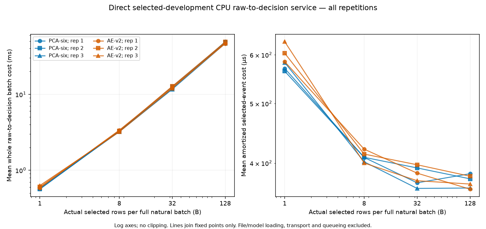
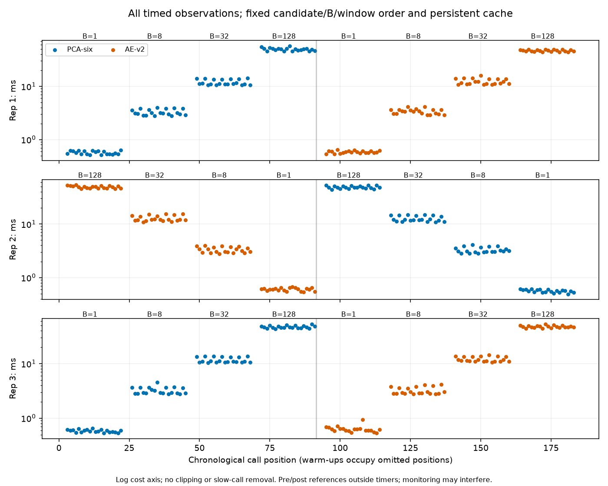

# Independent development raw-to-decision CPU campaign v2 — Task0043

## Accepted outcome and boundary

One new Task0043 session is **`parent_accepted_development_raw_decision_measurement`**.
It directly measures approved HDF selections through unchanged full-particle frozen
feature construction, owned natural FP32 packing, original native CPU FP64 SSE,
four original strict decisions and retained actual-row results. All24cells and
480timed/72warm-up calls complete; all feature/score/mask parity checks are exact.

[Actual prospective authorization](prompts/0043-development-raw-decision-campaign-v2.md),
[fixed v2 protocol](../configs/benchmarks/development_raw_decision_v2.json),
[24-cell table](../results/tables/final/task0043-development-raw-decision-cells.csv),
[curated summary](../results/tables/final/task0043-development-raw-decision-summary.json)
and [detailed handoff](handoffs/0043-development-raw-decision-campaign-v2.md) separate
new measurements, software evidence and historical campaigns. Raw sequences,
plans/grants/receipts/ledgers and integrity-block hashes remain ignored; no per-event
features, scores, masks, raw particles or IDs are curated.

Initial checkout: clean main/origin/main, HEAD6d5fb4464eda4cd775a7245e0ff51ef8441e0af9,
committed Task0042, empty index, memory1.37. Task0042historical a7ee0a23 and
Task0041historical8b6310d bases are preserved. Task0041remains failed/consumed with
its header-only CSV, exact record/marker and original source snapshot. Task0042
remains accepted software-only. New task/validation owner is0043 throughout.
Task0043 is a new allowance, never a renewal or retry of Task0041.

## Closed admission and preserved computation

A new closed Task0043 context, serialized software producer/verifier, immutable
admission plan/freeze and parent-issued phase authority are additive. Task0042's
context/sealed synthetic object/flags and the consumed Task0041 real CLI are not
reused or loosened. The canonical software status is shared unchanged; software
records remain `execution_authorized=false`. Only the exact Task0043 prompt,
current-source acceptance, final emitted-record native roundtrip and frozen input/
model/budget plan supply its distinct operational capability.

The sole checked entry performs verification→freeze→single claim→controller;
failed admission/freezing blocks downstream effects. Controller and workers
independently check task/kind/scope/prompt/config, source/packages/native build,
claim, model/threshold/input/budget bindings, namespace, continuous deadlines and
runtime. Once real prerequisites begin the own canonical marker consumes the
allowance; any later failure would stop without retry or changed source. Both
prerequisite marker and execution anchor now exist and remain consumed.

Unchanged pure scheduling, selected-row operations, feature/CPU-service arithmetic,
measurement/reference loop, owned aggregate plotting, clock and guards are reused.
The new provider constructor verifies only a Task0043 payload capability before
using the selected-row algorithms; it converts no historical permit and substitutes
no module globals. The worker assembly retains the established numerical/cleanup
body with new protocol/provider/receipt wiring; the controller is separate and
small. No historical source/config/controller has been edited.

Exactly the same original6999-ID source, sorted first1024payload f80a9483…266f1a,
Task0020golden7164bfd7…990a5e/payload2ba0776a…b3d05, raw5da8fda2…cecc6 and
PCA6dd54d8a…e3190/AEa0b1563c…13bf5 model identities are bound. Existing split/dev/
preparation/scientific/calibration lineage is verified independently of filenames
and lengths. Historical maps are checked only against their original entries;
Task0041's six repaired entries resolve to its preserved original source. Model
JSON loaders, eight ordered features, standardization/log channels, full-particle
FP64 aggregates after physical FP32 conversion, CPU thread/arithmetic policies,
SSE casting and original strict cutoffs are unchanged. No store is constructed.

## Direct costs and variability

Each candidate/B pool below contains all60timed observations across three fresh
workers. Per-cell statistics use20observations, population SD and linear quantiles;
pooling uses actual observations rather than averaged percentiles. No slow call,
interruption, worker or unfavorable ordering is removed.

| Actual B | PCA whole-batch mean ms | AE whole-batch mean ms | PCA amortized µs/input row | AE amortized µs/input row |
| ---: | ---: | ---: | ---: | ---: |
| 1 | 0.572585 | 0.606340 | 572.585 | 606.340 |
| 8 | 3.251953 | 3.294765 | 406.494 | 411.846 |
| 32 | 12.035956 | 12.345976 | 376.124 | 385.812 |
| 128 | 48.047652 | 47.514822 | 375.372 | 371.210 |

Whole-batch cost increases over the fixed B grid; mean amortized cost decreases,
with modest differences between32and128. Candidate ordering reverses at128 in the
pooled means; this fixed, same-host study does not select a model/batch policy or
establish a causal difference. All repetitions are available in the table/figures.
Pooled observed maxima atB128are56.958250ms PCA and53.302041ms AE. AE's largest
B1call is0.936750ms versus its pooled median0.598146ms. These are finite observed
calls, not recurring stall frequencies or production p99 guarantees.

Both figures were visually inspected. Log axes are explicit, no clipping, and lines
join only fixed grid points. Chronology retains all480timed calls; warm-ups occupy
omitted call positions. The selected-event denominator means selected **HDF input
rows processed**, not anomaly-accepted events or a physical trigger rate.

## Exact access and parity accounting

| Component | Actual calls/loads | Actual row presentations/records |
| --- | ---: | ---: |
| Development ID arrays | 3 | 20997ID records inspected;3072selected records;1024unique approved IDs |
| Prepared golden arrays | 3 | 3072rows loaded;1024unique rows |
| Timed complete chain | 480 | 20280 |
| Warm-up complete chain | 72 | 3042 |
| Complete-chain pre/post gates | 288 | 12168 |
| Selected raw reads / feature constructions / chain services, each | 840 | 35490requested and returned |
| Golden-only reference services | 144 | 6084 |
| All public adapter/decision calls | 984 | 41574;166296Boolean values |
| PCA reconstructions | 492 | 20787 |
| AE forwards / AE reconstructions | 492each | 20787 |
| Frozen model/threshold loads and model instantiations | 6each | one candidate per worker |
| HDF handles | 3opened/3closed | metadata checked before/after on those same handles |
| Whole raw SHA256 passes | 2 | 5816520818byte presentations |

There are384unique raw source rows within1024approved/golden rows. Each worker
independently loads/validates its original ID array and golden exactly once; no
cached-prefix substitute, other membership/label/fingerprint/score array or broad
store reader. The Python reader receives only exact authorized selections, max128;
contiguous slices are legal only when their whole interval is requested. Truth0
validates background and never enters features. All actual rows are processed
before strict decisions; no dummy/padding row or operational setup inference.

144gate-window records pass with zero feature/score/mask byte mismatches; every
480timed and72warm-up output also matches its pre-established same-B references
outside timer pairs, with no extra HDF/feature/model calls. Input/parameter/threshold
state and pre/post golden references are exact. Model computation counts derive
from completed per-candidate public-service ledger counts and unchanged one-call
score→reconstruction/forward implementations, verified by synthetic regressions;
no intrusive operational forward hooks or extra diagnostic models were added.

## Validation, clock, resources and lifecycle

Fresh final acceptance:214focused tests including106new campaign cases;
2588full and2588portable tests in artifact-free copies; lint/format/dependencies
pass,268source/config/prompt/test bindings,43package versions and41native identities.
Actual emitted-record admission/freeze/claim/native roundtrip succeeds before real
entry. Three native generated-fixture integrations are accepted: preliminary
17.472736s, final bootstrap15.795412s and final roundtrip17.262225s (exact bootstrap
duration is retained in summary validation receipts). Each conserves840reads/
constructions and984services; no real arrays/models/HDF/hash during validation.
Preliminary version source is preserved before stricter final evidence/deadline
checks. Historical toy model activity is separately disclosed, not globally zero.

The one actual controller session is37.337518s; reserved34.488050s, prerequisites
2.924416s, post raw hash1.312887s, finalization1.231510s, overshoot0. Software
admission/freezing precedes consumed real prerequisites; the whole duration refers
to the continuously supervised controller session. Numerical worker durations
10.074873/9.385456/9.213941s; reporting2.201777s. All fourexit0, normal exit confirmed,
reaped and parent accepted independently of body completion.

Max workerRSS397803520B/native203276288B; controllerRSS51855360B; conservative
parent-plus-one-serial-worker native sum245219328B. Owned output6274301B,
conservative numerical-array envelope55858176B. All unchanged limits pass:
prerequisites60s/workers180s/reporting60s/posthash45s/finalization15s/reserved720s/
whole780s, cleanup2sinside worker caps, RSS1GiB/native512MiB/controller128MiB,
arrays64MiB/combined worker journals16MiB/log1MiB/output128MiB. Native primary
accounting covers main controller plus one serial worker; assertion-helper RSS is
separate context, not allocation attribution or unique physical memory.

Worker pressure has1506WARN advisory observations,0NORMAL/CRITICAL/unknown.
Max query-start gap0.126207s and terminal exit gap0.306075s are disclosed; sampled
resource supervision does not claim uninterrupted coverage. Optional available
RAM is unavailable/context only, never a launch floor. The owned assertion has
10active observations, then release/reaping/absence confirmed before acceptance;
display sleep allowed, persistent settings unchanged. Continuous clock includes
suspension, independent of integer-ns service timing.

## Interpretation and next decision

The directly measured boundary includes selected HDF read/decompression/materialization,
full frozen features, packing, CPU score/four decisions/result retention. File/model
loading, external transport, arrival/queue/batching scheduling and detector integration
are excluded. Prehash/gates and persistent1MiB/521/.75cache give warm history, not
cold I/O. Decoder threading, physical bytes/cache misses remain unknown.

Geometry verifies312distinct chunks and30181184352B=28.108418GiB repeated no-cache
decoded upper bound for the840-read schedule. This is not measured decompression or
permission to return neighboring rows. Task0040's different24.501GiB bound is not
reused. Task0038/0040 are historical scope/context; no median sums, cross-session
subtraction, claimed adapter increment/speedup, causal bottleneck or optimal policy.

Task0043 supplies the first accepted joint operational sequences. The next decision
may separately authorize deterministic systems replay of those owned sequences
with fixed synthetic arrivals, mapping/order/accounting and limits defined prospectively.
No replay, new model/sample access, Task0044 or confirmation campaign is launched.
Task0036remains unresolved_no_acquisition; Task0034gates unchanged; Task0032complete,
Task0033exploratory; historical exposureYES/YES/YES, Task0025failed and particle192/
192consumed/canonical-deferred remain intact. No scientific metrics or tail repair.
