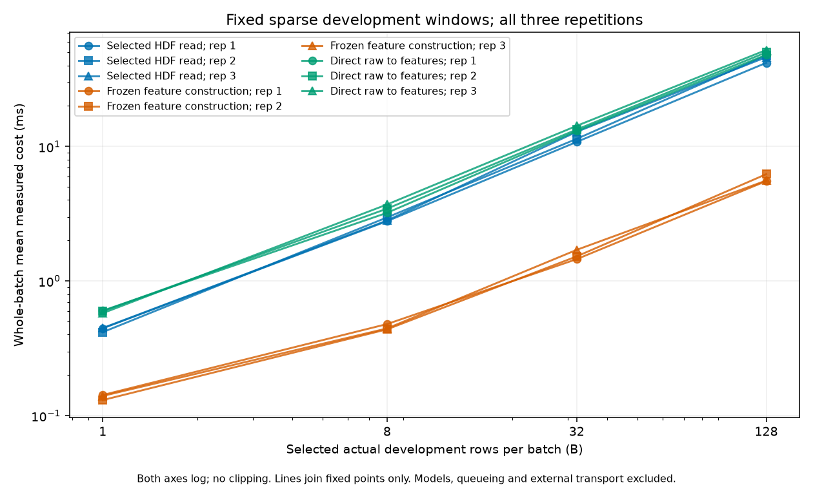
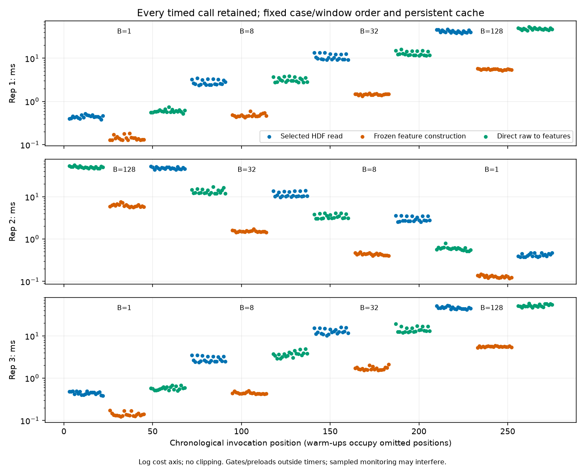
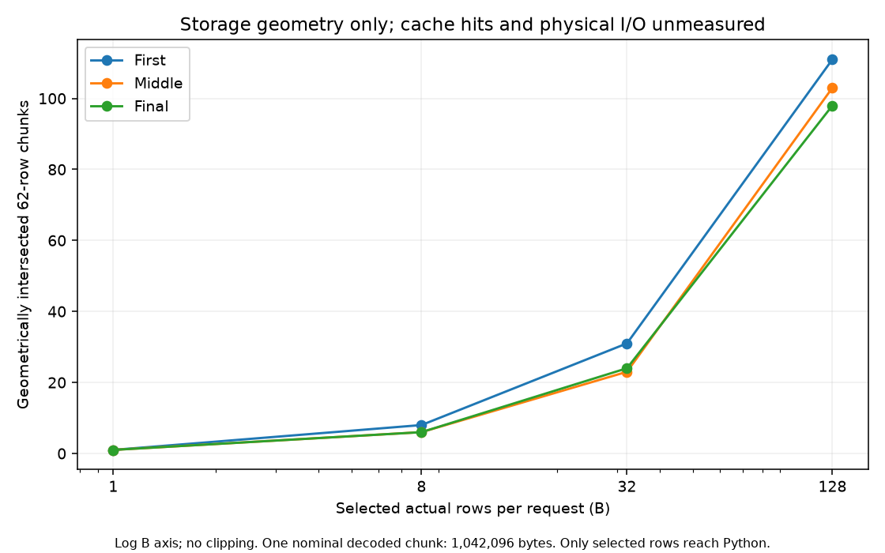

# Guarded development raw-to-feature measurement — Task0040

## Scope

This task adds a separate payload protocol/provider/controller to the completed
Task0039 synthetic foundation. The actual Task0040 attachment grants one conditional
measurement after fresh acceptance and freezing. Task0039's prospective configuration,
synthetic provider block, accepted metadata resolver and acceptance are preserved.
Initial clean main/origin/main HEAD90868d6e75fcb298fa7e606dce00ad3457f8374e commits
Task0039; its historical292a7e9base remains historical. Memory1.34 at start.

[Actual prompt](prompts/0040-development-raw-feature-measurement.md),
[strict protocol](../configs/benchmarks/development_raw_measurement_v1.json) and
[handoff](handoffs/0040-development-raw-feature-measurement.md) bind the scope.
The sole session is `parent_accepted_development_raw_feature_measurement`, consumed.
[Cell table](../results/tables/final/task0040-development-raw-feature-cells.csv) and
[curated summary](../results/tables/final/task0040-development-raw-feature-summary.json)
retain all repetitions, accounting, gates and lifecycle evidence.
No model execution, held-out roles, fitting, acquisition or scientific evaluation.
Task0036 remains unresolved_no_acquisition and Task0034's gates unchanged.

## Sources, authorization and arithmetic

Each of three fresh workers loads the original6999development-training int64 IDs
once, validates their domain/uniqueness, sorts ascending and selects the same1024
prefix as Task0020/0039. Each loads the original FP32[1024,8] golden once. The
split/dev scientific identity, frozen recipe/config and accepted preparation/resolver
bind role/order. No derived prefix substitutes for original membership lineage.
The raw file undergoes exactly two full SHA256 byte passes: before all numerical
payload access and after the numerical/reporting workers. The passes are separate
from selected-row requests and per-call timers. Sources/pins are specified in the
strict config; missing, symlinked, altered or ambiguous inputs are rejected.

A parent-issued, plan/source/build/dependency-bound, single-claim grant authenticates
one worker and exact source/dataset/prefix/deadline. The provider refuses unauthorized
IDs and requests outside the12fixed windows before backend selection. No unsafe flag,
broad interval, alternative role, processed store, axis-array or model path exists.
Raw rows are owned contiguous FP64[requested,2101]; background truth0 validates role
and does not enter features. The unchanged pure chain performs FP64 source sort/wrap,
physical FP32casting, all-particle FP64 aggregates, frozen logs/scalers and final FP32.
The384particle view is never built. Exact golden-position bytes and repeat equality
are required before and after timing; no tolerance enlargement or operational replay.

## Boundaries, schedule and accounting

selected_hdf_read measures checked selected-ID read/decompression/materialization
and background guard, excluding file opening and feature construction.
frozen_feature_construction measures the full pure chain/input guard from an owned
preloaded raw window without HDF reads. selected_raw_to_features measures that same
direct selected read through completed features jointly. Separate medians cannot
reconstruct the joint boundary or whole detector/queue/model latency.

B1/8/32/128; windows0/floor((1024−B)/2)/1024−B. Workers1/3 ascend B and execute
read→feature→joint; worker2 reverses B and scope order. Each case has3warm-ups and
20timed calls, windows cycling independently per phase:1/1/1 then7/7/6. All calls,
serial ordering and slow observations are retained. Three raw buffers are preloaded
immediately before feature-only scope per B, reused and released before the next B.
One readonly HDF handle/cache per worker persists from pre through post gates.
Each pre/post gate/B/window makes2raw reads and3feature constructions, checking
repeat/golden identity. After-timer block equality checks reuse those established
window hashes/golden bytes, without more reads/constructions. Block hashes remain
ignored and are integrity checks, not a published event-fingerprint dataset.

The immutable planned matrix is36cells/720timed/108warm-up invocations. Expected
raw732requests/30927rows:552timed+warm requests23322rows,36preloads1521rows,
144gate reads6084rows. Feature768calls/32448rows:552timed+warm23322rows,
216gate calls9126rows. Three membership loads20997records/three golden loads3072rows;
1024approved/golden unique rows and384unique requested raw rows. Durable start/end
and inflight records distinguish requested, returned and completed operations.
No raw matrix, particles, event features or labels are persisted operationally.

## Timer, cache and resource interpretation

Worker timer implementation/resolution is recorded before timing; integer ns storage
does not imply1ns resolution. Synchronous perf_counter_ns pairs are independent of
Mach continuous supervision. Window lookup/hashes/ledger/resource queries are outside
pairs; periodic monitoring may interfere. All20serial calls/cell remain, linear
quantiles/population SD, no trimming/distribution fitting/production-p99 claim.
Continuous timestamps and timer discrepancy are retained, including suspension.

Effective cache1MiB/521slots/w0=.75 is required at dataset/file access properties;
FP64[1100000,2101], chunks[62,2101], Blosc32001 exact pipeline and unambiguous hard
links/no virtual/external sources are checked on each existing worker handle.
BLAS/Accelerate controls are enforced separately; effective Blosc decoder thread count
remains unknown despite requested BLOSC_NTHREADS=1. No cache/thread search or install.
Whole-file hashing warms OS pages: warm-context selected-read study, unknown other
cache layers, no cold-I/O claim/purge/app closure/global RAM floor.

312geometric chunks and26307713520B≈24.501GiB no-cache decoded upper bound are
inherited planning geometry, not measured decompression, cache misses or physical I/O.
Mechanical neighboring-chunk decoding does not permit returning/analyzing neighbors.
Only approved rows reach Python; selected payload bytes cannot establish disk bandwidth.

Fixed ceilings:60s prerequisites;180s per numerical worker including reaping;
60s report;45s post-numerical custody within reserved slack;15s finalization;
720s reserved/780s whole; cleanup2s inside caps. WorkerRSS1GiB/native512MiB;
controller128MiB; owned numerical arrays64MiB; journals16MiB/log1MiB/owned128MiB.
Shape-bounded live-chain envelope conservatively covers24FP64particle-size temporaries,
explicit raw buffers and fixed result/metadata overhead; this is an enforced upper
bound, not an instrumentation claim about actual intermediate allocations.
WARN advisory, CRITICAL/invalid primary veto, unknown pressure/gaps disclosed;
normal exit/reaping/source/output identities/assertion release required for acceptance.
Owned temporary idle-system assertion permits display sleep, no persistent setting.

## Actual measured outcome

One actual invocation completed/was parent accepted; no prerequisite/operational
failure or replay. Whole19.498497s, reserved18.003004s, prerequisites1.495500s,
post raw custody1.330165s, finalization0.141319s, overshoot0. Worker bodies
4.863738/4.948585/5.208784s; dispatch-through-reap4.881756/5.004512/5.235015s
(the detailed summary carries exact observed values), reporting1.233463s. All four
processes exit0/reaped/source-output identities accepted. Body completion was not
used as a substitute for parent acceptance.

Exact pre/post feature and repeat bytes passed for all72window gates, with zero
mismatching bytes. Raw block identity, original membership/golden/frozen transforms
and final raw SHA are unchanged. Actual3membership loads20997IDs/3golden3072rows;
1024approved unique rows,384raw unique rows. Exactly732selected requests30927
requested and returned row presentations,768completed constructions32448rows,
3HDF handles opened/closed,36cells720timed108warm-up calls, no inflight uncertainty.
Two byte passes5816520818B are separate from payload access. No source extracts,
raw matrices/features/labels are persisted operationally. There are zero operational
models/reconstructions/updates/calibrations/scientific/fingerprint/download calls.

Pooled means below derive from all60actual observations per B/scope (three20call
cells), never averaged percentiles. Units are whole-batch milliseconds:

| B | Selected HDF read | Frozen feature construction | Direct raw to features | Direct mean per selected event, µs |
|---:|---:|---:|---:|---:|
| 1 | 0.436654 | 0.137628 | 0.592085 | 592.085 |
| 8 | 2.858273 | 0.453940 | 3.457469 | 432.184 |
| 32 | 11.679953 | 1.561234 | 13.532818 | 422.901 |
| 128 | 45.142758 | 5.778030 | 50.012520 | 390.723 |

In these sparse windows, the separately timed read scope is consistently more
costly than feature construction. This does not isolate disk/decompression shares:
the read includes selection, guards and allocation with persistent caches. Direct
joint means increase with B; amortized useful-event cost decreases from592.085to
390.723µs between B1/128. This is a fixed-sample description, not a deployment choice,
stationary capacity or sparse-sample/general-source guarantee. Joint timings are
measured directly and are not sums of component means/medians.

All three repetitions are retained: atB128read means41.813/47.529/46.086ms,
feature5.529/6.223/5.582ms, joint47.940/50.004/52.093ms. Fixed order differs in
repetition2and does not fully control host drift. The observed maxima across timed
calls are52.347083ms read,7.585208ms features and58.980916ms joint. No slow call
was excluded, stall cause assigned, service distribution fitted, or production-p99
claim made. Each cell's20calls/shared-window/cache dependence limits tail resolution.
The three figures were visually inspected; units, repetitions/B and all points are
visible. Log axes and lack of clipping are explicit; lines only join fixed points.

Runtime is h5py3.16.0/HDF52.0.0/hdf5plugin7.1.0 with31native build bindings.
Actual file/dataset cache controls match the fixed policy on the same3handles.
Effective BLAS/Accelerate single-thread control passes; Blosc effective threading
remains unknown. Timer implementation mach_absolute_time(), resolution41.666667ns,
recorded independently before each worker's timing. Continuous-minus-timer samples
range666to36709ns, including instrumentation around pairs; no overhead was subtracted
and no suspension mechanism is inferred from these differences.

Maximum numerical workerRSS83017728B(79.172MiB), all workers including report
96452608B(91.984MiB), maximum native reserved77201408B(73.625MiB); controller
33882112B(32.3125MiB). Parent-plus-max-serial-worker native upper-bound sum123338752B
(117.625MiB), below512MiB. Explicit raw buffers6454272B; enforced conservative
owned-array envelope peak59145216B(56.406MiB), not measured allocation attribution.
Owned output5627071B at acceptance. No global available-RAM floor/query.
Workers record1454WARN advisory/0NORMAL/0CRITICAL/0unknown; parent2220NORMAL/
3989WARN/0CRITICAL/0unknown, with no invalid-primary veto. Maximum worker query gap
0.061234s and terminal unmonitored resource gap0.056575s are disclosed; deadline/
exit supervision continued after sampled guards closed. Seven active owned sleep
assertion observations, release/helper−15/reaped/confirmed absent; display sleep
permitted and persistent settings unchanged.

## Fresh validation and provenance

100focused/2310full/2310portable tests pass, full/portable in artifact-free source
copies. Lint/format/pip-check pass;236source/config/prompt/test/old-summary bindings,
43package versions/31native binaries. Two native synthetic invocations accepted;
final6.861521s. Each integration executes the same732raw requests/768constructions
on fixtures plus24setup constructions3072rows, not operational inputs. One early
pytest collection failed on a reserved parameter name before test execution or operational work;
corrected before acceptance. Preliminary focused80/93passes reflect iterative
coverage, not extra operational allowances. Synthetic visual inspection informed
labels before final-source freeze; no executable/config change after reservation.

Historical instrumented research subsets in each full/portable run include85fixture
models/31forwards8710rows/two toy optimizer updates/two toy calibrations. They exclude
other historical synthetic models/native subprocesses; no globalzero forward/update
claim. Task0040's new helpers/native fixtures contain no model path.

AcceptanceSHA508a95a0b7e432ffaf800369d8c988447bebcff5e131305c01a26352132b02d5;
prospective freezeSHA9f45a9acedfe3c665667fa3a857e7205544e95fca092cca88d164868530205fb.
The actual prompt/config/source/build/input plan was frozen before one reservation.
Detailed plans/grants/acceptance maps/ledgers/window hashes/timing sequences/logs/
receipts stay ignored. Curated outputs contain only aggregate cost and identities.
Historical Task0039/0038/0037 sources/configs/science/receipts are preserved; three
living documents update separately to1.35. Exposure remainsYES/YES/YES; no new test,
signal, selection or calibration access. Task0036 staysunresolved, Task0034 unchanged,
Task0032complete/Task0033exploratory/Task0025failed/particle192consumed deferred.

## Remaining chain and next decision

| Stage | Evidence now | Remaining boundary |
|---|---|---|
| Sparse selected raw HDF read/decompression/materialization | Measured, warm context, fixed cache/windows | Cold/physical I/O and decoder threading unknown |
| Full-particle frozen feature construction | Measured with exact approved golden parity | Fixed development sample only |
| Joint selected raw to frozen features | Directly measured here | Excludes model adapter and transport |
| Prepared packing/adapter/decisions | Task0038 separate accepted engineering service | No measured joint preprocessing+inference |
| External transport/actual streaming queue/device paths | Unmeasured | Requires independent scoped engineering evidence |

The smallest next measurement proposal is a separately authorized joint selected
raw→unchanged frozen features→one of the two frozen native CPU adapters/four original
decisions on these same approved development windows. First freeze source/membership/
model/threshold identities, operation budgets/exact feature and decision gates,
thread/cache/timer and continuous resource/assertion/lifecycle policy. Use fresh
synthetic acceptance and one new attempt; no held-out roles, source acquisition,
scientific evaluation or deployment choice. Task0041 is not implemented/launched.
Task0037 is not rerun, and Task0038/0040 medians are not summed into whole-chain
latency. Detailed timing sequences can support later explicitly scoped deterministic
systems replay, not an invented empirical production distribution.
