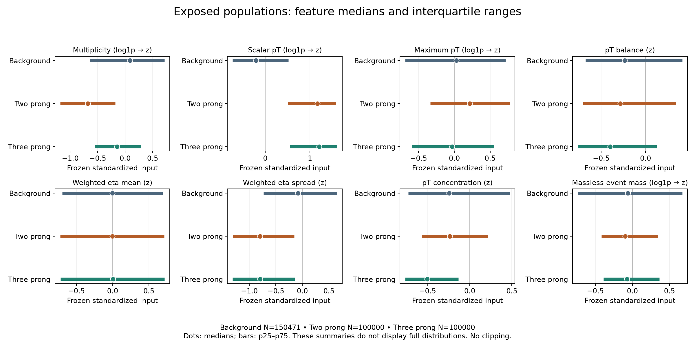
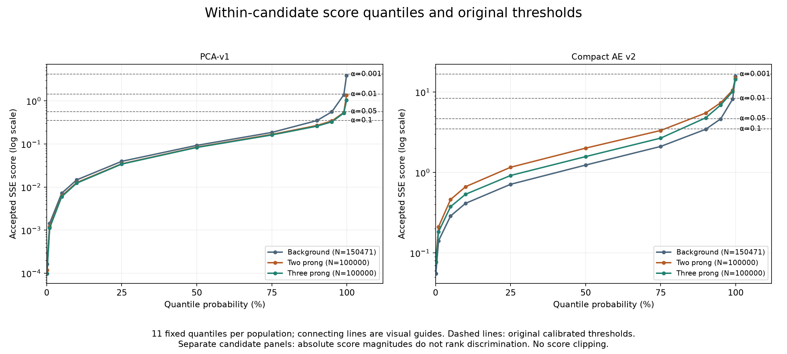

# Exploratory frozen-feature and score-tail diagnostics

Task0033, 2026-10-12 Europe/Rome. **One authorized session completed and was parent-accepted.** These are exploratory, result-informed descriptions of already exposed samples. [Task0032](two-three-prong-synthesis.md) remains the completed frozen baseline synthesis. This task does not reopen evaluations, repair tails or provide independent confirmation.

[Curated summary and input provenance](../results/tables/final/task0033-exploratory-feature-score-summary.json), [actual authorization prompt](prompts/0033-exploratory-feature-score-diagnostics.md), [handoff](handoffs/0033-exploratory-feature-score-diagnostics.md), [protocol](../configs/diagnostics/exposed_feature_score_v1.json).

## Questions, inputs and alignment

The four fixed questions concern eight input-feature marginals across background/two-prong/three-prong populations; six within-candidate score marginals; 48 within-population monotonic feature–score associations; and profiles at each candidate’s four original calibrated thresholds. No subgroup search, feature selection, perturbation, fitting, forwards, new reconstruction, alternative score, inversion, recalibration, operating-threshold search, AUC/AP, ROC/PR, significance or downloads occurred.

Original inputs are only the full store’s manifest/configuration, frozen standardized `event_features`, split codes, source IDs and labels. A separate adapter checks original scientific identity `d12574e9…e12d2`, manifest-recorded file size/dtype/shape/SHA256 and configuration/split bindings. It never constructs `ProcessedStore`, scans particles/physical aggregates or opens fingerprints. Whole-file hashing is byte custody, not numerical feature-population access.

Numerical membership validation loads split codes, source IDs and labels once each, with 1100000 records per array. Codes4/5 select 150471 background and100000 two-prong positions **before feature values are accessed**. All source IDs are complete ascending0…1099999; labels and every role count agree with the frozen manifest. For both candidates, every accepted Task0026 batch count and first/last source ID matches the selected order, including tails3015/1696. The accepted original store/configuration is also bound by the original unblinding ledgers and evaluation receipts. Byte-pinned, unchanged historical reader/evaluation code establishes how that complete ascending order was stored in score arrays. Length equality is only one check.

Three-prong inputs are the accepted prepared manifest and100000×8 FP32 feature array, scientific identity `089f6c2c…2e622`, feature SHA256 `3059ff96…7f93`. Task0031’s accepted preparation retains all source rows0…99999, verified signal labels, complete valid/nonempty population and the original transformation. Both score receipts bind that same prepared identity and complete24×4096+1696 source order. Accepted acquisition/preparation lineage is inherited without reopening raw data or fingerprints.

Exactly six stored FP64 arrays are numerically loaded: Task0026 PCA/AE background/two-prong and Task0031 PCA/AE three-prong. All have exact lengths, finite nonnegative scores and the six prompt-pinned hashes. Parent/receipt outputs are checked using explicit basename or repository-relative keys; ambiguous or missing identities fail. All used operational metadata also agrees with the accepted curated Task0026/0031 receipt registries. No scoring is rerun to manufacture alignment.

## Observed feature descriptions

The inputs are **frozen standardized coordinates**, never GeV/radians. Multiplicity, scalar pT, maximum pT and massless event mass received the original log1p transformation before standardization. No scaler was refitted and no rounded inputs were inverted to approximate physical variables. Descriptions accumulate in FP64 from the existing FP32 values; standard deviation is population std (`ddof=0`) and quantiles use linear interpolation at0.001/0.01/0.05/0.10/0.25/0.50/0.75/0.90/0.95/0.99/0.999.

[Complete feature table](../results/tables/final/task0033-feature-marginals.csv) has24rows with count/mean/std/min/max/all11quantiles. The following cells show median[p25,p75], rounded for display. Background N=150471; each signal N=100000.

| Frozen input | Background | Two prong | Three prong |
| --- | --- | --- | --- |
| multiplicity (log1p → z) | 0.088 [-0.638, 0.718] | -0.680 [-1.183, -0.181] | -0.146 [-0.557, 0.289] |
| scalar_pt (log1p → z) | -0.208 [-0.729, 0.519] | 1.164 [0.503, 1.579] | 1.208 [0.551, 1.608] |
| max_pt (log1p → z) | 0.027 [-0.687, 0.717] | 0.214 [-0.338, 0.772] | -0.033 [-0.596, 0.553] |
| pt_balance (z) | -0.235 [-0.677, 0.413] | -0.286 [-0.707, 0.342] | -0.400 [-0.765, 0.126] |
| weighted_eta_mean (z) | -0.002 [-0.693, 0.690] | -0.005 [-0.724, 0.713] | 0.004 [-0.720, 0.717] |
| weighted_eta_std (z) | -0.083 [-0.732, 0.655] | -0.797 [-1.310, -0.154] | -0.795 [-1.313, -0.141] |
| pt_concentration (z) | -0.245 [-0.727, 0.474] | -0.239 [-0.570, 0.212] | -0.506 [-0.766, -0.133] |
| massless_event_mass (log1p → z) | -0.064 [-0.737, 0.671] | -0.098 [-0.417, 0.344] | -0.074 [-0.389, 0.362] |

Two prong has a lower multiplicity median than three prong (−0.680 versus−0.146); three prong has lower concentration (−0.506 versus−0.239), lower maximum-pT median and lower balance median. Both signals have elevated scalar-pT inputs relative to background and very similar eta-spread medians (−0.797/−0.795). Their weighted eta means remain centered near zero, and central mass-coordinate ranges overlap. These similarities are informative ambiguity: they do not support a simple single-marginal explanation of the topology difference.

Dots are medians and bars are IQRs, with per-panel horizontal scales. No clipping is applied; neither these intervals nor11quantiles display a full distribution.

## Observed score descriptions

[Complete score table](../results/tables/final/task0033-score-marginals.csv) has6rows under the same conventions. All overlapping count/mean/std/min/max/median/p90/p95/p99/p99.9 statistics match the two accepted historical background summaries. Existing accepted artifacts provide no corresponding signal marginal summaries; agreement is not invented. Scores are accepted eight-channel SSE accumulated in FP64 from the original forward paths; comparisons of absolute PCA and AE magnitudes cannot rank discrimination.

| Candidate | Population | Mean | Median | p99 | p99.9 |
| --- | --- | ---: | ---: | ---: | ---: |
| PCA | background | 0.170173 | 0.092717 | 1.381558 | 3.885565 |
| PCA | two_prong | 0.120356 | 0.084291 | 0.536754 | 1.353559 |
| PCA | three_prong | 0.116102 | 0.082806 | 0.520558 | 1.041698 |
| AE | background | 1.703215 | 1.237087 | 8.189167 | 15.720911 |
| AE | two_prong | 2.639073 | 2.008749 | 10.554075 | 15.001871 |
| AE | three_prong | 2.225642 | 1.576639 | 10.154344 | 14.419351 |

Within PCA, both signal score medians/upper quantiles are lower than background. Within AE, the signal medians exceed background, with two prong above three prong; at p99.9 the background exceeds **both** signals (15.721 versus15.002/14.419). A central score shift therefore coexists with weak strict-tail acceptance. This describes existing arrays without new ranking metrics, full ROC/PR or a selected operating point.

Separate candidate panels use logarithmic score axes and all11fixed probabilities, with original calibrated thresholds. Connecting lines only guide the eye between quantiles; there is no score clipping or interpolated ROC.

## Observed feature–score associations

[All48coefficients](../results/tables/final/task0033-feature-score-associations.csv) use stable sorting, average ranks for ties, centered-rank covariance and rank variances. There is no significance API, p-value or confidence interval. All operational variables are finite/nonconstant; none is undefined. The code returns explicit null/reason for constant or insufficient synthetic inputs. The24ranked feature vectors are reused for both candidates.

| Frozen feature | PCA background | PCA two | PCA three | AE background | AE two | AE three |
| --- | ---: | ---: | ---: | ---: | ---: | ---: |
| multiplicity | 0.0139 | -0.0997 | -0.0443 | -0.1430 | -0.4109 | -0.2985 |
| scalar_pt | -0.0237 | -0.1688 | -0.1712 | 0.0158 | 0.0433 | 0.0993 |
| max_pt | 0.0590 | 0.2219 | 0.1611 | 0.1722 | -0.1768 | -0.1305 |
| pt_balance | 0.0043 | 0.0183 | 0.0106 | 0.1824 | 0.0755 | 0.0127 |
| weighted_eta_mean | 0.0002 | 0.0007 | -0.0002 | -0.0093 | -0.2525 | -0.2859 |
| weighted_eta_std | 0.1384 | 0.1788 | 0.2045 | -0.0255 | -0.2530 | -0.2811 |
| pt_concentration | -0.0112 | 0.0804 | 0.0734 | 0.1824 | -0.0907 | -0.0857 |
| massless_event_mass | 0.1407 | -0.0097 | 0.0086 | 0.0265 | -0.1653 | -0.1437 |

PCA associations are generally small; signal maximum-pT/eta-spread coefficients are positive and scalar-pT coefficients negative. AE’s multiplicity coefficient is−0.411 for two prong and−0.299 for three prong. Signed weighted eta mean and eta spread have negative signal associations, approximately−0.25 to−0.29, despite similar centered eta marginals. Background associations are smaller/different. Global PCA concentration correlation is−0.011, which does not exclude a distinctive extreme-tail concentration profile. These are monotonic associations, not feature importance, isolated effects or attribution to reconstruction channels.

Three figures were generated and visually inspected. The association heatmap’s colorbar overlaps two columns. That figure is excluded from curation and retained unchanged in the ignored operational namespace. Both readable figures above and the complete coefficient table are delivered. No additional worker/replot, source correction or plan mutation was made after reservation.

## Original-threshold tails

[All24count rows](../results/tables/final/task0033-tail-counts.csv) give denominator/count/fraction, exactly matching Task0032. Only strict `score > threshold` is used; ties are rejected. The target α labels the original background calibration target, not a signal target or a newly achieved rate.

| Candidate | Original α sequence | Original thresholds in the same order |
| --- | --- | --- |
| PCA | 0.1 /0.05 /0.01 /0.001 | 0.3496768162794852 /0.5642097175249418 /1.4232146905138892 /4.1356483360291865 |
| AE | 0.1 /0.05 /0.01 /0.001 | 3.478338537407165 /4.681070974717348 /8.324174660133213 /16.642218868621573 |

| Candidate | Population / denominator | Counts at α=0.1 /0.05 /0.01 /0.001 |
| --- | --- | --- |
| PCA | background /150471 | 14922 /7362 /1416 /124 |
| PCA | two_prong /100000 | 4620 /852 /90 /2 |
| PCA | three_prong /100000 | 3942 /762 /43 /1 |
| AE | background /150471 | 14793 /7357 /1424 /116 |
| AE | two_prong /100000 | 23217 /13608 /3298 /56 |
| AE | three_prong /100000 | 16438 /10326 /2662 /34 |

[All192feature-profile rows](../results/tables/final/task0033-tail-feature-profiles.csv) retain every count and suppression flag. For counts≥20, mean/median/p25/p75 use reused in-memory features. Exactly16feature rows are suppressed: all eight channels of PCA’s strict two-prong slice(N=2) and strict three-prong slice(N=1). Their summary values are null, with reason `small_tail_descriptive_summary_suppressed`; no singleton feature vector is exported or discussed. The20event rule is a reporting convention, not a confidence guarantee.

The four reportable strict slices have these illustrative **frozen standardized medians**; all other channels and original cuts remain in the complete table.

| Slice | N | Multiplicity | Scalar pT | Balance | Weighted eta mean | Eta spread | Concentration |
| --- | ---: | ---: | ---: | ---: | ---: | ---: | ---: |
| PCA background | 124 | -1.810 | -0.517 | 0.030 | 0.185 | -0.238 | 5.494 |
| AE background | 116 | -0.468 | -0.910 | 3.298 | -0.062 | 1.366 | 0.717 |
| AE two_prong | 56 | -1.025 | 0.292 | 7.021 | -0.990 | -1.453 | -0.184 |
| AE three_prong | 34 | 0.197 | 2.188 | -0.138 | -1.862 | -1.471 | -0.423 |

Strict PCA background has elevated concentration(median5.494) and maximum-pT(median2.087), with low multiplicity. Strict AE background has elevated balance(median3.298) and eta spread(median1.366); strict two prong has balance median7.021, with a broad IQR0.739–11.592. Strict three prong instead has balance median−0.138, scalar-pT median2.188 and signed eta mean median−1.862. Both signal tails have low eta spread, approximately−1.45/−1.47. These descriptive profiles demonstrate heterogeneity and leave the residual mechanism unresolved. Rare combinations, feature covariance, model geometry and simulation/population differences are alternatives; global Spearman coefficients do not describe all local tail behavior.

Historical weak utility remains: strict AE retains56/100000 and34/100000 signal versus116/150471 background. Task0032’s selected mixture fractions32.5581%/22.6667% remain below39.9248% initial signal prevalence. These are preserved baseline descriptions, not repaired utility or new significance results.

## Access, validation and lifecycle

Actual new accesses are3feature-population requests/350471rows and6score-array loads/700942values, plus3membership arrays/3300000metadata records. One original feature mapping accesses only the two selected test populations; prepared features retain all100000three-prong rows. There are24feature rankings and6score rankings, reused in memory. The reporting worker opens only five owned aggregate CSVs. Four explicit input integrity sweeps(freeze/prerequisites/analysis/finalization) each check39files and11NPYheaders; additional source/lineage/output hashing is byte custody. The11NumPy loading calls also parse headers; internal mapping/header rereads do not represent extra population requests. No event arrays or membership extracts are exported.

Current-source acceptance binds200source/config/test files and43installed packages, the protocol, accepted inputs and actual saved prompt. Plan canonical SHA256 is `04325edc2c6573b1597bc2104701b99527ea38ac1105dc4ca0780d8c49ae4583`. Validation:90new specific tests;179focused including reused clock/assertion tests;1728full and1728portable(41.53/40.98s), lint/format/dependency checks pass. Full/portable suites run in artifact-free source copies with the existing synthetic legacy-schema plugin, preventing operational model/sample access. Native synthetic integration is parent-accepted in8.581950s with an active/released assertion. A preliminary script-path import failure was corrected before freeze; synthetic-only evidence is retained. No physical host-suspension test or hosted CI success is claimed.

| Scope | Continuous measured seconds | Ceiling |
| --- | ---: | ---: |
| Prerequisites before reservation | 0.124773 | 60 |
| Analysis parent dispatch through normal exit/reaping | 0.555118 | 120 including≤2cleanup |
| Aggregate reporting parent dispatch through normal exit/reaping | 8.043751 | 60 including≤2cleanup |
| Parent finalization | 0.082993 | 15 |
| Reserved session | 8.778443 | 240 |
| Whole invocation including prerequisites | 8.904391 | Separate scopes above |

Both workers exit0, are reaped and pass source/output identities, deadlines and resource checks; body-complete receipts alone are insufficient. The Task0033 guard explicitly enforces1GiB RSS, with512MiB native reservations and128MiB controller caps. Peaks: analysis121.171875MiB RSS/68.40625MiB native; reporting128.078125MiB RSS/94.046875MiB native; controller29.21875MiB. All296observed pressure samples are WARN, treated as advisory; no CRITICAL/unknown/invalid-primary-accounting sample or latch. Global available RAM is contextual, never admission. Source/output/log/access bounds are declared; final operational storage is1437787bytes, far below256MiB. No whole source-store copy or per-event diagnostic export.

Resource monitoring is sampled: maximum query-start gaps56.367/76.217ms; terminal unaccounted intervals28.181/79.903ms after monitor closure. Parent supervision continues through reaping, but there is no continuous hard memory certificate. Continuous deadlines include suspension; session overshoot0. Owned guard cleanup is within2s. The caffeinate-i-w assertion has seven active observations, permits display sleep, and is released/reaped with owned assertion absent at2026-10-12T08:47:53.103030Z(10:47:53 Europe/Rome). No persistent power setting changed.

All three populations remain permanently model/evaluation exposed: YES/YES/YES. New model forwards/reconstruction/AUC-AP-or-significance/fingerprint numeric loads/optimizer/downloads are each0. These numerical diagnostic reads are new and explicitly authorized; they must never be reported as zero numerical access. Operational arrays, logs, ledgers, receipts, acceptances and plan remain ignored; only curated aggregates/two figures and source/docs belong in a manual commit. All historical scientific artifacts/parameters/thresholds and failed/consumed campaigns are preserved.

## Plausible interpretations, unresolved mechanisms and next decision

The frozen representation and existing score response are compatible with different aggregate regimes across topologies and tails. That is a hypothesis-generating interpretation, not evidence that a specific feature causes poor utility. Quantiles omit joint structure and distribution shapes; ranks omit nonlinear/nonmonotonic relationships; no residual channel is recomputed or attributed. Similar eta spread/scalar-pT signal marginals coexist with distinct score distributions. Signed eta associations also coexist with centered feature marginals. Neither establishes a mechanism, and capacity6PCA/3AE remains unequal. The background is shared, samples are preselected simulation, and no independent generalization or physical trigger rate is measured.

Supported decision: preserve the complete baseline and this exploratory evidence. Before any result-informed model/representation development, define a separately authorized protocol using independent confirmation populations, frozen prospective questions and capacity/representation controls. Do not select a favorable feature, candidate or threshold from these results. Exposed samples cannot be reblinded by reshuffling; no Task0034 or proposed test is launched.

| Observation | Possible interpretation | Alternative explanation | Future independent test to distinguish them |
| --- | --- | --- | --- |
| Lower two-prong multiplicity and AE rho−0.411 versus−0.299 | Existing score responds to event composition | Covariance with other inputs or unequal representation capacity | Prespecified matched-regime comparisons and capacity controls on independent populations, with models frozen before confirmation |
| Centered eta marginals but negative signed eta associations/three-prong tail median−1.862 | Score may have an asymmetric response to signed coordinates | Population correlations, nonlinear interactions or simulation conventions | Prospectively specified symmetry contrasts and channel-residual diagnostics on independent samples; no current perturbation |
| Weak global PCA concentration rho yet strict-background median5.494 | Extreme combinations may differ from global monotonic behavior | Other residual channels or joint covariance select the same rows | Fixed-threshold joint/residual profiles under a new authorized independent protocol |
| AE central signal shift but background p99.9 above both signals | Rare background regimes compete with the supplied signals in the strict tail | Score geometry, capacity or signal-specific simulation coverage | Independent background and signal confirmation with prespecified tail-count criteria; no threshold optimization |
