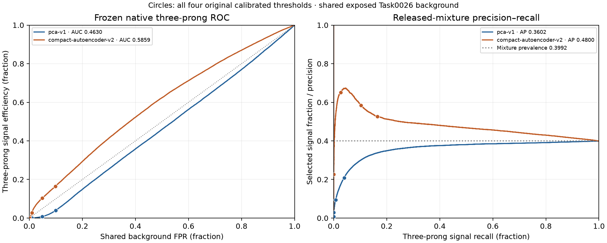

# Frozen local three-prong scientific evaluation — Task0031

## Abstract

**One authorized campaign completed, accepted and consumed.** All 100000 pinned local three-prong events pass numerical custody, label/axis/particle validity, exact within-source uniqueness and all-role original-fingerprint disjointness. Frozen AE v2 retains a modest observed advantage over PCA-v1, but both rank this sample worse and accept less signal at every frozen threshold than in the accepted two-prong study. AE strict-tail efficiency is 0.00034 versus shared background FPR 0.0007709127: no observed enrichment in that selected evaluated mixture. This is a signal-topology comparison with reused exposed background, not independent background generalization or physical trigger validation.

[Summary and full identities](../results/tables/final/task0031-local-three-prong-evaluation-summary.json), [scientific CSV](../results/tables/final/task0031-three-prong-scientific-comparison.csv), [calibrated CSV](../results/tables/final/task0031-three-prong-calibrated-operating-points.csv), [empirical CSV](../results/tables/final/task0031-three-prong-empirical-operating-points.csv), [two-/three-prong comparison](../results/tables/final/task0031-two-vs-three-prong-comparison.csv), [protocol](../configs/evaluation/frozen_three_prong_local_v2.json), [actual prompt](prompts/0031-local-three-prong-evaluation.md), [handoff](handoffs/0031-local-three-prong-evaluation.md).

## Research question, data and frozen method

Does the observed native PCA/AE ranking and calibrated utility persist for the declared three-prong signal, under the unchanged aggregate representation and thresholds? Task0030 supplied the read-only accepted Zenodo6466204 corrected R&D v5 file, 235488994 bytes, publisher MD5 `54e123a86143b668f9cb76905152a124`, local SHA256 `063fff3547d17bf4f36a40109e940ac6990105a0fe33a79f4f7c630905dd0742`. The acquisition manifest, accepted parent, source, protocol and integrity receipts are bound together. No download or source refresh occurs.

The complete pandas-fixed FP64 [100000,2101] source is scanned in original order: 100 chunks of992 plus800 tail. Column/item arrays equal0…2100; row axis equals0…99999; all last-column labels are1. All100000 events are finite, nonempty and satisfy the unchanged pT/padding rules. Every invalidity category is zero. No filtering, deduplication, reordering or favorable subset is used. Exact original FP64 count/triplet fingerprints preserve signed-zero normalization, phi wrapping and ordering: duplicates0, overlap0 against all1100000 original-role V32 fingerprints. This gate establishes exact fingerprint disjointness, not complete statistical or simulation independence.

The eight ordered features remain multiplicity, scalar pT, max pT, pT balance, weighted eta mean/std, pT concentration and massless-event mass. Exact transformation: validate/sort/wrap sourceFP64 → original physicalFP32 storage for all particles → full-event FP64 aggregate accumulation → frozen log channels0/1/2/7 and training-fitted scaler → finalFP32 features. Aggregates precede object truncation; no more-precise substitute path is introduced. Prepared features/fingerprints and a distinct scientific manifest are persisted. Genuine original processed-store metadata validates model training provenance; the new source passes a separate compatibility contract.

Candidates remain PCA-v1 (six centered non-whitened FP64 components) and compact-AE-v2 (8→6→3→6→8,155FP32 parameters,nativeCPU). Canonical eight-channel SSE casts input/reconstruction toFP64 before subtraction; higher scores mean more anomalous; every calibrated decision is strict `score > threshold`. No fitting, optimizer step, recalibration, inversion, candidate/threshold selection or extra parity forward occurs. Stable effective PyTorch/BLAS/OpenMP threads1 and parameter hashes before/after are recorded.

## Accepted scientific results

| Candidate | Two-prong ROC-AUC | Three-prong ROC-AUC | Two-prong AP | Three-prong AP |
| --- | ---: | ---: | ---: | ---: |
| pca-v1 | 0.468488658 | 0.462953133 | 0.364379155 | 0.360220298 |
| compact-autoencoder-v2 | 0.660063803 | 0.585877115 | 0.547427268 | 0.479971652 |

Each evaluated mixture uses100000signal and150471cached background: prevalence0.3992478171125599 (39.9247817113%). AP depends on this mixture; it is not a physical LHC signal rate. PCA AUC below0.5 is reported under the frozen orientation without inversion. AE has higher observed ranking and more accepted signal at all four frozen thresholds for this sample. Both candidates have lower AUC/AP and signal acceptance than with the accepted two-prong signal; no significance or causal-topology test is added.

## Calibrated utility: every original threshold

Rates and Wilson intervals below are percentages; nominal targets are fractions. Background denominator150471, signal denominator100000 throughout. Rejection is finite inverse achieved FPR. Full precision is in the CSV.

| Candidate | Nominal target | Frozen threshold | BG accepted | FPR% [Wilson95%] | Signal accepted | Efficiency% [Wilson95%] | Rejection | TPR/FPR | Selected signal% |
| --- | ---: | ---: | ---: | --- | ---: | --- | ---: | ---: | ---: |
| pca-v1 | 0.1 | 0.3496768162794852 | 14922 | 9.916861 [9.766864,10.068905] | 3942 | 3.942000 [3.823151,4.064387] | 10.0838 | 0.397505 | 20.896947 |
| pca-v1 | 0.05 | 0.5642097175249418 | 7362 | 4.892637 [4.784791,5.002787] | 762 | 0.762000 [0.709962,0.817821] | 20.4389 | 0.155744 | 9.379616 |
| pca-v1 | 0.01 | 1.423214690513889 | 1416 | 0.941045 [0.893498,0.991097] | 43 | 0.043000 [0.031927,0.057911] | 106.2648 | 0.045694 | 2.947224 |
| pca-v1 | 0.001 | 4.135648336029186 | 124 | 0.082408 [0.069128,0.098237] | 1 | 0.001000 [0.000177,0.005665] | 1213.4758 | 0.012135 | 0.800000 |
| compact-autoencoder-v2 | 0.1 | 3.478338537407165 | 14793 | 9.831130 [9.681718,9.982593] | 16438 | 16.438000 [16.209582,16.668997] | 10.1718 | 1.672036 | 52.633601 |
| compact-autoencoder-v2 | 0.05 | 4.681070974717348 | 7357 | 4.889314 [4.781503,4.999429] | 10326 | 10.326000 [10.138919,10.516129] | 20.4528 | 2.111953 | 58.395069 |
| compact-autoencoder-v2 | 0.01 | 8.324174660133213 | 1424 | 0.946362 [0.898679,0.996549] | 2662 | 2.662000 [2.564035,2.763602] | 105.6678 | 2.812878 | 65.149290 |
| compact-autoencoder-v2 | 0.001 | 16.64221886862157 | 116 | 0.077091 [0.064285,0.092447] | 34 | 0.034000 [0.024333,0.047506] | 1297.1638 | 0.441036 | 22.666667 |

The two background arrays are numerically loaded once each after byte/header/lineage checks, then checked finite/nonnegative. Counts exactly reproduce Task0026: PCA14922/7362/1416/124, AE14793/7357/1424/116. FPRs and background Wilson intervals are shared historical measurements, not independent repeats; new original-background forward passes0. Reporting loads two newly owned curve archives, never the original caches again. Original two-prong signal is accessed only through accepted aggregate CSVs.

Preregistered descriptive arithmetic: relative acceptance = signal efficiency / achieved background FPR; selected signal fraction = accepted signal / (accepted signal + accepted background). Zero denominators produce null rather than invented values. These are accepted-count descriptions, not physical purity, significance or confidence intervals for a ratio. At the strict AE point,34/100000=0.00034 versus116/150471=0.0007709126675572038; relative acceptance0.4410356897 and selected34/150=22.6667%, below initial39.9248%. PCA accepts1signal/124background. Avoid multiplicative headlines based on that single accepted PCA event. The first three AE points show observed enrichment within this mixture; the strict point does not. No threshold is selected as a winner.

Wilson95% intervals summarize conditional rates and exclude calibration, model and simulation uncertainty. No AUC/AP interval, model-difference interval, ratio interval, significance scan, hypothesis test or subgroup search is constructed.

## Descriptive empirical ROC evidence

The empirical CSV retains all four target-FPR attainable points and background acceptance at TPR50/80/90%. It preserves accepted plateau/tie rules, nextafter strict-threshold representation and discrete attainable sets without interpolation. These empirical cutoffs do not replace original calibrated thresholds.

| Descriptive target signal efficiency | PCA background acceptance% | AE background acceptance% |
| --- | ---: | ---: |
| 50% | 54.044965 | 37.871749 |
| 80% | 82.757475 | 70.582371 |
| 90% | 91.560500 | 84.227526 |



Full empirical curves from owned accepted artifacts; circles are all four frozen calibrated thresholds in both panels. Axes use fractions; dotted references are TPR=FPR and the evaluated-mixture prevalence. Near-origin strict points are resolved numerically in the operating table. No AUC/AP statistical error bars. Synthetic and accepted figures were visually inspected. The [accepted two-prong ROC/PR](../results/figures/final/task0026-pca-ae-roc-pr.png) remains unchanged.

## Supported interpretation and limits

Observed AE advantage persists across these two declared signal samples, but is weaker on the three-prong sample and has weak strict-tail utility in both. Shared background means this campaign measures signal-topology performance against the same exposed reference, without fresh background generalization or an independent replication of FPR. Simulation provenance and exact disjointness do not establish complete independence or rates transportable to real LHC events.

Six PCA retained dimensions versus three AE latent dimensions and155parameters prevent isolating the causal effect of nonlinearity. Residual magnitudes also do not rank scientific utility directly. Representation, bottleneck and score-distribution explanations remain untested hypotheses; this campaign measures no feature-level bias or subgroup mechanism. Other signals/populations, capacity-controlled comparisons and physical deployment remain open.

The [accepted Task0022 CPU benchmark](frozen-cpu-benchmark-v2.md) remains historical cost context: public prepared-feature adapter B1 median of three worker p50s8.125µsPCA/24.708µsAE. It excludes raw loading/preprocessing; canonical scientific quality here is B4096, not quality independently measured at every cost batch. Current campaign times include custody, metrics, guards and figures and are not an inference benchmark. Task0025 ratios remain provisional/unaccepted; no CPU/MPS/export/precision/streaming/particle experiment is added.

## Access, continuous lifecycle and resources

One raw numerical custody and preparation of100000rows; column/items4202values plus row-axis100000values checked separately. One original fingerprint numerical load1100000records. Two candidate constructor/provenance checks; two new signal model requests,25batches each =24×4096+1696,50batches/200000scored presentations/100000unique new events. Two background-cache loads/300942scores; zero new background forwards and zero original signal numeric loads. No uncertain inflight remains. Byte/header/hash checks are separately scoped.

| Stage | Parent-observed continuous seconds | Ceiling | Exit/reaping/parent |
| --- | ---: | ---: | --- |
| prepare | 13.821576 | 180s | 0 / reaped / accepted |
| PCA | 2.452941 | 120s | 0 / reaped / accepted |
| AE | 2.267475 | 120s | 0 / reaped / accepted |
| consolidate | 9.886448 | 60s | 0 / reaped / accepted |

Prerequisites0.548813s, finalization0.506377s, reserved29.058839s≤600s, controller including prerequisites29.607650s. Ordinary monotonic29.607650417s, negligible continuous discrepancy, overshoot0. Cleanup2s slack stays inside each ceiling; post-publication continuous acceptance check passes. Offline documentation curation is outside that campaign timing.

Task0030 native mach_continuous_time with integer125/3 timebase→ns governs grants/guards/IO/hash/supervision/cleanup/acceptance; ordinary monotonic andUTC are diagnostic. Reused supervisor and termination helpers were inspected for hard-coded acquisition paths/monotonic-only enforcement. Late exit0 is rejected. Software cannot terminate a sleeping host; suspension overshoot must be disclosed and rejected.

Temporary caffeinate-i-w controllerPID assertion is active before reservation and monitored:7active parent observations, helper23679, controller23678, confirmed releaseUTC2026-10-11T17:28:53.442918+00:00, helper−15/reaped/owned assertion absent. Display sleep permitted; no persistent power setting/app/admin/user-activity change. Manual sleep/lid closure remains possible.

Observed maximum workerRSS537083904B(512.203125MiB), native reservation322781184B(307.828125MiB), stdlib parent31522816B(30.0625MiB), helper sampled3227648B(3.078125MiB). Worker ceilings6GiB RSS/512MiB native, parent128MiB pass.1498WARN advisory samples,0CRITICAL/unknown/latched failures. Global available RAM2.807–2.889GiB is context only. Terminal monitoring gaps prepare0.468708/PCA0.337721/AE0.231515/consolidate0.283458s remain disclosed; sampled guards are not continuous/lifetime-complete coverage or hard-real-time guarantees.

Fixed storage budget385875968B under536870912B required free: prepared arrays, two score/curve groups, reporting, four64MiBguard journals, four1MiBaccess/log groups and metadata slack. Actual space check passes; operational arrays, access ledgers, receipts, logs and acceptances remain ignored.

## Validation and artifact provenance

Before operational science:87new synthetic cases,1590full/1590portable tests(51.52/50.02s), lint/263-file formatting/dependencies pass. Portable copy excludes data/artifacts/sources/.git/.venv; unchanged old CPU/MPS fixture plugin. Native supervised synthetic integration2.785279s, exit0/reaped, stable threads, figure and active/released assertion, no operational populations/models. Suspensions use injected clocks; no host-sleep experiment. An initial exact-float fixture assertion was corrected to tolerance; preliminary records retained, final source map unchanged from accepted suites. No hosted CI success claimed.

All153historical source/dependency bindings remain identical;161current bindings have fresh Task0031 software acceptance. Original models/scaler/calibration/store/accepted results and Task0030 bytes/receipts are pinned. New code is not covered by the historical1503-test or1259-test scientific acceptance. Protocol/plan canonical hashes and file-byte hashes are separate. Actual human prompt authorizes prospective conditional scope and is bound to finalized source/acceptance/plan; exact postimplementation-hash human approval isFalse.

Protocol canonicalSHA `25d862a0f77074cb8f476ea3cc445b2c9469db1f1e65ec289899719a556b0244`; plan canonicalSHA `1b10e4fedbe572a4514f147842a4f5a7967099d6ad1c46f6a6ad98dcecb99125`; acceptance fileSHA `3ff512e210b5ffdf29f82a55443fd840629dc3aa4bd5677421618bcf65c41c07`. Prepared scientificSHA `089f6c2c168a999fd0eaeca68414bc19633a0454e2981f9bc30e21a4dd22e622`. Full candidate/config/calibration/transform/cache/source/prepared/output/receipt hashes are in the summary. All four worker bodies are provisional until normal exit/reaping and independent parent acceptance; only the accepted complete campaign is curated here.

```yaml
original_test_background model/evaluation accessed: YES
original_test_signal model/evaluation accessed: YES
new_three_prong_signal model/evaluation accessed: YES
numerical_preparation_rows: 100000
original_fingerprint_numeric_loads: 1
cached_background_numeric_loads: 2
new_signal_model_requests: 2
new_signal_batches: 50
new_signal_scored_presentations: 200000
new_original_background_forward_calls: 0
original_signal_numeric_loads: 0
optimizer_updates: 0
downloads: 0
```

OriginalYES/YES preserves Task0026 exposure; newYES records actual Task0031 model access. These samples cannot be reblinded or treated as untouched tuning sets. Task0028/0029 consumed failures and Task0030 accepted acquisition remain historical records. Task0025 remains failed/consumed/provisional; particle192/192consumed and canonical-deferred. No automatic Git operation or subsequent task occurs.

## Justified next step

An offline integrated two-/three-prong synthesis using these accepted aggregates and Task0022 scoped CPU costs would clarify how stable the sampled quality/cost tradeoff is and highlight weak strict-tail utility. It requires no new population access, scoring or fitting. Broader scientific or model-development extensions need an explicit methodological decision and independent evaluation protocol/population; no training, optimization or evaluation successor is launched.
