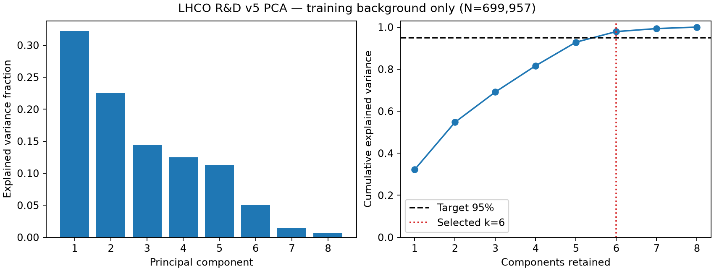
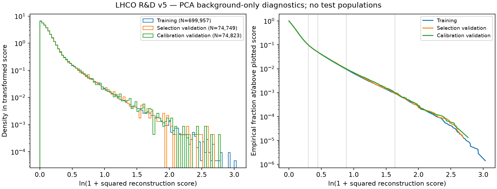

# PCA reconstruction baseline — Task 0006

**Status: fitted and frozen using background only. No real test-signal performance
was inspected during Task 0006. No real test-background model scores were read.**

The common [evaluation protocol](evaluation-protocol.md) defines split, threshold,
metric and unblinding rules. Numeric report tables are snapshots from
[the curated scientific results](../results/tables/final/task0006-pca-background-results.json).
The [model configuration](../configs/models/pca_baseline.json) records modeling
choices; it contains no fitted signal/test results.

## Purpose and input representation

Establish a transparent first anomaly score before autoencoders/particle models.
Inputs are the existing eight standardized FP32 full-event aggregate channels:
`multiplicity, scalar_pt, max_pt, pt_balance, weighted_eta_mean, weighted_eta_std,
pt_concentration, massless_event_mass`. Task 0004 fitted preprocessing on training
background; Task 0005 generated these vectors using all canonical particles,
not truncated views. No features/scalers were redefined or refitted.

The guarded feature-only reader avoids loading ragged particle records. Every
background population request records its role/count and disabled test/label
access. Full-store integrity checks may read the complete artifact for hashing
and structural validation; they do not score test events or unblind performance.

## Training protocol and component rule

Use scikit-learn PCA, deterministic full SVD, float64 fit, internal mean centering,
no whitening and no randomized solver. Internal PCA centering is a model parameter;
it does not replace the frozen preprocessing scaler. All events have equal weight.
The complete eight-component spectrum is fitted on 699,957 train-background events.

The candidate target of 95% was specified before validation/signal diagnostics. Inspecting
the training spectrum confirms it yields a nonpathological reduced subspace:
select the **smallest k whose training cumulative variance is >=95%**. Full-rank
selection fails for policy review rather than silently producing zero residuals.
No search over validation/test AUC or k was performed. scikit-learn's mature
[PCA implementation](https://scikit-learn.org/stable/modules/generated/sklearn.decomposition.PCA.html)
provides fitted axes and sample-covariance variances; the explicit >= selection
rule avoids depending on the library's fractional-n_components boundary convention.

## PCA spectrum

| Component | Explained variance ratio | Cumulative |
| ---: | ---: | ---: |
| 1 | 0.321932423 | 0.321932423 |
| 2 | 0.225297891 | 0.547230314 |
| 3 | 0.143915339 | 0.691145653 |
| 4 | 0.125000234 | 0.816145888 |
| 5 | 0.112100547 | 0.928246435 |
| 6 | 0.050454430 | 0.978700865 |
| 7 | 0.014317469 | 0.993018334 |
| 8 | 0.006981666 | 1.000000000 |

**Selected k=6**; retained variance
**97.870086%**.
Five components retain only 92.824643%.
The baseline removes two directions; it is a modest linear representation,
not a claim of anomaly sensitivity or aggressive hardware optimization.



## Anomaly score

For standardized x in R8, fitted mean mu and first k orthonormal axes W:

\[
\hat x=\mu+W^\top W(x-\mu),\qquad s(x)=\sum_{j=1}^8(x_j-\hat x_j)^2.
\]

W stores axes as rows. The score is **squared L2 residual, not mean squared error**;
higher means more anomalous. Scoring is float64 with bounded feature batches.
No label, source ordinal, split, particle slot or mask is a model input.

## Background-only validation

| Population | N | Mean | Std | Min | Median | p90 | p95 | p99 | p99.9 | Max |
| --- | ---: | ---: | ---: | ---: | ---: | ---: | ---: | ---: | ---: | ---: |
| train_background | 699957 | 0.17039308 | 0.32649283 | 6.2298524e-08 | 0.092929434 | 0.34665087 | 0.55923048 | 1.3908934 | 4.0118847 | 19.732762 |
| validation_selection_background | 74749 | 0.17224552 | 0.3307744 | 1.3939337e-06 | 0.093442093 | 0.34794822 | 0.5627889 | 1.4278172 | 4.0058473 | 13.790413 |
| validation_calibration_background | 74823 | 0.17282825 | 0.3370285 | 2.7165359e-06 | 0.093751415 | 0.34967141 | 0.56420503 | 1.4231737 | 4.1182852 | 14.886826 |

The distributions have right tails but finite stable moments, not an observed
numerical pathology. Maxima differ with sample size. No clipping/tail fitting
was applied. The training mean residual matches the discarded sample-covariance
eigenvalue sum times (N-1)/N to about 7e-16, an independent PCA sanity check.

ECDF KS distances (no p-values or tuning):

- `train_vs_selection_ks`: 0.004469787.
- `train_vs_calibration_ks`: 0.005223804.
- `selection_vs_calibration_ks`: 0.002330909.

These small absolute ECDF differences indicate no obvious background split drift
in this score. They do not establish signal sensitivity or detector realism.



Plots show ln(1+s) solely for display; the saved scores and thresholds use raw s.
Vertical dotted survival markers are calibrated thresholds for 10%,5%,1%,0.1%.
The plotted tail uses sparse empirical ranks including the last observed event;
there is no extrapolation. Max/min and all quantiles are in the small CSV table.

## Threshold calibration

Calibration uses only 74,823 calibration-background events, higher empirical
quantiles and **strict score > threshold**, as defined in the evaluation protocol.
Independent selection checks use 74,749 background events; k and thresholds are
not adjusted afterward.

| Target FPR | Threshold | Calibration accepted | Calibration FPR | Selection accepted | Selection FPR | Absolute deviation | Signed relative deviation |
| ---: | ---: | ---: | ---: | ---: | ---: | ---: | ---: |
| 0.1 | 0.349676816279 | 7482 | 0.099995991 | 7425 | 0.099332433 | 0.000667567 | -0.6676% |
| 0.05 | 0.564209717525 | 3741 | 0.049997995 | 3729 | 0.049886955 | 0.000113045 | -0.2261% |
| 0.01 | 1.42321469051 | 748 | 0.009996926 | 754 | 0.010087091 | 0.000087091 | +0.8709% |
| 0.001 | 4.13564833603 | 74 | 0.000989001 | 71 | 0.000949845 | 0.000050155 | -5.0155% |

The 1e-3 selection operating point contains only 71 accepted events. Its Wilson
95% interval is [0.000753179,0.001197803], consistent with the requested rate;
finite tail counts limit precision. A 5.02% relative deviation here is an absolute
FPR deviation of only 0.000050155. This is a background calibration/stability
result, not signal efficiency or discovery performance.

## Evaluation metrics and embargo

Reusable functions implement ROC-AUC, prevalence-dependent Average Precision,
signal/background efficiency, rejection with zero-count uncertainty, attainable
TPR at fixed FPR and FPR/rejection at fixed TPR, with counts and finite-sample
resolution. They are exercised on **synthetic score arrays only** in this task.
No real AUC/AP/signal efficiency exists yet. Background summaries/KS metrics are
model independent. Future models reuse the same protocol, not PCA internals.

The background CLI cannot opt into tests. A separate future final-evaluation CLI
requires explicit opt-in, frozen model/calibration/data identities and writes
an unblinding record before each test population request. That gate was tested
only with synthetic fixtures. Neither real test population was requested through
model/evaluation readers. Integrity verification is separately authorized custody.

## Reproducibility, artifacts and commands

Model scientific SHA-256:
`d09f96bb7b1536e8da147458f3b0bf50a120bdf6cfc4c247b37970f4f51bf42f`.

Background-results scientific SHA-256:
`285a254847424870b5bee08e5a218733dcbe553ff7a4d00ec5c9493288600ccb`.

The ignored transparent model.json stores means, all eight axes/eigenvalues/
variance ratios, k, score definition, feature order and source/config/split/library
provenance; it needs no pickle. Results/run manifests record hashes, population
requests, code base/dirty hashes, timestamps/environment and runtime separately.

Two independent real runs produced identical parameters (maximum difference 0),
scientific hashes, thresholds, summaries, score-array bytes, tables and PNGs.
Creation/build timestamps differ and are excluded from scientific identities.
This proves local reproducibility, not cross-platform BLAS bitwise equivalence.

```bash
python -m pip install -e ".[dev,data,analysis]"
python -m raregate.models.pca --config configs/models/pca_baseline.json
python -m raregate.models.pca --config configs/models/pca_baseline.json \
  --output data/baselines/pca-v1-repeat
```

Defaults resolve from the editable checkout. Outside it use explicit config,
store and output paths. `--no-plots` avoids the optional Matplotlib extra.
Existing output/partial directories are refused; select a new run directory.
Failures remove owned staging; hard kills may leave a partial which must be
removed deliberately after confirming no run is active. No test flag exists here.

Generated model, score arrays and manifests remain ignored under
`data/baselines/`. Only two small background tables, scientific JSON and two
inspected figures are deliberately curated under `results/.../final/`.
The JSON is the precise scientific result; Markdown values are rounded snapshots.

## Resource observations and limitations

Final exported run: fit 0.105 s; train scoring 0.0206 s; selection scoring 0.0020 s;
calibration scoring 0.0027 s. Whole run before finalization 8.92 s includes full-store
verification and plotting; lifetime peak RSS 2.24 GiB is dominated
by prior full-store verification/mmap pages, not just the eight-feature PCA matrix.
Independent final run: fit 0.106 s, total 7.90 s, peak 2.41 GiB. The earlier first
plotting run took 16.15 s including font setup. These are engineering
observations, not controlled inference latency benchmarks.

Scikit-learn 1.9.1/SciPy 1.18.1/NumPy 2.5.3 on macOS ARM64/Python 3.12.12 were used.
PCA is linear, the input aggregates discard particle-level structure, and pure
background training is idealized. Simulation/preselection, finite tails and future
score biases still limit interpretation. No signal sensitivity is known yet.

## Future final benchmark

Task 0007 should introduce a compact autoencoder using the same eight-feature
view, split roles and background-calibration protocol. Preserve embargo while
building models. A later explicitly authorized stage freezes the candidate list,
models and thresholds, records real test unblinding, and measures discrimination.
Do not run that final evaluation merely because the CLI is available.
