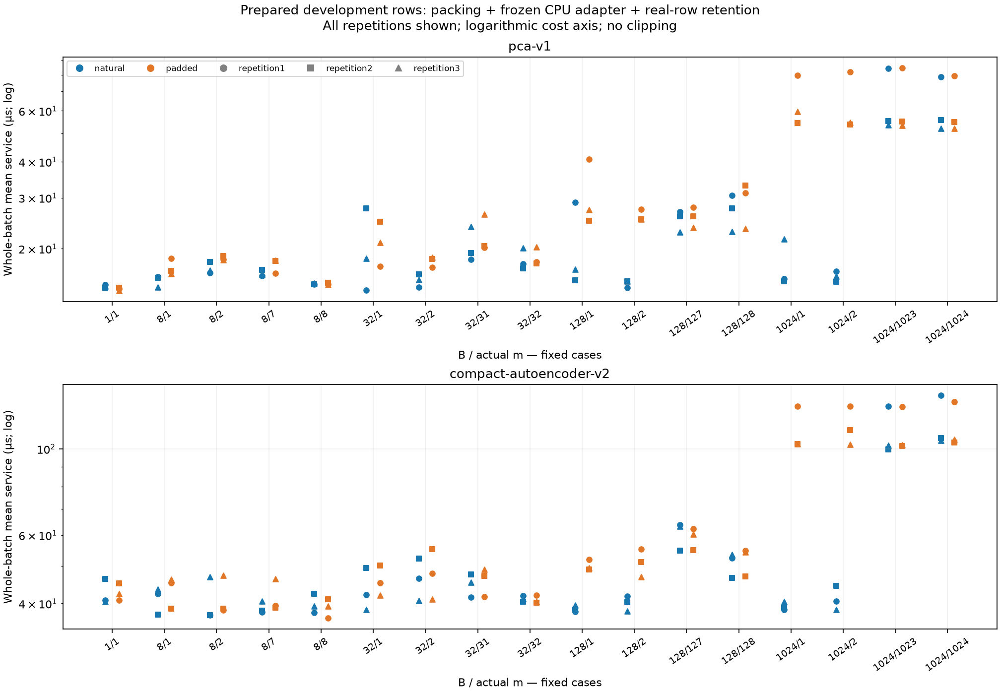
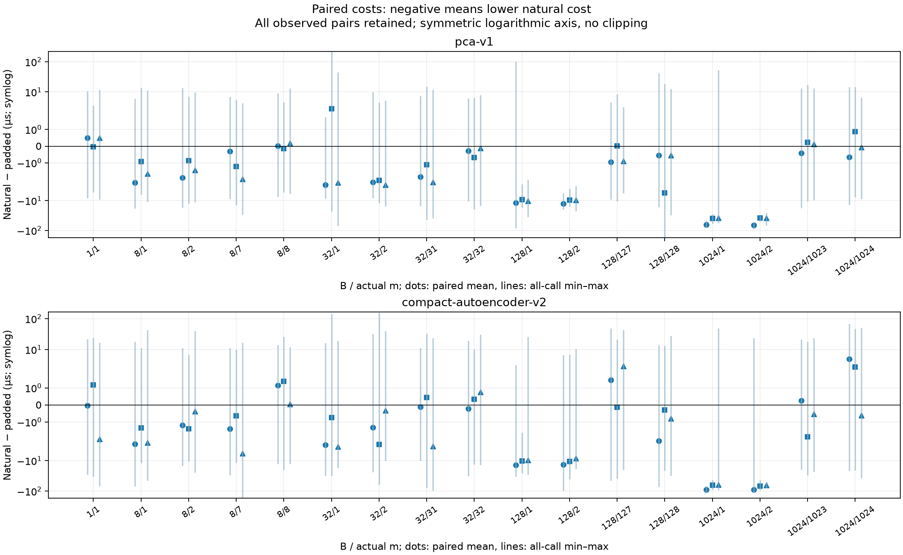
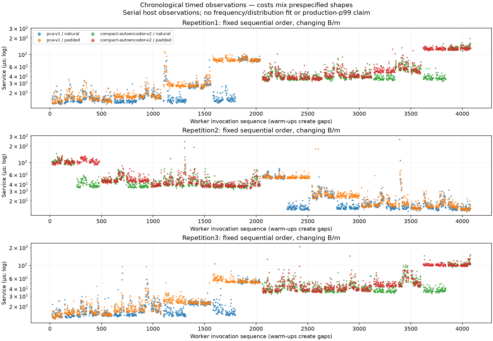

# Prepared-batch service measurement — Task0038

## Scope and status

Started2026-10-12; final handoff verified2026-10-13 Europe/Rome. A distinct current-host engineering measurement of owned prepared-row packing, canonical CPU adapter, four original strict decisions and retention of real rows. The one authorized operational session is complete: `parent_accepted_prepared_development_measurement`, all204cells/10200timed/2040warm-up invocations, successful pre/post numerical gates, normal worker exits/reaping and verified assertion release. No retry or post-reservation implementation change occurred. Task0037 remains unchanged, Task0036 remains `unresolved_no_acquisition`, source acceptance false and Task0034 scientific gates unchanged.

## Input and lineage

Only the original32896-byte FP32 little-endian C-contiguous1024×8 file `results/benchmarks/task0020-frozen-cpu/prepare/input.npy` is eligible. FileSHA2567164bfd7a86a9561ae3abc7b44b396c1a60db0114fc8542443ad3f71d2990a5e, payloadSHA2562ba0776aa1b5dfb7eb91dc0df4993d0a2ec52c83a79cc5424acc9b98a59b3d05. Accepted Task0020 preparation metadata/receipt identify one first source-ordered development `train_background` iterator,1024unique rows, strict ordering and IDs byte identityf80a9483f5ddafcac0e05d9fd6de757e5bbfe9e805f65ced1c0aa801cc266f1a. No IDs, memberships or original stores are reopened. Task0021 and accepted Task0022 preserve that exact prepared identity. Task0020's overall failed campaign remains failed.

[Strict protocol](../configs/benchmarks/prepared_batch_service_v1.json) pins source bytes, full-training provenance, feature order, original PCA-six/AE-v2 model/config/calibration scientific identities and thresholds independently. Original model fileSHA2566dd54d8aa788ab27f3cbd674d82c549ce31787b9865a911635d9ebd8faee3190 and a0b1563c34526bbfd965de6b63d041da2dfa713e9fe4bbc514852595ea813bf5 are preserved. File hashing/header/JSON custody does not constitute a numerical population request.

## Fixed service and matrix

Natural copies m actual rows into owned contiguous m×8 FP32; padded copies the same rows into B×8 and fills only trailing B−m rows with exact FP32zero. All executed rows receive canonical SSE and all four strict original comparisons; only first-m scores/decisions are copied into retained results. Padding zero is in frozen standardized coordinates, not an empty physical event. At m=B the construction is identical, though measured times need not match. Useful throughput is m/mean whole-batch time; padding never contributes useful rows.

B1/m1; B8/32/128/1024 each m1/2/B−1/B:17cases. Source windows start at deduplicated0/floor((1024−m)/2)/1024−m, deterministic cycling reset per phase/case. Deduplication gives48distinct case-window combinations,96including strategies per model/gate phase; m1023 has only starts0/1, m1024 only0. Workers1/3 run PCA→AE ascending cases, worker2 AE→PCA descending cases. Each case has10warm-up pairs then50timed pairs, natural→padded on even pair and reversed on odd pair,25timed pairs per ordering. Total204cells/10200timed/2040warm-up invocations and600empty timer pairs. Three original array reads/3072loaded rows reuse1024unique development rows and six canonical frozen model instances.

CPU eager original single-thread environment is set before imports and queried in PyTorch, threadpoolctl and public Accelerate thread-local API. Canonical reconstruction/dtypes/FP64-before-subtraction SSE/strict cutoffs are unchanged. Synchronous perf_counter_ns brackets include construction, adapter and real-row retention; view selection, identity checks, thread/proof instrumentation, hashing, durable journaling and guard queries are outside timer pairs. Periodic monitoring remains active and can interfere. Loading, raw I/O, physical features, transport and queueing are excluded. Task0022's preloaded adapter has a different boundary; these times are not a direct speedup or a sum of overlapping scopes.

## Numerical contract and acceptance

The unchanged [Task0022 derivation](arithmetic-cpu-v2-policy.md) is rowwise: affine input dimensions8/6/3/6 and gamma(2n+2), checked support band, zero-exact outward primitives, ReLU1-Lipschitz and FP64 SSE allowances do not depend on number of independent rows. Each new shape receives local affine checks and full-reference comparisons under the same assumptions; no empirical tolerance extension. Exact zeros satisfy the permitted zero case, including dummy activations/biases. This is a checked engineering extension, not a universal native-kernel proof.

Every distinct case/window/strategy before and after timing checks owned actual copies, dummy exclusion, finite actual/dummy reconstruction/SSE, byte-exact same-shape reconstruction and public scores, separated/public SSE, unchanged inputs/parameters/thresholds and zero actual-row mismatches at all four cuts. AE has separately accounted FP64 diagnostic copies/full/local-layer work; first-m reconstructions are checked against the fixed1024-row FP64 reference with E, then the original D=2E/SSE envelope. PCA keeps original1e−12 absolute/relative tolerances. Full canonical reference hashes must be byte-identical pre/post. Hooks are removed before timing.

Source/config/prompt/test/dependency/build acceptance is fresh. Plan freezing binds the actual user prompt as prospective authorization before the one-winner durable Task0038 anchor. Workers require owned grants, matching plan, source/dependencies/build/input identities and accepted predecessors. Body-complete is not accepted until exit0, reaping, output identities, continuous deadlines/resources and assertion release. A failure after reservation consumes the attempt without repair/retry.

## Runtime limits and reporting

Prerequisites60s; each repetition120s, reporting60s, finalization15s, reserved480s, whole540s; cleanup2s inside worker caps. RSS1GiB explicitly enforced, native reservation512MiB, parent128MiB; guard journal16MiB/worker, log1MiB/worker, owned storage128MiB. Mach continuous time includes suspension; perf_counter service pairs do not supervise deadlines. Temporary verified owned idle-system-sleep assertion permits display sleep and is released/reaped on exits. WARN is advisory, CRITICAL/invalid primary accounting veto; unavailable pressure/context and sampled/terminal gaps are disclosed. No idle-Mac requirement or persistent power changes.

Each cell retains count/min/max/mean/populationSD/p50/p95/p99 via linear quantiles, actual m, executed shape/padding/slot utilization, useful throughput and mean amortized cost. Paired natural−padded differences and chronological observations preserve every slow call. Raw invocation/window/order/timer sequences stay ignored; no per-event features/scores/masks/labels are persisted. Fifty serial calls per cell have limited tail resolution and are dependent; sample p99 is not production p99 or stall frequency. Aggregates/figures do not fit a service distribution, select a deployment policy or update the simulator.

## Actual measurements and variability

[204worker-specific cells](../results/tables/final/task0038-prepared-batch-service-cells.csv) retain every required statistic and shape/utilization field. The [curated summary](../results/tables/final/task0038-prepared-batch-service-summary.json) adds all68pooled groups, each using150actual observations, all102worker-specific paired-difference summaries and34pooled paired means. Percentiles are calculated on pooled observations, never averaged from worker percentiles. All10200timed and2040warm-up raw invocation records remain ignored and unchanged.

Selected fixed-case descriptions below are whole-batch means in µs pooled over all three repetitions; they illustrate the already fixed matrix, not a chosen winner. All cases/repetitions remain in the tables.

| Candidate | B/m | Natural mean µs | Padded mean µs |
|---|---:|---:|---:|
| PCA-six | 1/1 | 14.8125 | 14.4939 |
| PCA-six | 128/1 | 20.4653 | 30.9716 |
| PCA-six | 1024/1 | 17.5700 | 64.5916 |
| PCA-six | 1024/1023 | 64.2578 | 64.2747 |
| PCA-six | 1024/1024 | 62.1828 | 62.1283 |
| AE-v2 | 1/1 | 42.4478 | 42.7336 |
| AE-v2 | 128/1 | 38.7361 | 50.0422 |
| AE-v2 | 128/127 | 60.5497 | 59.1420 |
| AE-v2 | 1024/1 | 39.3199 | 111.7067 |
| AE-v2 | 1024/1023 | 110.2019 | 110.9150 |
| AE-v2 | 1024/1024 | 116.3549 | 114.0756 |

At B1024/m1 padding executes1023dummy rows and uses0.09765625%actual slots. Natural minus padded pooled mean is−47.0216µs PCA and−72.3867µs AE. At B128/m1 the contrasts are−10.5063/−11.3061µs. Nearly full shapes show small and sometimes unfavorable differences; AE128/127 natural is+1.4077µs slower. B1 and m=B have identical construction semantics: timing differences there do not imply a padding algorithm advantage. This service includes packing and retention, so exact constant cost for every m is not established even at fixed B.

Worker variation is visible: PCA1024/1padded means79.604/54.472/59.699µs; AE128.933/103.158/103.030µs. Fixed forward/reverse ordering is not full host-drift control. The largest timed calls are PCA266.750µs (rep2,32/1,natural) and AE243.083µs (rep2,32/2,natural); neither is trimmed. These maxima from the new boundary/host period do not explain, replace or establish a frequency for historical Task0022 AE2's26.2485ms call. Same-host serial observations are dependent, and50per cell/150pooled have limited tail resolution. No distribution fit, confidence interval, significance, production-p99 or whole-trigger claim is made.

All actual-row strict decisions agree at all four thresholds and all full reference hashes are byte-identical pre/post. AE's largest checked error/envelope ratio is0.2730991355 under the unchanged outward policy; all773comparisons per AE gate phase pass. PCA's original tolerances pass; its error maxima were not retained by the adapter, and its zero AE-envelope comparison count is not a zero-error measurement. Six canonical model instances plus six separately owned FP64 diagnostic copies are accounted; copies do not mutate originals or become candidates.

### Counts and timer context

Original prepared file3loads/3072rows/1024unique; six frozen canonical model instances. Public adapter calls12240service +3468numerical =15708,7854per candidate. AE additionally1158direct FP32 traced full forwards; PCA1158direct FP64 reconstruction calls; AE diagnostics582FP64full forwards and2328local-affine module calls. No stored scientific score array or fingerprint load.

| Presentation scope | Actual development rows | Synthetic padding rows |
|---|---:|---:|
| Timed plus warm-up service | 1722960 | 855360 |
| Public adapter numerical checks | 308064 | 256572 |
| AE direct FP32 proof | 104736 | 85524 |
| PCA direct FP64 proof | 104736 | 85524 |
| AE diagnostic FP64 full | 55440 | 42762 |
| AE diagnostic local affine layer rows | 221760 | 171048 |
| All presentations, counting each local layer separately | 2517696 | 1496790 |

These repeated in-memory presentations are not new source rows or population requests. Service timing/warm-up separately accounts1435800/287160actual and712800/142560padding rows. Per-call in-flight status is persisted before timing, then raw sequence and completion are durably flushed outside pairs. Proof public/full calls likewise retain completed/in-flight accounting; local-affine work is separately enumerated. No features, scores, decisions, labels or raw row IDs are curated.

The pinned Python runtime uses `perf_counter_ns` backed by `mach_absolute_time()` with reported resolution4.166666666666667e−8s (about41.667ns); integer-ns storage does not imply1ns resolution. This runtime metadata was queried during curation after the session, not persisted in each worker receipt. Empty-pair means23.725/26.050/21.620ns, including observed zeros;600pairs are context and never subtracted. Mach continuous deadlines are independent. Per-call continuous brackets include the pre-call durable ledger and therefore are not another service timer or an estimate of suspension/overhead to subtract. Whole-worker ordinary/continuous timestamps are retained; no observation was removed for a discrepancy.

### Validation, bounded lifecycle and figures

Fresh final acceptanceb696a3154e9b2c32f290e937b0661f04d33ced45a5aee59e21da0402a00d558d covers211source/config/prompt/test entries,43package versions and pinned Torch2.14.1/NumPy2.5.3 build/thread controls.100focused,2122full,2122portable pass; final driver durations2.567/42.655/45.089s, lint/format/dependencies pass. Native synthetic integration9.1953s is parent accepted and its figures were inspected before freeze. All synthetic artifacts, including two preliminary failures and the earlier-source accepted integration, remain ignored: four native synthetic invocations total, one before models/arrays, one completed synthetic repetition but failed plotting, two accepted. These are not real campaign attempts. Artifact-free historical fixtures legitimately instantiate/forward/update synthetic models; the final full and portable instrumented research subsets each record85instances/31forwards/8710rows/two toy optimizer updates/two toy calibrations. This instrument covers neither every historical fixture nor new Task0038 synthetic proof work; no global-zero test-forward/update claim.

The real anchor is `results/benchmarks/task0038-prepared-batch-service/attempt.json`, one consumed sessionf7dd29ca6a234c22a3b3e84972993ac1. PlanSHA256a1822c94449a0dd159882d3fa6f52594db6b4244a7f35cfafb41037299823198 binds final source/dependencies/acceptance/build, exact inputs/thresholds/proof/matrix and actual promptSHA256a831a15665b8dd0af71d2e1631ec3214eabe4a41ffc6f004d3ef4566bf76f823. Prospective freezefddecfebe3241d76dbd98894c843c0a4627f240f72c04175f64a1b5d7da1fd3c predates reservation. No software changes followed reservation.

Whole43.942592458s, prerequisites3.750414708s, reserved40.192176375s, finalization0.077322500s; overshoot0. Probe dispatch3.604650917s; repetition dispatch12.571305625/12.701192791/13.007320166s; report1.565193917s. Normal exits0/reaping/source/output checks complete; all worker cleanup within2s. Max worker lifetimeRSS369934336B (352.797MiB), conservative own-process all-malloc-zone native reservation184205312B (175.672MiB), parent53477376B (51MiB); owned storage27307794B (26.043MiB) at acceptance. Each active native worker is supervised separately; global available RAM was not queried and is not an admission floor.26400primary pressure samples are NORMAL, WARN/CRITICAL/unavailable0; the policy still retains WARN advisory and CRITICAL/invalid-primary veto.

Sampling is incomplete by construction: maximum start-gap0.260269375s in import/probe, numerical workers0.069997/0.080753/0.088330s; final monitor-close→parent observation gaps0.256585s probe,0.218458/0.237192/0.262587s repetitions,0.074597s reporting. Process exit/deadline/reaping remain supervised during those terminal intervals; process-specific resource sampling has closed. Temporary idle assertion observed18times, then helper−15/reaped/owned assertion absent; display sleep allowed/no persistent settings changed. Details and raw sequences stay ignored; caps apply to this session, not validation wall time.

All three figures were visually inspected. Costs use logarithmic y axes; paired differences use symmetric-log axes and min–max of all pairs, not intervals. Automatic-axis checks include all paired extrema; there is no manual clipping, trimming or interpolation between shapes. Chronology mixes fixed shape blocks, so it is not a stationary service distribution.

## Remaining chain gaps and next scope

| Stage | Evidence here | Smallest later prerequisite |
|---|---|---|
| Prepared row allocation/copy/zero fill + adapter + actual retention | Newly measured boundary if session accepted | Preserve boundary when using costs |
| Raw HDF read/decompression | Unmeasured | Separately pin existing raw source, layout and exact dev membership |
| Full-particle eight-feature construction | Unmeasured | Same1024accepted development ID identity; allowlist particles/transform state, no held-out roles |
| External transport | Unmeasured | Specify transport and owned development payload boundary |
| Actual streaming/batching/queue scheduling | Only Task0037 synthetic scheduling | Separately prescribed runtime workload and process accounting |
| Device-specific execution | CPU eager only | Separate device/runtime/shape contract and authorization |

Next useful decision: design a small separately authorized development-only raw-read/feature-construction measurement, first establishing the existing raw file and exact1024development membership from accepted preparation evidence. Do not invent row IDs or assume an available adapter. Fix source/header/membership allowlists, load/presentation caps and continuous deadlines before access; selection/calibration/tests/signals stay excluded. Alternatively a separately scoped replay of owned timing sequences can study queue sensitivity without pretending they are an empirical production distribution. Neither work is launched, no missing costs are manufactured, and sums of medians do not measure whole-chain latency.
