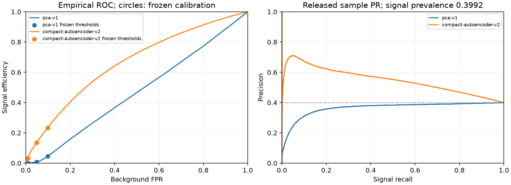
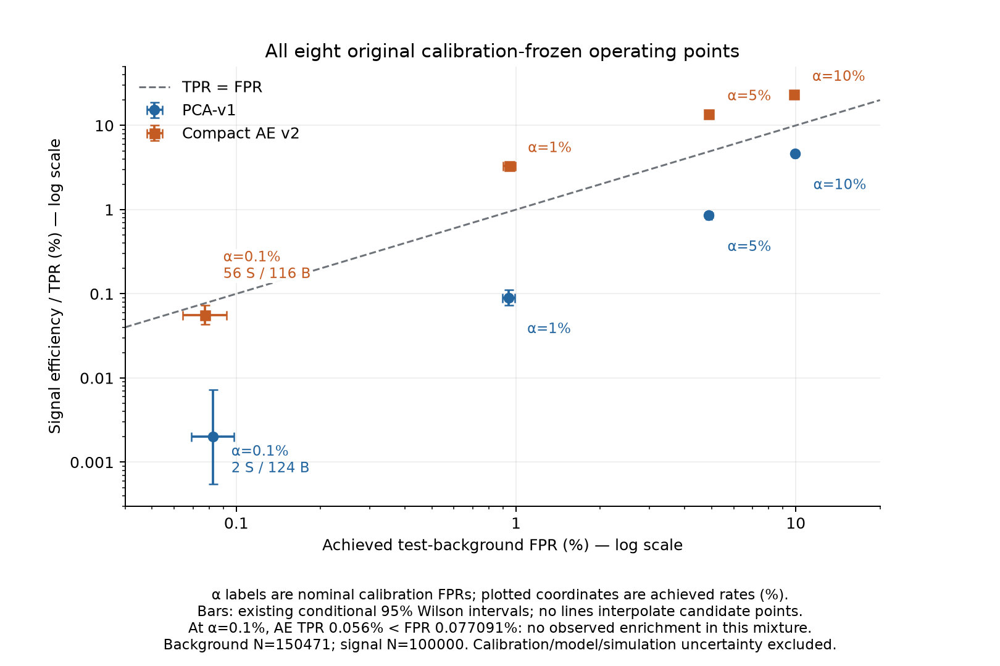
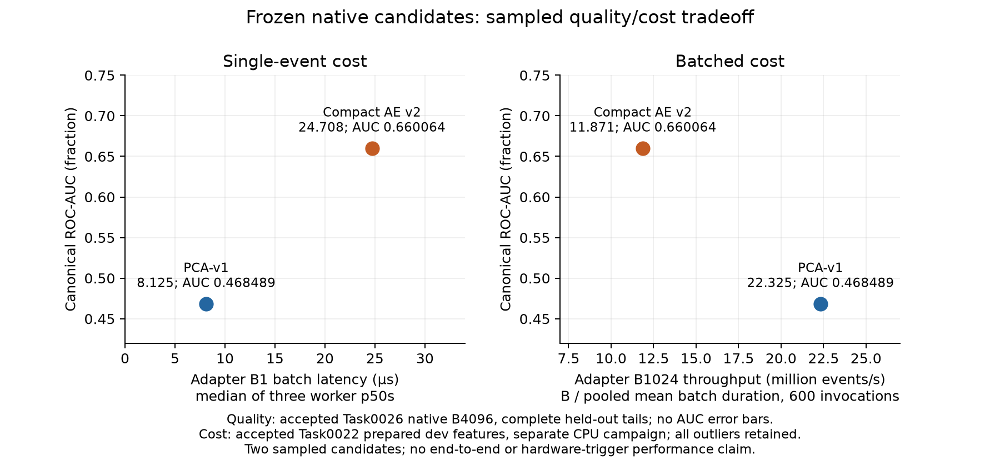

# LatentTrigger — Frozen native scientific synthesis and quality/cost tradeoff

Task0027, 2026-10-11 (Europe/Rome). Completed initial study; offline synthesis of
accepted Task0026 science and accepted Task0022 CPU costs. No new scientific
execution. [Curated summary](../results/tables/final/task0027-frozen-scientific-synthesis-summary.json),
[quality/cost CSV](../results/tables/final/task0027-quality-cost-frontier.csv),
[operating interpretation CSV](../results/tables/final/task0027-operating-point-interpretation.csv),
[prompt](prompts/0027-frozen-scientific-synthesis.md) and
[handoff](handoffs/0027-frozen-scientific-synthesis.md).

## Abstract

On the declared simulated two-prong signal, the frozen compact autoencoder v2
has better observed ranking than PCA-v1: ROC-AUC 0.660064 versus 0.468489, AP
0.547427 versus 0.364379. It accepts more signal at each of four original
background-calibrated thresholds. This is a moderate observed AE advantage for
these aggregate models and this signal, at higher measured native CPU cost.
Global ranking does not guarantee strict-tail utility: at nominal calibration
FPR 0.001, AE retains 56/100000 signal and 116/150471 background, with TPR below
achieved FPR and no observed enrichment in that selected evaluated mixture.
The six-dimensional PCA and three-dimensional AE do not isolate the causal effect
of nonlinearity. The initial comparison and integrated reporting are complete;
other signals, bias diagnostics, controlled capacity and deployment studies remain
separate extensions. Both held-out populations were exposed in Task0026 and
cannot be reblinded.

## Research question and initial-study scope

LatentTrigger asks how anomaly-detection quality trades against computational
cost under constrained event selection. This initial study compares two frozen
reconstruction baselines on the same eight aggregate features and one declared
signal. It establishes scientific discrimination, utility at four frozen
thresholds and a scoped historical CPU tradeoff. It does not test detector
integration, arrival-rate budgets, discovery significance or production suitability.
No new candidate, threshold, scoring orientation or runtime variant is chosen here.

The evidence comes from [the accepted native evaluation](guarded-pca-ae-evaluation.md)
and [the accepted CPU v2 campaign](frozen-cpu-benchmark-v2.md). Their campaigns
are completed and consumed. Numerical engineering acceptance, scientific quality
and computational cost are distinct evidence. The 31.094950 s evaluation campaign
contains custody, audit, metrics and reporting; it is not an inference benchmark.

## Dataset, duplicate-safe populations and preprocessing

The pinned source is LHC Olympics 2020 R&D, corrected Zenodo v5 record 6466204,
DOI [10.5281/zenodo.6466204](https://doi.org/10.5281/zenodo.6466204), file
`events_anomalydetection_v2.h5`, 2908260409 bytes. Previously verified MD5:
`629789d55813be3860781b084ae7f1de`; raw-byte SHA256:
`5da8fda2ca78edf8fa5acc0af92fcb6a2d464ba7bf0fd75e3944a169b88cecc6`.
These are historical provenance, not a new payload verification. Dataset license
is CC BY 4.0; the software license does not relicense it. See
[data design](data-design.md), [raw audit](raw-data-audit.md) and
[preprocessing contract](preprocessing-contract.md).

The source has 1000000 QCD and 100000 two-prong signal events, shuffled together;
the simulated signal is W′→XY→(qq)(qq), with masses 3.5 TeV, 500 GeV and 100 GeV.
The existing documentation records Pythia8/Delphes simulation without pileup or
multiple parton interactions and prior fat-jet trigger selection. This preselected
simulation and narrow topology constrain generalization. Rows are not an event
arrival stream, and class proportions are not physical LHC rates.

Exact-content grouping preceded population assignment and fitted statistics:
physical triplets were normalized for signed zero/out-of-range phi and sorted
for hashing, without rounding or truth/row IDs in the fingerprint. The prior
full audit found 1100000 unique exact groups and no duplicates or conflicting
labels. This does not establish absence of approximate duplicates. Frozen
hash-domain assignment uses protocol `lhco-rd-v1`, seed 1729; validation-selection
and calibration have independent disjoint roles. Membership is shared by models.

| Population | Events | Role in this study |
| --- | ---: | --- |
| Training background | 699957 | Preprocessing statistics and model fitting |
| Selection background | 74749 | Background diagnostics and AE epoch selection |
| Calibration background | 74823 | Thresholds after model restoration/freeze |
| Test background | 150471 | Accepted final evaluation; already exposed |
| Test signal | 100000 | Accepted final evaluation; already exposed |
| Dev background subset | 8494 | Engineering diagnostics; 1024 prepared training rows used for cost |

The eight inputs, in permanent order, are multiplicity, scalar pT, maximum pT,
relative transverse pT balance, pT-weighted eta mean, pT-weighted eta width,
pT concentration and massless full-event mass. They are computed from **all**
canonical physical particles before particle-view truncation. Multiplicity,
scalar pT, maximum pT and mass use log1p; the others retain their physical formula.
Transformed features are standardized using frozen training-background event
means/population standard deviations, accumulated in FP64 and emitted as FP32.
There is no test-driven clipping, rotation, rescaling or refitting. Mass is a
massless event proxy, not dijet mass; pT balance is not detector-provided MET.
Truth, split, event ID and fingerprint are separate metadata. The particle-view
Nmax=384 does not truncate these aggregate features.

Processed-full scientific identity:
`d12574e90e9ba9dff71e4e796f5004e704bce5d824db98c545a96d2df08e12d2`;
split scientific identity:
`74a97d8956a4b75d5710d456bc207fdfa9d27569256bafe7b8e72a7891468fea`.
Preprocessing configuration canonical JSON SHA256 is
`4eae7a9f689ad8bd9faaa56f439e33540fddc586a8e9a51be96ea78dc52ec8ea`;
its file-byte SHA256 is separately
`2c11e6a995fd677ac88a4830243bfb7944532e3ef1aa83d1b6389ab9ca802e68`.
Exact scalers remain in [the frozen configuration](../configs/data/lhco_rnd_v5.json).
No numerical store, raw file or population reader was reopened in Task0027.

## Background-only development, independent calibration and frozen candidates

PCA used deterministic full SVD on training background, with centering, no
whitening and FP64 reconstruction. The smallest component count reaching 95%
training explained variance was chosen: six retain 97.870086%. No test or signal
information selected this count. Historical independent CPU fitting repeats were
exact within their recorded environment.

The compact AE has architecture 8→6→3→6→8, biased Linear layers, hidden ReLU,
linear latent/output and 155 FP32 parameters (620 parameter bytes). Development
used CPU FP32 reconstruction MSE, Adam learning rate 0.001, seed 1729, deterministic
shuffled B4096 complete-tail batches and background selection loss. Task0008
extended only the historical epoch cap after exact reproduction of the first 200
epochs. The unchanged patience-15/min_delta-0 rule selected epoch 381 and stopped
at 396. Independent repeats reproduced weights and calibration. This resolves
the preregistered stopping endpoint, without proving a global optimum or an
optimal architecture. AE v1 remains historical. See [PCA](pca-baseline.md) and
[AE convergence](autoencoder-convergence.md).

| Frozen candidate | Reconstruction | Retained dimensions | Capacity |
| --- | --- | ---: | --- |
| PCA-v1 | Centered, non-whitened native FP64 | 6 | 56 inference coefficients including mean; not 155 trainable AE parameters |
| Compact AE v2 | Canonical native CPU FP32 | 3 | 155 FP32 learned parameters |

Both scores are `sum_j (float64(x_j) - float64(reconstruction_j))²` over eight
standardized channels, **casting before subtraction**, with higher score more
anomalous. Decisions are strict `score > threshold`, rejecting ties. Score
magnitudes remain on their original scales; no post-test PCA inversion occurs.

| Candidate | Model scientific SHA256 | Config canonical JSON SHA256 | Calibration scientific SHA256 |
| --- | --- | --- | --- |
| PCA-v1 | `d09f96bb7b1536e8da147458f3b0bf50a120bdf6cfc4c247b37970f4f51bf42f` | `e61e43bc57afc010286bf2b1deff91167b4951644d52d882ecbd1cf10f938f95` | `285a254847424870b5bee08e5a218733dcbe553ff7a4d00ec5c9493288600ccb` |
| Compact AE v2 | `6a7044ae199cf6609d096377d7bca782b0ae2a0398ad870a4f63cb874a46777b` | `0af02cba0dcab4cd750b19f6357fe5030aadb56c7c0422c4f35ea4adc1521800` | `324d7363b3e2d2ec96f57cc88790af99895097a35c91efe4839c3cead25c7d33` |

The Task0026 candidate registry equals Task0022's native model registry, including
config/model/calibration file-byte hashes, score dtypes, all thresholds and
calibration count. The curated synthesis summary preserves those typed bindings.
Canonical scientific hashes above exclude historical run metadata according to
their accepted schemes; they are not interchangeable with source file-byte hashes.

Calibration was performed after model freeze on 74823 independent background
events. For alpha in {0.1,0.05,0.01,0.001}, the original threshold is sorted score
index `ceil((N-1)*(1-alpha))`, equivalent to quantile method `higher`. Strict ties
are rejected; there is no interpolation or test refit. Historical calibration
accepts 7482/3741/748/74 events per model (all denominator 74823). Nominal targets
are conservative sample calibration goals, not guaranteed test/physical FPRs.
The separate selection-background checks were diagnostics and did not retune them.

## Accepted global scientific findings

| Candidate | ROC-AUC | Average precision | Background / signal | Evaluated signal prevalence |
| --- | ---: | ---: | --- | ---: |
| PCA-v1 | 0.4684886579473786 | 0.36437915494963025 | 150471 / 100000 | 0.3992478171125599 |
| Compact AE v2 | 0.6600638025267328 | 0.5474272683246686 | 150471 / 100000 | 0.3992478171125599 |

AUC uses the frozen supplied orientation. PCA's AUC below 0.5 is reported as
observed, without reversing its score after seeing the test. AP is sklearn's
recall-increment-weighted precision, not trapezoidal PR area; it depends on class
mixture. Initial evaluated prevalence is 100000/250471 = 39.924781711256%, the
constant-score AP reference for this mixture, **not a physical LHC signal rate**.
AE's AP exceeds this reference and PCA's is below it. No AUC/AP statistical
interval, model-difference test or significance result was accepted or added.

The complete curves are the unchanged accepted Task0026 PNG below. Task0027
neither reopened numerical curve archives nor reconstructed a ROC from four
calibrated points.



## Calibrated utility and strict-tail interpretation

Every rate below uses its achieved test count, with the existing conditional 95%
Wilson interval and finite rejection. The target is the **nominal calibration**
FPR expressed as a fraction; displayed test rates/intervals are percentages.
Exact fractional values remain in the [original calibrated CSV](../results/tables/final/task0026-pca-ae-calibrated-operating-points.csv)
and the Task0027 interpretation CSV. All eight thresholds remain original.

<!-- BEGIN CALIBRATED TABLE -->
| Candidate | Nominal target FPR (fraction) | Original frozen threshold (SSE) | Background accepted / total | Achieved FPR % [Wilson95%] | Signal accepted / total | TPR % [Wilson95%] | Finite rejection |
| --- | ---: | ---: | --- | --- | --- | --- | ---: |
| PCA-v1 | 0.1 | 0.3496768162794852 | 14922/150471 | 9.916861 [9.766864, 10.068905] | 4620/100000 | 4.620000 [4.491628, 4.751858] | 10.083836 |
| PCA-v1 | 0.05 | 0.5642097175249418 | 7362/150471 | 4.892637 [4.784791, 5.002787] | 852/100000 | 0.852000 [0.796893, 0.910883] | 20.438875 |
| PCA-v1 | 0.01 | 1.4232146905138892 | 1416/150471 | 0.941045 [0.893498, 0.991097] | 90/100000 | 0.090000 [0.073233, 0.110601] | 106.264831 |
| PCA-v1 | 0.001 | 4.1356483360291865 | 124/150471 | 0.082408 [0.069128, 0.098237] | 2/100000 | 0.002000 [0.000548, 0.007293] | 1213.475806 |
| Compact AE v2 | 0.1 | 3.478338537407165 | 14793/150471 | 9.831130 [9.681718, 9.982593] | 23217/100000 | 23.217000 [22.956344, 23.479714] | 10.171770 |
| Compact AE v2 | 0.05 | 4.681070974717348 | 7357/150471 | 4.889314 [4.781503, 4.999429] | 13608/100000 | 13.608000 [13.396886, 13.821910] | 20.452766 |
| Compact AE v2 | 0.01 | 8.324174660133213 | 1424/150471 | 0.946362 [0.898679, 0.996549] | 3298/100000 | 3.298000 [3.189096, 3.410492] | 105.667837 |
| Compact AE v2 | 0.001 | 16.642218868621573 | 116/150471 | 0.077091 [0.064285, 0.092447] | 56/100000 | 0.056000 [0.043131, 0.072706] | 1297.163793 |
<!-- END CALIBRATED TABLE -->

All achieved background rates are below their nominal calibration targets; this
does not guarantee unseen-population acceptance or justify recalibration.
Wilson intervals summarize rates conditional on the frozen threshold and
sampling approximation. They exclude calibration, model-selection and simulation
uncertainty. Background resolution is 1/150471, signal resolution 1/100000.
No zero-background point occurs here; all reported rejections are finite.

**Task0027 derived descriptions:** the following are **post-evaluation descriptive
arithmetic from accepted aggregate counts**, not newly preregistered Task0026
metrics or an additional experiment. For each original point:

```text
relative acceptance = (signal_accepted / signal_total)
                      / (background_accepted / background_total)
selected signal fraction = signal_accepted
                           / (signal_accepted + background_accepted)
percent = 100 * fraction
```

<!-- BEGIN INTERPRETATION TABLE -->
| Candidate | Nominal target FPR (fraction) | Relative acceptance TPR/FPR | Selected signal % | Initial evaluated signal % |
| --- | ---: | ---: | ---: | ---: |
| PCA-v1 | 0.1 | 0.465873 | 23.641388 | 39.924782 |
| PCA-v1 | 0.05 | 0.174139 | 10.372535 | 39.924782 |
| PCA-v1 | 0.01 | 0.095638 | 5.976096 | 39.924782 |
| PCA-v1 | 0.001 | 0.024270 | 1.587302 | 39.924782 |
| Compact AE v2 | 0.1 | 2.361580 | 61.081294 | 39.924782 |
| Compact AE v2 | 0.05 | 2.783212 | 64.908180 | 39.924782 |
| Compact AE v2 | 0.01 | 3.484925 | 69.843287 | 39.924782 |
| Compact AE v2 | 0.001 | 0.726412 | 32.558140 | 39.924782 |
<!-- END INTERPRETATION TABLE -->

At alpha=0.001, PCA accepts 124 background and 2 signal; AE accepts 116 background
and 56 signal. AE TPR=0.00056 (0.056%) is below its achieved background FPR
116/150471=0.0007709126675572038 (0.077091266756%). AE relative acceptance is
0.726411724137931; selected signal fraction 56/(56+116)=56/172=32.558139534884%,
below the initial evaluated prevalence 39.924781711256%. These **observed** values
show no signal enrichment in this selected slice of the evaluated mixture.
They do not establish statistical significance, physical purity or transport to
LHC rates. No unsupported uncertainty interval is constructed for either ratio,
selected fraction or model difference.

AE's greater observed signal acceptance than PCA at all four points coexists
with weak strict-tail sensitivity. At the first three AE points, the descriptive
relative acceptance exceeds one and the selected fraction exceeds initial
prevalence; no cutoff is selected from this observation. PCA's two strict-tail
signals are limited evidence, so no headline multiplicative tail gain or deeper
tail extrapolation is justified.



Figure: all eight original thresholds, achieved FPR versus TPR in **percent** on
log axes, existing Wilson bars on both rates, nominal alpha labels and TPR=FPR
reference. Candidate points are not connected or interpolated. No enrichment
error bars or additional significance test are implied.

The [separate empirical CSV](../results/tables/final/task0026-pca-ae-empirical-operating-points.csv)
contains 14 descriptive complete-ROC points: attainable fixed-FPR and fixed-TPR
results, strict-gt cutoff encoding and preserved tie rules. They are ROC evidence,
not deployment threshold replacements. For example, AE's descriptive FPR≤0.001
point keeps 74 signals/148 background, versus the frozen calibration point's
56/116. Task0027 adopts neither empirical cutoff nor a new operating point.

## Accepted CPU quality/cost tradeoff

Primary costs use the existing **public adapter/decision** scope: validation,
wrapping/conversion, native reconstruction, canonical FP64 SSE and all four
strict comparisons on prepared features. Input loading, raw reading, all-particle
aggregate construction, preprocessing and queueing are outside these timers.
Historical reconstruction and score-only scopes remain linked in the original
90-cell CSV; their medians must not be summed into end-to-end latency.

Task0022 used 1024 already-prepared source-ordered dev-training rows, with five
batch sizes 1/8/32/128/1024, 20 warm-ups then 200 synchronous timed invocations
per cell, three fresh workers per candidate. Historical hardware is Apple M5,
Mac17,2, 16 GB, arm64/macOS26.6.2, shared normal use. Python3.12.12/NumPy2.5.3 /
Torch2.14.1/sklearn1.9.1 and actual intra/inter/OpenMP single threads/public
Accelerate mode1 were recorded. Fixed order, warm caches, scheduler/periodic
watchdog overlap, three repetitions and 200-call p99 resolution limit inference.
Thermal/native system fields and pressure remained unknown where reported.

For each of the ten candidate/batch groups:

```text
median batch latency ns = median(three worker p50_ns values)
pooled mean batch duration ns = sum(three worker mean_ns * 200) / 600
throughput events/s = batch_size * 1e9 / pooled_mean_batch_ns
amortized mean ns/event = pooled_mean_batch_ns / batch_size
microseconds = nanoseconds / 1000
```

The accepted JSON pooled values are retained after independent arithmetic checks.
Throughput uses all 600 invocations; it is neither average reciprocal invocation
time nor the reciprocal of median latency. Median of worker p50s is not pooled
p50. B1 is single-event latency; B>1 latency concerns the whole batch. Amortized
time/event does not describe the response latency of an individual queued event.

<!-- BEGIN COST TABLE -->
| Candidate | Cost batch B | Median of 3 worker p50s, batch µs | Pooled mean, batch µs | Pooled mean amortized ns/event | Pooled throughput events/s |
| --- | ---: | ---: | ---: | ---: | ---: |
| PCA-v1 | 1 | 8.1250 | 8.422183 | 8422.183333 | 118734.057479 |
| PCA-v1 | 8 | 8.6250 | 8.776187 | 1097.023333 | 911557.639309 |
| PCA-v1 | 32 | 9.5000 | 17.973300 | 561.665625 | 1780418.732231 |
| PCA-v1 | 128 | 15.5205 | 15.981385 | 124.854570 | 8009318.341308 |
| PCA-v1 | 1024 | 44.4585 | 45.868398 | 44.793358 | 22324738.539123 |
| Compact AE v2 | 1 | 24.7080 | 35.217075 | 35217.075000 | 28395.316760 |
| Compact AE v2 | 8 | 25.8955 | 29.806243 | 3725.780417 | 268400.143907 |
| Compact AE v2 | 32 | 25.7705 | 35.809548 | 1119.048385 | 893616.409292 |
| Compact AE v2 | 128 | 31.7920 | 110.924545 | 866.598008 | 1153937.570805 |
| Compact AE v2 | 1024 | 85.5000 | 86.257810 | 84.236143 | 11871388.805257 |
<!-- END COST TABLE -->

The [frontier CSV](../results/tables/final/task0027-quality-cost-frontier.csv) has
**exactly ten rows** and includes original ns and converted µs, both canonical
AUC/AP references, all three worker names/p50s/means/maxima/p95/p99/std, and pooled
600-call means/throughputs. The [Task0022 CSV](../results/tables/final/task0022-frozen-cpu-benchmark-v2-cells.csv)
and [JSON](../results/tables/final/task0022-frozen-cpu-benchmark-v2-summary.json)
retain all 90 historical scope cells. No historical observations were filtered.
AE2 B128 adapter maximum 26.2485 ms, mean 267.5986 µs, p50 54.875 µs remains
alongside AE1/AE3 means 31.706725/33.46831 µs; its effect is visible in the pooled
mean 110.924545 µs and throughput 1153937.5708054518 events/s. PCA also has
repetition variability: B32 worker means 9.713380/9.569635/34.636885 µs. No cause
is assigned to either observation without evidence.

Scientific quality was evaluated separately at canonical B4096 with complete
3015-background/1696-signal tails. These canonical metrics are repeated as a
**scientific reference** in the cost rows, not independently measured held-out
quality for each cost batch. Prepared dev numerical gates do not prove held-out
ranking/rate invariance at B1–B1024. The two campaigns have different dates/work
and populations, despite equal native candidate identities.



Figure: two labeled candidates per panel; y is canonical ROC-AUC fraction.
Left cost is adapter B1 median of three worker p50s (µs). Right cost is adapter
B1024 throughput in million events/s from pooled means of 600 invocations.
No AUC/AP error bars were accepted. B1024 median batch latencies are 44.4585 µs
PCA and 85.5 µs AE; accepted pooled throughputs are respectively
22324738.539122738 and 11871388.805257171 events/s.

Within each fixed cost batch and this adapter scope, PCA has lower observed
median batch latency and higher pooled throughput, whereas AE has higher
canonical reference AUC/AP. Neither dominates jointly in AUC (or AP) and these
cost metrics. This is a two-candidate sampled tradeoff, not a continuous or
universal Pareto frontier. No hardware-trigger throughput, end-to-end latency,
latency guarantee, contemporaneous rerun or production suitability follows.
Task0025's provisional ONNX ratios enter **no accepted cost coordinate**.

## Numerical/runtime evidence and limits

Task0022 accepted an explicitly prospective arithmetic-aware CPU v2 engineering
policy with independent outward-rounding bounds, local affine checks, finite
supported domain, exact same-shape repeats/restored references and zero sampled
four-threshold mismatches pre/post on all 1024 dev rows/five batches. PCA retained
its original tolerances. AE's largest observed reconstruction difference at B1
was 5.4359436035e-5; conservative pair-envelope maximum was 0.01475455108148.
Those are different quantities. Bounds/local checks depend on stated arithmetic
assumptions and sampled domain, not universal certification of native kernels.
Historical Task0020 numerical failure and Task0021 diagnostic remain preserved;
the new policy does not retroactively pass them.

Task0026's authorized native scientific campaign completed PCA→AE→reporting,
all three children exit0/reaped/parent-accepted within its finite caps. Complete
source-order tails, native score semantics and output identities were accepted.
Resource peaks include custody/setup/diagnostics, not isolated model memory;
terminal guard-to-exit gaps and unknown pressure were disclosed. Its 31.095 s
whole wall cannot be divided into an accepted inference rate. These practical
process guards do not prove hard real-time behavior or a continuous memory envelope.

| Branch | Accepted outcome / remaining limit |
| --- | --- |
| Task0022 native CPU | Complete accepted consumed 90-cell cost reference |
| Task0023 MPS | Software foundation; sole check unavailable, original failed digest evidence/software-only repair retained; no physical validation or paired cost |
| Task0024 ONNX CPU | Accepted derived reconstruction export and scoped equivalence; no performance result |
| Task0025 paired ONNX CPU | Complete numerical/timing bodies, ORT3 exit deadline failure; failed/consumed, ratios provisional, shutdown cause unknown |
| Particle canonical training | Deferred; 192/192 disposable diagnostic updates consumed, no frozen canonical particle model/calibration |
| CoreML / reduced precision / streaming | Planned independent engineering studies; unmeasured here |

## Exposure, reproducibility and artifact provenance

Task0027 began on clean main/origin/main at verified local commit
`839f8cd68a87c776d84afa2e189e157536258b2d`, which includes Task0026's accepted
Phase B continuation after Phase A `e69d80ed…`. No uncommitted continuation
needed staging separation; Task0027's README/memory/index changes start from that
committed state. Historical reports/handoffs are preserved. No push or hosted CI
success is inferred from local Git history.

```yaml
test_background model/evaluation accessed: YES
test_signal model/evaluation accessed: YES
new_test_population_requests_in_Task0027: 0
new_model_scoring_in_Task0027: 0
```

YES permanently records **existing Task0026 exposure**, not new Task0027 access.
Historical requests=4, scored presentations=500942, unique held-out events=250471;
no uncertain in-flight exposure. New Task0027 population/custody/model execution /
scoring/optimizer/benchmark/export/MPS/particle counts are all zero. Future design
informed by these results requires an explicit methodological decision and an
independent evaluation protocol/population; exposed tests cannot become fresh or
serve as an undeclared tuning set. Historical dataset custody/scoring is not replayed.

The evidence registry has nine primary sources. Their exact SHA256 **file bytes**
are pinned below and in the helper/summary; historical canonical scientific
identities are separately typed in the summary and registry above.

<!-- BEGIN SOURCE TABLE -->
| Source file | SHA256 of exact file bytes |
| --- | --- |
| [guarded-pca-ae-evaluation.md](guarded-pca-ae-evaluation.md) | `5f95107ccd7d5911c618007c7c857644571f726a2c0d94af71921b50aebcab02` |
| [task0026-guarded-pca-ae-evaluation-summary.json](../results/tables/final/task0026-guarded-pca-ae-evaluation-summary.json) | `d72270e9807b1a2176d46be248ddb697d7a22e10cf5aac4904583ab4fae1e966` |
| [task0026-pca-ae-scientific-comparison.csv](../results/tables/final/task0026-pca-ae-scientific-comparison.csv) | `d3c3119f4bc20fb9a05c1a361d37caa5b7f0b1c8581177eed68eb4c7ba8a8824` |
| [task0026-pca-ae-calibrated-operating-points.csv](../results/tables/final/task0026-pca-ae-calibrated-operating-points.csv) | `5170f177094e5c8b7273d582650aa572da532986abd09713440a287580b3e886` |
| [task0026-pca-ae-empirical-operating-points.csv](../results/tables/final/task0026-pca-ae-empirical-operating-points.csv) | `2a54dded7e88f2434f213e4f0927158d816849d5a4d84c7059ceb30ad412c0cd` |
| [task0026-pca-ae-roc-pr.png](../results/figures/final/task0026-pca-ae-roc-pr.png) | `2eaf396e9ab83cb8c6d3a0f94b198ff1825d2f3fab9af0634f46f9a30cf42c06` |
| [frozen-cpu-benchmark-v2.md](frozen-cpu-benchmark-v2.md) | `04892664f5fe9945e698039a8879c09f51c48816c84715b6a43bce84fd6890c4` |
| [task0022-frozen-cpu-benchmark-v2-summary.json](../results/tables/final/task0022-frozen-cpu-benchmark-v2-summary.json) | `33c09221548ef56ef1b96f10c951161b65bea8d9565f2f3c100fd5f7a7c5744e` |
| [task0022-frozen-cpu-benchmark-v2-cells.csv](../results/tables/final/task0022-frozen-cpu-benchmark-v2-cells.csv) | `ddd4d1ed21d11f28999687c757638238bb548e156061525a0c4ded368ed9d75b` |
<!-- END SOURCE TABLE -->

Small accepted parent/source-acceptance metadata hashes were checked to resolve
lifecycle/source provenance; no operational record was changed. The preserved
Task0026 summary includes historical Phase A fields such as its then-absent real
results; current `scientific_results`, Phase B parent acceptance and exposure
fields establish the final accepted outcome. Historical NO/NO declarations in
older tasks describe those task-time states, without undoing current YES/YES.

Regenerate only these derived artifacts with the installed environment:

```bash
MPLCONFIGDIR=/tmp/task0027-matplotlib .venv/bin/python scripts/synthesize_frozen_results.py
```

The helper reads only the nine pinned curated sources; report/PNG sources are
hashed, aggregates supply arithmetic. It imports no LatentTrigger module, model,
reader, scoring or evaluation function. It writes only the two derived CSVs,
summary and two PNGs. Formulas, input hashes, identities, status/scopes/exclusions,
zero new counts and output hashes are in the summary. Same-environment regeneration
is deterministic; renderer bytes may differ across environments. Dependencies
and all prior scientific/protocol/executable bytes remain unchanged.

The helper's **12 synthetic aggregate tests**, scoped Ruff lint/format and aggregate
regeneration checks are Task0027 validation. The historical 1259 full/portable
Task0026 and 942 Task0022 acceptances are preserved, **not rerun** and do not cover
this new helper. CSV/JSON/report/figure values, nine source hashes, all 130 original
source/dependency hashes, original tracked-byte preservation (except three living
documents), relative links, whitespace and Git exclusions were checked. Figures
were visually inspected. No hosted CI success is claimed. Detailed commands and
actual check results remain in the handoff.

## Supported conclusions, hypotheses and one follow-up

**Accepted findings:** these two frozen aggregate candidates and this signal
show a moderate AE ranking advantage and more observed signal acceptance at all
four original thresholds, with greater native CPU adapter cost. The initial
native comparison and integrated scientific synthesis are complete. Strict-tail
utility remains weak. Lower PCA background mean SSE 0.1701725410289663 versus AE
1.7032152656897315 is not a ranking of anomaly detection quality: reconstruction
and separation are different objectives. Six retained PCA dimensions versus three
AE dimensions, different objectives/precision and model families preclude causal
attribution to nonlinearity.

**Descriptive arithmetic:** accepted counts imply AE relative acceptance below
one and reduced selected signal fraction at the strictest original point. These
Task0027 calculations describe this sample, without new uncertainty/significance
or physical-rate claims.

**Plausible explanations / untested hypotheses:** representation loss, bottleneck
size, reconstruction objective or score behavior could contribute to the observed
ranking/tail patterns. No feature-level, latent or population diagnostics were
performed to identify a mechanism. None is adopted as a causal explanation for
PCA's weak ranking or AE's strict tail.

**Open or limited:** scientific generalization to other signals/populations,
low-FPR utility, feature-level bias/sculpting, controlled capacity comparisons,
physical MPS validation/paired measurement, accepted ONNX performance, CoreML,
reduced precision, streaming and particle canonical convergence. These are separate
research/engineering choices, not prerequisites to report the completed initial
study. Failed/unavailable branches remain as recorded above.

One justified next step is a **prospective independent-population evaluation
protocol for the already-frozen native models**, focused on signal generalization
and strict-tail utility. Before any new access, explicitly authorize the independent
signal/background source and population roles, contamination/overlap checks,
unchanged preprocessing/model/threshold identities, planned metrics/rate uncertainty
and adequate background tail counts. Predeclare whether rates are tested under
transported frozen thresholds; any recalibration needs a separate independent
background role and methodological decision. Do not choose a model or threshold
using this exposed test. This is a proposed follow-up, with no Task0028 created,
execution launched, data access or new allowance authorized here.
