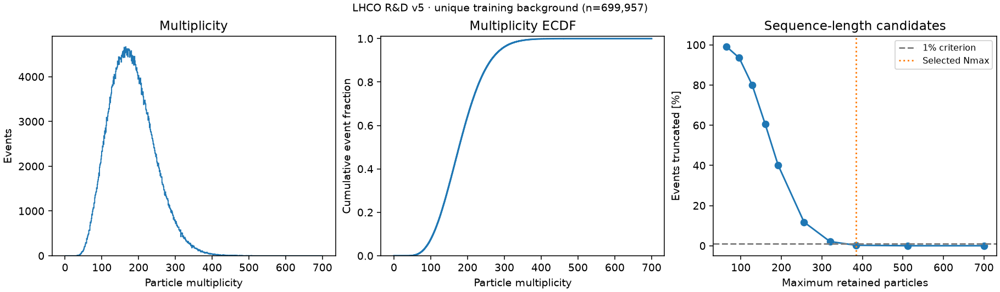
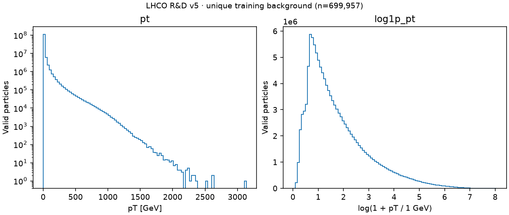
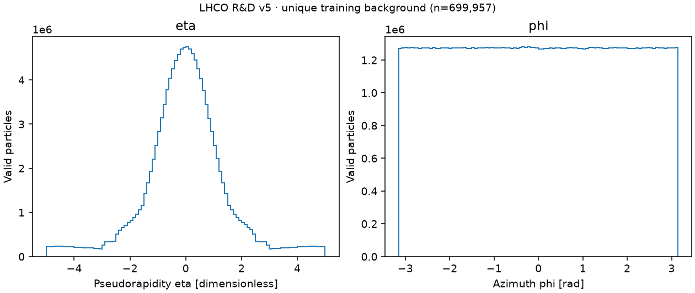

# Task 0004 — Training-background EDA and schema validation

Measured on 2026-10-04; finalized on 2026-10-05. This report freezes the design
for Task 0005; no production
processed dataset or model has been built. Tables are report snapshots generated
from [the machine-readable source of truth](../configs/data/lhco_rnd_v5.json).
Task 0005 must read that configuration rather than transcribe rounded values.
See [the preprocessing contract](preprocessing-contract.md) for exact semantics.

## Dataset population and embargo boundary

[LHCO R&D Zenodo v5](https://doi.org/10.5281/zenodo.6466204), corrected
`events_anomalydetection_v2.h5`: 2,908,260,409 bytes, MD5
`629789d55813be3860781b084ae7f1de`, locally reverified; SHA-256
`5da8fda2ca78edf8fa5acc0af92fcb6a2d464ba7bf0fd75e3944a169b88cecc6`.
The [raw audit](raw-data-audit.md) establishes authoritative feature semantics:
700 reconstructed-constituent `(pT [GeV], eta, phi [rad])` slots, no object-type,
charge, mass or jet assignments; truth is column 2100. These are simulated
preselected events, not a representation of the complete LHC trigger input rate.

`/df/block0_values` has shape `(1,100,000,2101)` and dtype `float64`; its
uncompressed numeric payload is 18,488,800,000 bytes.

The complete file was accessed only for structural integrity, labels needed for
membership, multiplicity as structural metadata, and exact content identity.
Membership was persisted before any model-oriented statistics. All distributions,
scalers, ordering checks, precision measurements and plots below use **unique
training background only**. HDF decompression reads chunks containing mixed
splits, but rows are selected before every statistical operation. Neither test
background nor test signal distributions were explored for decisions; validation
background was used only for membership. No signal performance was measured.

## Full structural integrity scan

1,100,000 events: **1,000,000 background**, **100,000 signal**. All eligible.

| Violation (events, except axis mismatch) | Exact count |
| --- | ---: |
| Unexpected truth value | 0 |
| NaN, including truth | 0 |
| Infinity, including truth | 0 |
| Negative pT | 0 |
| Malformed padding | 0 |
| Non-trailing padding | 0 |
| Empty event | 0 |
| Row-axis ordinal mismatch | 0 |
| Full 700-slot event | 0 |
| Exceeds 700 slots | 0; impossible in the validated fixed-width schema |

Padding means exactly `(0,0,0)`; malformed padding means zero pT with nonzero
eta/phi. Non-trailing padding means any nonzero triplet after the first zero
triplet. Multiplicity is the number of positive-pT slots. Full-file structural
range: **22–560**. Structural violations would be recorded/quarantined and block
EDA, rather than silently discarded. Shape, dtype and column axes match Task 0003.

## Exact duplicate analysis

Canonical identity removes padding, canonicalizes signed zero, wraps only phi
outside `[-pi,pi)`, sorts triplets lexicographically `(pT,eta,phi)`, then hashes
`uint64 little-endian count || float64 little-endian triplets` with SHA-256.
Labels, ordinals and splits are excluded. In-range values are not rounded.
Canonicalization treats reordered constituents and equivalent boundary angles
as the same content; it is not approximate/fuzzy matching. Vectorized chunk
sorting precedes one hashlib digest call per event. Cryptographic collision
risk is negligible, not a mathematical proof of byte identity.

**1,100,000 unique groups; 0 duplicated groups; 0 participating duplicate rows;
largest group 1; 0 conflicting-label groups.** In future duplicate groups, the
lowest source-row ordinal represents the group; aliases retain group membership.
Conflicting labels quarantine the entire group and block statistical EDA.

## Frozen split construction

Protocol `lhco-rd-v1`, seed **1729**. For each background fingerprint, hash exact
UTF-8 `lhco-rd-v1|1729|bg-split|` followed by its 64-character lowercase hex.
Interpret the first eight digest bytes as big-endian uint64 `k`; `u=k/2^64`.
Assign train for `u<0.70`, validation for `0.70<=u<0.85`, test otherwise. Integer
ceil cutoffs avoid floating rounding. An independent `val-role` domain assigns
validation selection/calibration halves with cutoff `u<0.5`. Signals all belong
to test. Groups are indivisible; splits use one representative per group.
Ratios are probabilistic hash thresholds, not exact row-count quotas.

| Membership | Representatives |
| --- | ---: |
| `train_background` | 699,957 |
| `validation_selection_background` | 74,749 |
| `validation_calibration_background` | 74,823 |
| `test_background` | 150,471 |
| `test_signal` | 100,000 |
| `validation_background` | 149,572 |
| `dev_train_background` | 6,999 |
| `dev_validation_selection_background` | 747 |
| `dev_validation_calibration_background` | 748 |

Background fractions are 69.9957%, 14.9572%, 15.0471%. Group-level train/validation,
train/test and validation/test intersections are empty; signal count in train
and either validation role is zero. The two validation roles remain disjoint.
Validation selection is for background reconstruction/generalization choices;
calibration is for a predetermined background false-positive operating point.
There is **no anomaly validation population** in this protocol. A future supervised
selection protocol requires a new version and separate reserved evaluation.

## Development subset and local artifacts

`lhco-rd-dev-v1`: separately rank eligible groups in train, validation-selection,
and validation-calibration using SHA-256 of the same prefix with `dev-subset`.
Select `floor(group_count/100)` with bytewise digest order, then store sorted
representative row indices. Counts: **6,999 + 747 + 748 = 8,494**. No test rows,
duplicate aliases, or signal. Hash sampling is deterministic and distribution
neutral in expectation, not guaranteed stratification. It is a convenience
subset for pipeline checks; final reported ML results use the full protocol.

Ignored `data/analysis/lhco-rd-v1/` contains 20 primitive NPY arrays (110,167,088
bytes total), group membership, representatives, multiplicities, labels and
split/dev indices. `split-manifest.json` records source integrity, seed/version,
creation UTC, base commit, environment, source-code hashes, counts and each array's
SHA-256. Artifacts are checksum-checked and membership reconstructed/validated
before reuse. No raw-event copy is made. Labels remain a separate local array.

## Training-background multiplicity

699,957 events, **127,379,949 valid particles** (padding excluded).

| Statistic | Particles/event |
| --- | ---: |
| Minimum / maximum | 22 / 560 |
| Mean / population std | 181.982535 / 61.020073 |
| Median | 177 |
| p90 / p95 | 263 / 291 |
| p99 / p99.5 / p99.9 | 344 / 365 / 408.044 |



## Raw feature distributions and transforms

Particle-weighted moments use merged float64 population statistics (`ddof=0`).
Quantiles are exact NumPy linear interpolation, computed by in-place partition
of one disk-backed feature stream at a time. Histograms use bounded mapped
slices. Log quantiles interpolate transformed endpoints. No random sample,
clipping, padding, validation or test observations enter these statistics.

| Feature | Min | Max | Mean | Std | Median | p99 | p99.9 |
| --- | ---: | ---: | ---: | ---: | ---: | ---: | ---: |
| pt | 0.011443535 | 3138.8899 | 15.935601 | 52.263314 | 3.1709824 | 240.92645 | 686.91915 |
| eta | -5 | 4.9999995 | -2.3446857e-05 | 1.4824139 | 0.00029945854 | 4.4447229 | 4.9444275 |
| phi | -3.1415925 | 3.1415927 | -0.00025488804 | 1.8138959 | -0.0016896983 | 3.0789166 | 3.1353302 |
| log1p_pt | 0.011378553 | 8.051943 | 1.7563972 | 1.1860427 | 1.4281516 | 5.4886338 | 6.5336713 |

pT spans 0.0114–3138.89 GeV: mean 15.94 versus median 3.17, p99 240.93, raw std
52.26. Its long positive tail makes raw standardization strongly sensitive to
rare large constituents. **Decision: `log1p(pT/1 GeV)` then train-only standardization**;
retain physical pT for aggregates/provenance. Log std is 1.1860 and the tail is
compressed without discarding energy-scale information. No winsorization or
clipping. Valid-particle zero-pT frequency is exactly zero.



Eta is approximately centered at zero, std 1.4824, bounded in observed training
background by [-5,4.999999523]. p1/p99 are approximately -4.44484/+4.44472.
The outer acceptance structure is visible, but no values exceed the observed
acceptance range. **Decision: center/scale eta, no nonlinear transform or clipping**.
It is a signed pseudorapidity, not a periodic angle.

Phi is approximately uniform; mean sine -0.00021801267, mean cosine
-4.1865356e-05. There are 202,778 and
203,358 particles within 0.01 rad of the lower
and upper boundaries respectively. Exactly **two** values are just above mathematical
pi: float32(pi)=3.1415927410125732, an 8.74e-8 rad rounding excess. This is not
malformed padding. **Decision: wrap out-of-range angles into [-pi,pi), then encode
sin(phi), cos(phi)** without scaling. Raw standardized phi would create a false
seam between physically adjacent directions. Wrapped physical phi is retained
in canonical records; no per-event rotation/centering is introduced.



## Numerical precision

Every one of the 127,379,949 valid training particles was measured, exceeding
the requested representative sample. Float64 -> float32 -> float64 max absolute
and max relative (nonzero denominator) errors are **[0,0,0]** for raw pT/eta/phi.
The stored float64 values are already exactly representable in FP32 in this
population. All padding zeros remain exact; labels 0/1 round-trip and are stored
separately as uint8. This does not assert exactness of newly calculated logs,
angular wrapping, aggregates or other sources. Compute those in float64 then
cast output to FP32; test transformations numerically in Task 0005.
**Canonical and model inputs: float32; no FP16 canonical storage.**

## Sequence-length decision

Rule recorded before EDA: smallest candidate with >=99% complete-event coverage
and event-mean removed scalar-pT fraction <=0.1%. Retain descending-pT particles
when estimating loss; average includes zero loss for untruncated events.

| Nmax | Truncated events | Fraction | Mean removed if truncated | Worst removed | Mean lost scalar pT | Worst lost scalar pT |
| --- | ---: | ---: | ---: | ---: | ---: | ---: |
| 64 | 694,708 | 99.250097% | 118.929 | 496 | 9.551678% | 47.1936% |
| 96 | 654,595 | 93.519316% | 93.004 | 464 | 5.063434% | 37.2137% |
| 128 | 560,287 | 80.045917% | 73.625 | 432 | 2.671449% | 30.3669% |
| 160 | 424,443 | 60.638439% | 59.754 | 400 | 1.345815% | 25.0561% |
| 192 | 281,170 | 40.169610% | 49.893 | 368 | 0.631920% | 20.6590% |
| 256 | 82,470 | 11.782152% | 37.605 | 304 | 0.107777% | 13.7257% |
| 320 | 14,700 | 2.100129% | 30.870 | 240 | 0.012859% | 8.7487% |
| 384 | 1,740 | 0.248587% | 26.765 | 176 | 0.001118% | 5.1146% |
| 512 | 8 | 0.001143% | 29.500 | 48 | 0.000005% | 0.7091% |
| 700 | 0 | 0.000000% | 0.000 | 0 | 0.000000% | 0.0000% |

**Initial Nmax=384**. It retains all particles in 99.7514% of training events.
The 1,740 truncated events lose on average 26.765 particles; worst count 176.
Mean scalar-pT loss across all training events is 0.001118%; worst event loss
5.1146%. Nmax=320 meets momentum retention but fails 99% complete-event coverage.
384 is a multiple of 64, with 6,144 bytes of four-channel FP32 input per event
(786,432 bytes for batch 128, excluding masks, activations and runtime overhead).
This is a retention/memory choice, **not a measured trigger-latency guarantee**.
Full ragged records preserve every particle; sequence length remains a later
systems/quality experiment under a versioned protocol, without tuning on test.
Relative to 700 slots, 384 reduces input storage by 45.1% and potential dense
attention pair count by 69.9%; those are shape arithmetic, not measured speedups.
No runtime memory/latency limit has been validated for a future model. The
initial retention policy supersedes Task 0002's provisional no-truncation default;
all physical particles still survive in the canonical record.

## Particle ordering

All **699,957** training events contain a pT increase somewhere in raw order.
Source order is therefore not descending pT; this audit does not assign another
physical meaning to it. Sort descending source float64 pT, break ties by ascending
eta, wrapped phi, then original slot. Do this before precision conversion and
truncation, retaining original slots as provenance, not inputs. Attention/set
models should use masks and no slot-position embeddings for permutation symmetry;
truncation is nevertheless consequential. All event aggregates use full particles.

## Baseline aggregate features

Retain eight Task 0002 physical summaries, confirmed finite and nonconstant on
training background. The [contract](preprocessing-contract.md#baseline-aggregate-view)
contains exact formulas, units and ordering. EDA computes ephemeral per-chunk
observations for fitted statistics; no production feature matrix is saved.

| Aggregate | Min | Max | Mean | Median | Before standardization |
| --- | ---: | ---: | ---: | ---: | --- |
| `multiplicity` | 22 | 560 | 181.983 | 177 | log1p |
| `scalar_pt` | 1590.41 | 8196.98 | 2900 | 2795.27 | log1p |
| `max_pt` | 53.8665 | 3138.89 | 478.601 | 434.238 | log1p |
| `pt_balance` | 2.41222e-05 | 0.567818 | 0.0255702 | 0.0207545 | identity |
| `weighted_eta_mean` | -1.52388 | 1.53098 | -0.000391165 | -0.000605424 | identity |
| `weighted_eta_std` | 0.0625791 | 2.002 | 0.725046 | 0.703342 | identity |
| `pt_concentration` | 0.00631176 | 0.395895 | 0.0639175 | 0.0546667 | identity |
| `massless_event_mass` | 1668.69 | 11482.9 | 4259.75 | 4097.79 | log1p |

Momentum balance is a visible-constituent proxy, not measured missing transverse
energy; mass assumes massless constituents and is not the official dijet mass.
No labels, event ordinals, source identity or split markers are features.

## Bias-analysis variables

Later inspect scores/background acceptance against multiplicity N, scalar pT S,
maximum pT, and massless event mass M. These expose dependence on event complexity,
scale and mass; they are monitoring variables already in the compact schema,
not extra model features. Keep S/M available before any transform/truncation and
track retained pT fraction for sequence-loss bias. Do not interpret improved
anomaly separation without these background-bias checks. Test-signal score or
physics distributions remain embargoed until model/protocol freeze.

## Frozen decisions, reproducibility and resource observations

Use [the contract](preprocessing-contract.md) and its JSON for Task 0005: raw
FP32 ragged canonical triplets; four transformed channels; train-only population
scalers; descending-pT order; Nmax 384; zeros after scaling and boolean real-object
mask; full-event eight-aggregate view; frozen separate evaluation labels/indices.

```bash
python -m pip install -e ".[dev,data,analysis]"
python scripts/analyze_training_data.py
# Reverify source/indices and rerun training EDA without duplicate hashing:
python scripts/analyze_training_data.py --reuse-scan
```

Default chunks are 992 rows (16 physical HDF chunks), 16,673,536 raw bytes.
On this 16 GiB M5/macOS machine: source checksum 4.01s,
structural scan plus hashing 43.38s,
group/split/persistence 1.92s;
training feature/aggregate scan 30.14s,
exact quantiles/histograms 22.21s.
Lifetime peak RSS before plots 1,380,237,312 bytes
(1.285 GiB); one scratch feature maps at a time.
Peak temporary streams 3,101,916,024 bytes (~3.10 GB) were removed after
successful statistics. A failed run can leave scratch files; a rerun rewrites
them. These are engineering observations with concurrent system activity, not
inference benchmarks. Source uncompressed payload was never loaded wholesale.
An independent complete rerun reproduced all 20 NPY artifacts byte for byte and
all training statistics/scalers/decisions exactly. Local manifests/timings may
change per run; these are intentionally ignored. The tracked report is a snapshot
of a measured full run, not a promise of identical resource use on another run.

Tracked outputs: JSON statistics/configuration and three intentionally curated
small PNGs (seven panels). All NPY membership, manifests, raw data, logs and
scratch remain ignored. The optional `analysis` extra adds only Matplotlib;
HDF support stays in `data`, and synthetic CI tests require neither extra.

## Remaining questions

Task 0005 must implement/test deterministic raw-to-ragged storage, scaler reuse,
ordering ties, boundary wrapping, full-event aggregates, masked object views,
manifest compatibility and held-out-label isolation. It must verify conversion
and mass roundoff tolerances with small controlled fixtures. No new split/feature
or sequence choice is required. Model quality/latency consequences, whether to
remove/add aggregate views, any alternate anomaly calibration protocol and
other dataset sources belong to later versioned experiments. There was no
integrity or acquisition blocker and no reason to relax the test embargo.
