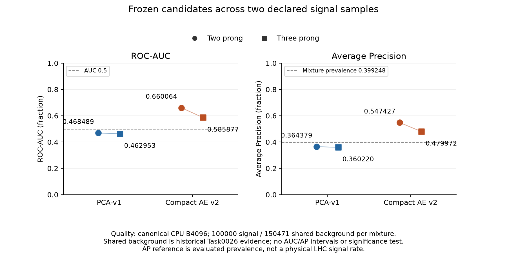
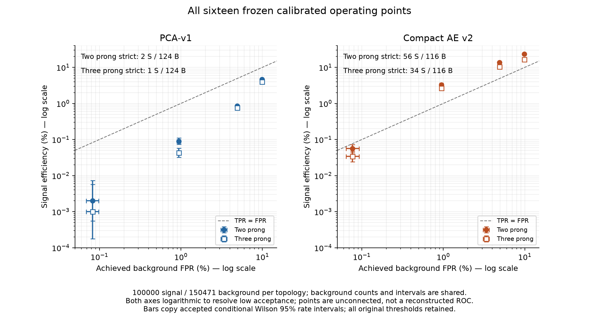
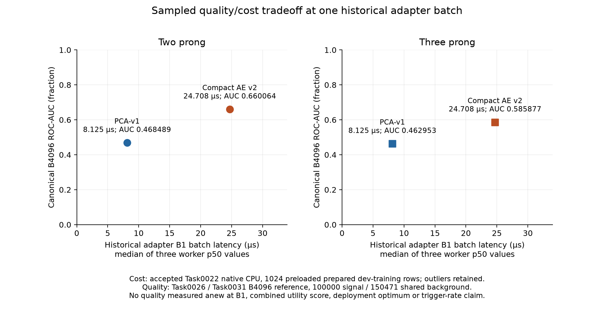

# Frozen two-/three-prong synthesis and quality/cost decision brief

Task0032, 2026-10-12 Europe/Rome. **The frozen baseline study is complete within its declared scope.** This report joins accepted two-prong science (Task0026), accepted three-prong science (Task0031) and accepted native CPU cost (Task0022). Task0027 remains the historical initial synthesis and is unchanged.

[Summary and pinned evidence registry](../results/tables/final/task0032-two-three-prong-synthesis-summary.json), [global quality](../results/tables/final/task0032-global-quality.csv), [sixteen calibrated points](../results/tables/final/task0032-calibrated-utility.csv), [eight topology comparisons](../results/tables/final/task0032-cross-topology-comparison.csv), [ten scoped CPU groups](../results/tables/final/task0032-quality-cost.csv), [actual prompt](prompts/0032-two-three-prong-synthesis.md), [handoff](handoffs/0032-two-three-prong-synthesis.md).

## Abstract and research question

The frozen compact AE has higher observed ranking and signal acceptance than the frozen PCA on both declared simulated signals, at higher scoped native CPU cost. Its advantage and absolute signal efficiency are weaker on the three-prong sample. Strict-tail utility is weak for both signals: AE's selected signal fraction falls below the initial evaluated mixture at the strictest original threshold. This is a sampled scientific/cost tradeoff, not a deployment optimum, significance result or causal explanation of topology effects.

The question is whether performance of the same background-developed reconstruction baselines persists across two signal samples, and how that observed quality relates to existing native CPU costs. All new Task0032 work uses curated aggregates, documents and existing PNGs. Population access, score/curve/fingerprint array loading, model execution, fitting, recalibration, downloading and new campaigns are zero. No score inversion or winning threshold is chosen.

## Evidence, population and compatibility

Primary evidence is [Task0026](guarded-pca-ae-evaluation.md), [Task0031](local-three-prong-evaluation.md) and [Task0022](frozen-cpu-benchmark-v2.md). [Task0027](scientific-synthesis.md) supplies historical consistency checks and cost-scope context. The helper has a finite **20-file input allowlist** with byte SHA256 values: four maintained reports, four summaries, ten CSVs and two accepted full-curve PNGs. It reads those paths only, rejects missing/altered or symlink-redirected sources and never follows embedded operational paths. Model/scaler/store/cache identities are compared as recorded metadata, without reopening them.

Two-prong science uses 100000 declared signal and 150471 original test-background events. Three-prong science evaluates a separate 100000-event signal against the **same accepted Task0026 background scores**. Counts, rates and conditional background intervals are shared historical measurements, not independent replications. Task0031 established numerical validity, exact uniqueness and zero overlap against the original 1100000-event all-role fingerprint registry; those are historical findings, not repeated custody here. Exact fingerprint disjointness does not prove full statistical or simulation independence.

The original simulated R&D populations were preselected and processed under the frozen duplicate-safe population protocol. Training, background selection and independent background calibration are separate roles. The original background calibration contains 74823 events. Both studies retain eight features in order: multiplicity, scalar pT, maximum pT, pT balance, weighted eta mean, weighted eta width, pT concentration and massless-event mass. They validate/sort/wrap source FP64 particles, preserve existing physical FP32 storage, accumulate full-event aggregates in FP64 before object truncation, apply frozen log channels and training-fitted scaler, then emit FP32 features. Shared configuration byte/canonical identities and scaler identity establish compatibility; the new signal has its own distinct prepared scientific identity, without being relabeled as the training store.

PCA-v1 retains six centered, non-whitened FP64 components. Compact AE v2 uses native CPU FP32 reconstruction, architecture 8→6→3→6→8 and 155 parameters. Both compute eight-channel `sum((float64(input)-float64(reconstruction))²)`, casting **before** subtraction, with higher scores more anomalous and strict `score > threshold`. Candidate/model/config/calibration bindings and all four thresholds agree across science and cost evidence. Scientific quality is the accepted canonical CPU **B4096** reference with complete tails. No fitting, refitting, candidate/threshold selection or numerical parity study occurs here.

## Accepted global quality

Each evaluated mixture has signal prevalence **100000/250471 = 0.3992478171125599**, or 39.9247817113%. Average Precision uses accepted recall-increment weighting, not trapezoidal PR area. Its constant-score reference is this mixture prevalence. Neither prevalence nor AP implies a physical LHC signal rate.

| Candidate | Signal sample | ROC-AUC | Average Precision | Background / signal |
| --- | --- | ---: | ---: | --- |
| PCA-v1 | Two prong | 0.4684886579473786 | 0.36437915494963025 | 150471 / 100000 |
| Compact AE v2 | Two prong | 0.6600638025267328 | 0.5474272683246686 | 150471 / 100000 |
| PCA-v1 | Three prong | 0.4629531325637498 | 0.36022029761655994 | 150471 / 100000 |
| Compact AE v2 | Three prong | 0.5858771149922577 | 0.479971651666809 | 150471 / 100000 |

PCA remains below 0.5 under its supplied frozen orientation. The study did not test an inverted candidate. AE exceeds PCA globally and at every original calibrated threshold on each sample, without establishing universal neural superiority. Both models show lower observed AUC/AP and signal acceptance on three prong. The following new differences are **Task0032 post-evaluation descriptive arithmetic**; they are not statistically established differences or causal topology effects.

| Candidate | Three minus two AUC | Three minus two AP |
| --- | ---: | ---: |
| PCA-v1 | -0.005535525384 | -0.004158857333 |
| Compact AE v2 | -0.074186687534 | -0.067455616658 |



The paired categorical lines are visual guides between the two declared samples. Axes span the full 0–1 metric range; no AUC/AP error bars were computed. Unchanged accepted full curves remain available as [two-prong ROC/PR](../results/figures/final/task0026-pca-ae-roc-pr.png) and [three-prong ROC/PR](../results/figures/final/task0031-three-prong-roc-pr.png). No numerical curves were reopened or regenerated.

## Calibrated utility: every original point

Nominal calibration targets below are **fractions**. Achieved FPR/TPR and interval displays are **percentages**. Shared background denominator is 150471; each signal denominator is 100000. These eight background rows apply to both topologies and are intentionally shown once. Original threshold values are round-trip representations of the accepted FP64 values. All rejection factors are finite inverse achieved FPR.

| Candidate | Nominal target FPR | Original threshold | Shared BG accepted / total | Achieved FPR% [Wilson95%] | Finite rejection |
| --- | ---: | ---: | --- | --- | ---: |
| PCA-v1 | 0.1 | 0.3496768162794852 | 14922/150471 | 9.916861 [9.766864, 10.068905] | 10.083836 |
| PCA-v1 | 0.05 | 0.5642097175249418 | 7362/150471 | 4.892637 [4.784791, 5.002787] | 20.438875 |
| PCA-v1 | 0.01 | 1.4232146905138892 | 1416/150471 | 0.941045 [0.893498, 0.991097] | 106.264831 |
| PCA-v1 | 0.001 | 4.1356483360291865 | 124/150471 | 0.082408 [0.069128, 0.098237] | 1213.475806 |
| Compact AE v2 | 0.1 | 3.478338537407165 | 14793/150471 | 9.831130 [9.681718, 9.982593] | 10.171770 |
| Compact AE v2 | 0.05 | 4.681070974717348 | 7357/150471 | 4.889314 [4.781503, 4.999429] | 20.452766 |
| Compact AE v2 | 0.01 | 8.324174660133213 | 1424/150471 | 0.946362 [0.898679, 0.996549] | 105.667837 |
| Compact AE v2 | 0.001 | 16.642218868621573 | 116/150471 | 0.077091 [0.064285, 0.092447] | 1297.163793 |

All sixteen signal outcomes are preserved below. Relative acceptance and selected fraction are newly consolidated as post-evaluation descriptions, not Task0026 preregistered metrics. Full fractional values, both denominators and accepted intervals remain in the integrated CSV/JSON.

| Candidate | Sample | Nominal target | Signal accepted / total | TPR% [Wilson95%] | TPR/FPR | Selected signal% | Observed mixture enrichment |
| --- | --- | ---: | --- | --- | ---: | ---: | --- |
| PCA-v1 | Two prong | 0.1 | 4620/100000 | 4.620000 [4.491628, 4.751858] | 0.465873 | 23.641388 | No |
| PCA-v1 | Two prong | 0.05 | 852/100000 | 0.852000 [0.796893, 0.910883] | 0.174139 | 10.372535 | No |
| PCA-v1 | Two prong | 0.01 | 90/100000 | 0.090000 [0.073233, 0.110601] | 0.095638 | 5.976096 | No |
| PCA-v1 | Two prong | 0.001 | 2/100000 | 0.002000 [0.000548, 0.007293] | 0.024270 | 1.587302 | No |
| Compact AE v2 | Two prong | 0.1 | 23217/100000 | 23.217000 [22.956344, 23.479714] | 2.361580 | 61.081294 | Yes |
| Compact AE v2 | Two prong | 0.05 | 13608/100000 | 13.608000 [13.396886, 13.821910] | 2.783212 | 64.908180 | Yes |
| Compact AE v2 | Two prong | 0.01 | 3298/100000 | 3.298000 [3.189096, 3.410492] | 3.484925 | 69.843287 | Yes |
| Compact AE v2 | Two prong | 0.001 | 56/100000 | 0.056000 [0.043131, 0.072706] | 0.726412 | 32.558140 | No |
| PCA-v1 | Three prong | 0.1 | 3942/100000 | 3.942000 [3.823151, 4.064387] | 0.397505 | 20.896947 | No |
| PCA-v1 | Three prong | 0.05 | 762/100000 | 0.762000 [0.709962, 0.817821] | 0.155744 | 9.379616 | No |
| PCA-v1 | Three prong | 0.01 | 43/100000 | 0.043000 [0.031927, 0.057911] | 0.045694 | 2.947224 | No |
| PCA-v1 | Three prong | 0.001 | 1/100000 | 0.001000 [0.000177, 0.005665] | 0.012135 | 0.800000 | No |
| Compact AE v2 | Three prong | 0.1 | 16438/100000 | 16.438000 [16.209582, 16.668997] | 1.672036 | 52.633601 | Yes |
| Compact AE v2 | Three prong | 0.05 | 10326/100000 | 10.326000 [10.138919, 10.516129] | 2.111953 | 58.395069 | Yes |
| Compact AE v2 | Three prong | 0.01 | 2662/100000 | 2.662000 [2.564035, 2.763602] | 2.812878 | 65.149290 | Yes |
| Compact AE v2 | Three prong | 0.001 | 34/100000 | 0.034000 [0.024333, 0.047506] | 0.441036 | 22.666667 | No |

Definitions: `relative acceptance = TPR / achieved FPR`; `selected signal fraction = signal_accepted / (signal_accepted + background_accepted)`; observed enrichment means the latter exceeds `100000/250471`. Undefined ratios or an empty selected slice produce null, never a manufactured zero. These are mixture-dependent count descriptions, not physical purity or significance. The first three AE points show descriptive enrichment for **both** topologies. The strict point does not; none is selected as a winner.

At the strict AE threshold, shared background acceptance is **116/150471 = 0.0007709126675572038**. Two prong retains **56/100000 = 0.00056**, relative acceptance **0.7264117241**, selected **56/172 = 32.5581395349%**. Three prong retains **34/100000 = 0.00034**, relative acceptance **0.4410356897**, selected **34/150 = 22.6666666667%**. Both selected fractions fall below initial **39.9247817113%**. This demonstrates no observed enrichment in either strict selected slice, without a significance claim. PCA retains only two and one signal events respectively; their small counts do not support multiplicative tail-gain headlines.

Wilson95% intervals are copied accepted conditional rate summaries. They exclude calibration, model and simulation uncertainty. No intervals for ratios, differences, AUC/AP or model comparisons, hypothesis tests, significance scans, subgroups or optimal cuts are added.



Horizontal coordinates are achieved background FPR, not nominal targets. Both axes are logarithmic percentages to resolve low acceptance. Error bars copy accepted Wilson intervals; points are unconnected, so the plot does not reconstruct a full ROC from four cuts. The dashed diagonal is TPR=FPR. Background positions/intervals are shared evidence. The accompanying tables retain strict-tail counts and all nominal targets.

## Descriptive changes across topologies

Efficiency changes are in **percentage points**, computed as `100*(TPR_three-TPR_two)`. Efficiency ratios are `TPR_three/TPR_two`, null if the two-prong efficiency is zero. Counts remain beside ratios. These are Task0032 descriptive arithmetic from accepted aggregates, with no difference/ratio uncertainty or causality claim.

| Candidate | Nominal target | Two → three accepted signal /100000 | TPR change (percentage points) | Three/two TPR ratio |
| --- | ---: | --- | ---: | ---: |
| PCA-v1 | 0.1 | 4620 → 3942 | -0.678000 | 0.853247 |
| PCA-v1 | 0.05 | 852 → 762 | -0.090000 | 0.894366 |
| PCA-v1 | 0.01 | 90 → 43 | -0.047000 | 0.477778 |
| PCA-v1 | 0.001 | 2 → 1 | -0.001000 | 0.500000 |
| Compact AE v2 | 0.1 | 23217 → 16438 | -6.779000 | 0.708016 |
| Compact AE v2 | 0.05 | 13608 → 10326 | -3.282000 | 0.758818 |
| Compact AE v2 | 0.01 | 3298 → 2662 | -0.636000 | 0.807156 |
| Compact AE v2 | 0.001 | 56 → 34 | -0.022000 | 0.607143 |

The integrated JSON also retains all **28 accepted descriptive empirical operating points**: four target-FPR and three target-TPR points per candidate/sample. Their attainable thresholds preserve original tie/plateau and strict-cutoff conventions without interpolation. They are descriptive ROC evidence and cannot replace calibrated thresholds. At descriptive TPR50/80/90%, background acceptance is:

| Candidate | Sample | BG acceptance at TPR50% | At TPR80% | At TPR90% |
| --- | --- | ---: | ---: | ---: |
| PCA-v1 | Two prong | 53.417602% | 82.391291% | 91.307960% |
| PCA-v1 | Three prong | 54.044965% | 82.757475% | 91.560500% |
| Compact AE v2 | Two prong | 26.916815% | 60.426926% | 77.503971% |
| Compact AE v2 | Three prong | 37.871749% | 70.582371% | 84.227526% |

## Accepted CPU quality/cost scope

The ten rows below are historical Task0022 **public adapter/decision** groups on 1024 preloaded prepared development-training rows. The adapter includes input validation/wrapping/conversion, native forward, FP64 SSE and four strict decisions. Raw loading/decompression, physical event processing, feature construction, transport, queueing, supervision and reporting are outside its timer. Historical host: Apple M5, Mac17,2, 16GB, shared arm64 macOS26.6.2; effective CPU threads1, unchanged recorded runtime.

Batch latency is for the whole batch. Median latency is the **median of three worker p50 values**. Pooled mean combines all600 invocations (200 per worker), equivalently the count-weighted three worker means. Throughput is `B*1e9/pooled_mean_ns`; it is neither an average of reciprocal invocation times nor reciprocal median. Amortized time/event is pooled batch mean divided by B. The CSV retains every worker's minimum, median, mean, p95, p99, maximum and population standard deviation, preserving outliers and repetition variability.

| Candidate | Cost batch | Median of worker p50s (µs/batch) | Pooled mean (µs/batch) | Pooled amortized (ns/event) | Pooled throughput (events/s) |
| --- | ---: | ---: | ---: | ---: | ---: |
| PCA-v1 | 1 | 8.1250 | 8.422183 | 8422.183333 | 118734.057 |
| PCA-v1 | 8 | 8.6250 | 8.776187 | 1097.023333 | 911557.639 |
| PCA-v1 | 32 | 9.5000 | 17.973300 | 561.665625 | 1780418.732 |
| PCA-v1 | 128 | 15.5205 | 15.981385 | 124.854570 | 8009318.341 |
| PCA-v1 | 1024 | 44.4585 | 45.868398 | 44.793358 | 22324738.539 |
| Compact AE v2 | 1 | 24.7080 | 35.217075 | 35217.075000 | 28395.317 |
| Compact AE v2 | 8 | 25.8955 | 29.806243 | 3725.780417 | 268400.144 |
| Compact AE v2 | 32 | 25.7705 | 35.809548 | 1119.048385 | 893616.409 |
| Compact AE v2 | 128 | 31.7920 | 110.924545 | 866.598008 | 1153937.571 |
| Compact AE v2 | 1024 | 85.5000 | 86.257810 | 84.236143 | 11871388.805 |

B1 medians are **8.125µs PCA /24.708µs AE**. B1024 medians are44.4585µs/85.5µs; pooled throughput is22324738.539122738/11871388.805257171events/s. In the historical AE2 B128 adapter cell, maximum26.2485ms, mean267.5986µs and p50 54.875µs differ materially from AE1/AE3 means31.706725/33.46831µs. Those observations remain included; their cause is not established. Limited tail resolution, fixed order, warm-cache/shared-host scheduling and monitoring overlap constrain extrapolation.

PCA has lower observed adapter cost at every accepted batch, while AE has higher observed quality for both signals. Neither dominates jointly in quality and cost. Any dominance statement must identify its metric, batch and scope. Two candidates form a sampled tradeoff, not a continuous or universal Pareto frontier. The joined CSV repeats **one** scientific reference per candidate/topology alongside cost batches1/8/32/128/1024, explicitly `quality_reference_batch=4096` and `cost_batch`. It does not independently measure quality at each cost batch. No AUC/latency utility score, heterogeneous combined ranking or deployment optimum is calculated.



Both panels use the same accepted historical adapter B1 latency statistic; separate panels identify topology-specific canonical quality. Denominators, shared-background caveat and scope appear in the caption. No production event-arrival, hardware-trigger throughput, end-to-end latency or physical deployment conclusion follows. Task0025 speed ratios remain provisional/unaccepted. Task0030 transfer time and Task0026/0031 campaign durations are not inference benchmarks.

## What has been established and what remains open

In plain language, the study has finished a reproducible comparison of two fixed reconstruction methods on two specified simulated signals, with all original operating points and a separate measured CPU cost reference. AE ranks these signals better and accepts more at the original cuts, but its strictest slice retains very little signal and is not enriched in the evaluated mixture. The three-prong signal is harder for these frozen pipelines in the observed results. This closes the baseline study without establishing detection suitability at the LHC.

Background is shared and previously exposed. Preselection, simulation provenance and exact disjointness do not establish physical rates or full independence. Six PCA dimensions versus three AE latent dimensions/155parameters do not isolate nonlinearity. Lower residual magnitudes do not directly rank discrimination. No significance result, feature-level bias diagnostic or mechanism explaining the topology change was established. Representation, bottleneck capacity and score-tail explanations remain **untested hypotheses**, not measured explanations.

Broader signal/background generalization, controlled capacity, feature bias and end-to-end/hardware validation remain open. Accepted ONNX equivalence does not supply accepted performance evidence; physical MPS/paired measurements, CoreML, reduced precision and streaming remain separate choices. Particle canonical execution remains deferred, with192/192disposable updates consumed; any future study needs a new feasibility/budget decision, never an assumed reset. Task0028/0029 failures and Task0030 acquisition acceptance remain unchanged.

## Provenance, regeneration and validation

The summary separates **file-byte SHA256** from recorded scientific/config/calibration identities and records accepted/failed historical status. All20 curated input hashes are pinned in [the separate helper](../scripts/synthesize_signal_topologies.py); the pure Task0027 analysis helper is an independently pinned code dependency used only for aggregate validation/arithmetic. No RareGate model, reader or controller module is imported. Input/output allowlists and symlink checks enforce the boundary. Only new Task0032 tables/summary/three PNGs are written. Historical documents/artifacts are unchanged, including Task0027.

Regenerate from the installed unchanged environment with `.venv/bin/python scripts/synthesize_signal_topologies.py`. All new calculations are explicitly post-evaluation Task0032 descriptions. CSVs/JSON retain full float precision; tables round only displayed values. Undefined ratios use JSON null/empty CSV cells. The summary binds all seven generated table/PNG hashes and helper bytes, without a self-referential hash of itself.

Focused validation: **60 passed**, including48new synthetic cases and12existing pure synthesis regression cases. It covers acceptance/identity/coverage, background consistency, original thresholds, arithmetic/undefined ratios, units/cost scopes, outliers, missing/altered/unapproved/symlink inputs, historical-preserving output boundaries and synthetic figure/JSON rendering. No operational arrays/models are used. Full historical1590-test acceptance is not claimed as new Task0032 validation; a complete suite/campaign rerun is unnecessary for this offline scope. Final lint/format/dependency, deterministic regeneration, output agreement/hashes, relative links, exclusions and whitespace checks are recorded in the handoff. All three generated figures were visually inspected. No hosted CI success is claimed.

```yaml
original_test_background model/evaluation accessed: YES
original_test_signal model/evaluation accessed: YES
three_prong_signal model/evaluation accessed: YES
new_population_accesses_in_Task0032: 0
new_score_or_curve_array_loads_in_Task0032: 0
new_model_scoring_in_Task0032: 0
new_fingerprint_numeric_loads_in_Task0032: 0
optimizer_updates_in_Task0032: 0
downloads_in_Task0032: 0
```

YES preserves actual Task0026/0031 exposure and does not imply a new access here. The evaluated samples cannot become untouched confirmation data again. No scientific successor or Task0033 is launched.

## Methodological decision brief

The recommended decision is to **close and preserve the frozen baseline**, then decide whether an explicitly exploratory feature/score-tail diagnostic is worth authorizing before designing new representations. Its purpose would be to examine plausible explanations for weak strict-tail utility and the observed topology change. Current evidence supports asking that question, not an explanatory mechanism. If diagnostics or current outcomes inform development, disclose that influence and define independent evaluation before any confirmation. Reshuffling exposed samples does not create a fresh test.

| Route and question | Current evidence | New data/access authorization | Evaluation independence | Compute/runtime prerequisite | Prospective acceptance criterion |
| --- | --- | --- | --- | --- | --- |
| Close/preserve baseline: what do the fixed methods establish? | Two accepted signal studies, all cuts, accepted scoped CPU cost; current synthesis complete | No further scientific access needed; manual Git preservation | Keep permanent exposure and shared-background labels | Offline regeneration only | Complete compatible evidence, correct arithmetic/provenance and readable outputs; fulfilled here |
| Exploratory exposed-sample diagnostic: which features/tails may explain the observed weakness? | Topology/strict-tail outcomes motivate hypotheses; no mechanism measured | New explicit authorization for defined feature/score reads and diagnostic scope; no fitting by default | Label exploration; no untouched confirmation claim or significance scan implied | Bounded analysis plan, read/count accounting, fixed questions and outputs | Complete declared diagnostics and honest null/ambiguous findings; no requirement to find a favorable explanation |
| New model/representation: does a capacity-controlled variant improve useful signal acceptance? | Unequal6/3dimensions and weak tails motivate a controlled question | Explicit design, development-only fitting/calibration budget and source access; particle needs new feasibility/budget | Disclose result-informed choices; freeze method/thresholds and independent confirmation protocol/population before confirmation | Feasible training/restore/convergence/resource plan and bounded software acceptance | Define comparator/capacity, relevant utility targets, uncertainty scope and cost limits before execution; no post-test retuning |
| Independent background/signal generalization: do rates transport to another population? | Two signals with shared background; no fresh background evidence | New independent simulated or real source, selection/label/custody/overlap protocol and explicit evaluation authorization | Separate new background and/or signal; exposed reshuffling cannot restore independence; simulation provenance must be assessed | Compatible schema/transforms, bounded custody/evaluation and source/plan freeze | Prospectively define population/rate targets, uncertainty and acceptable shifts; no cutoff search after exposure |
| End-to-end/hardware: can the full chain satisfy an actual trigger budget? | Prepared-feature CPU cost and numerical engineering evidence only | Explicit device/export/measurement/streaming authorization and realistic input/arrival assumptions | Engineering workloads are distinct from scientific confirmation; precision changes need independent frozen scientific validation | Available hardware, numerical/decision equivalence, full preprocessing/transport/queueing timing and feasible resource budgets | Define whole-chain latency/tail/throughput/resource/quality constraints and measurement acceptance before running |

These are separate research/engineering choices, not prerequisites for reporting the completed baseline. None is authorized or launched automatically by this synthesis.
